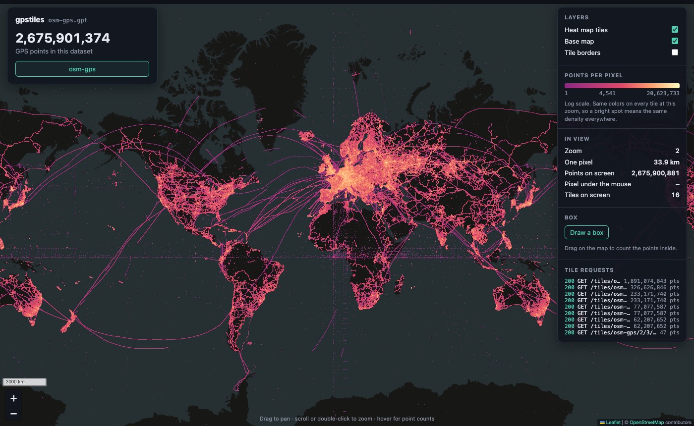
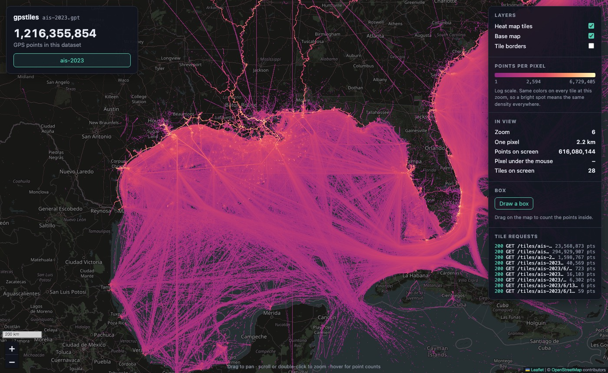
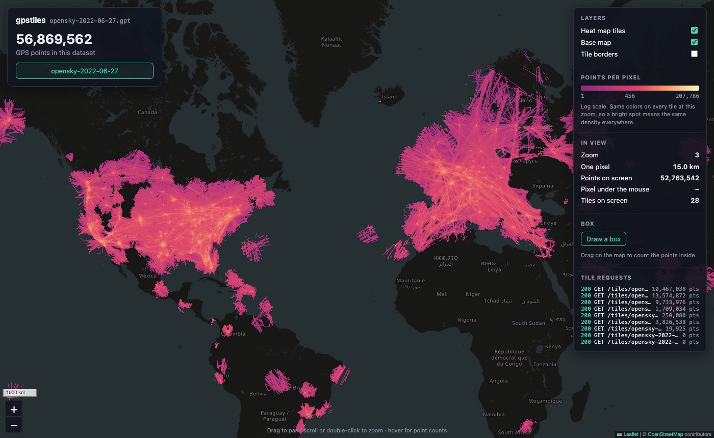
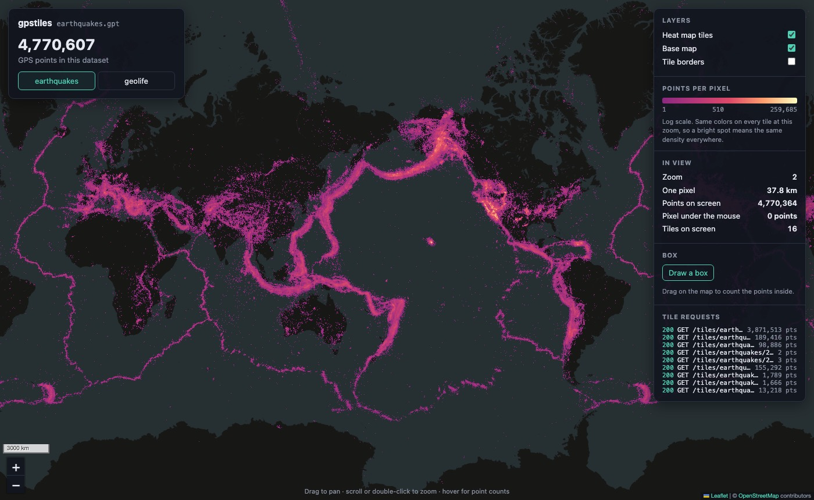
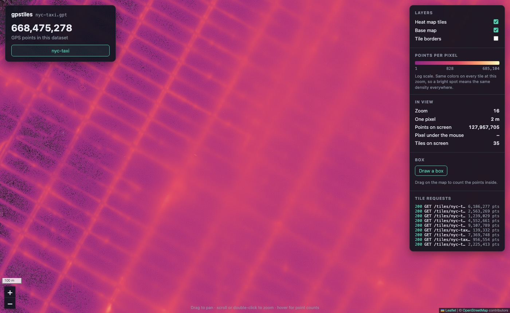
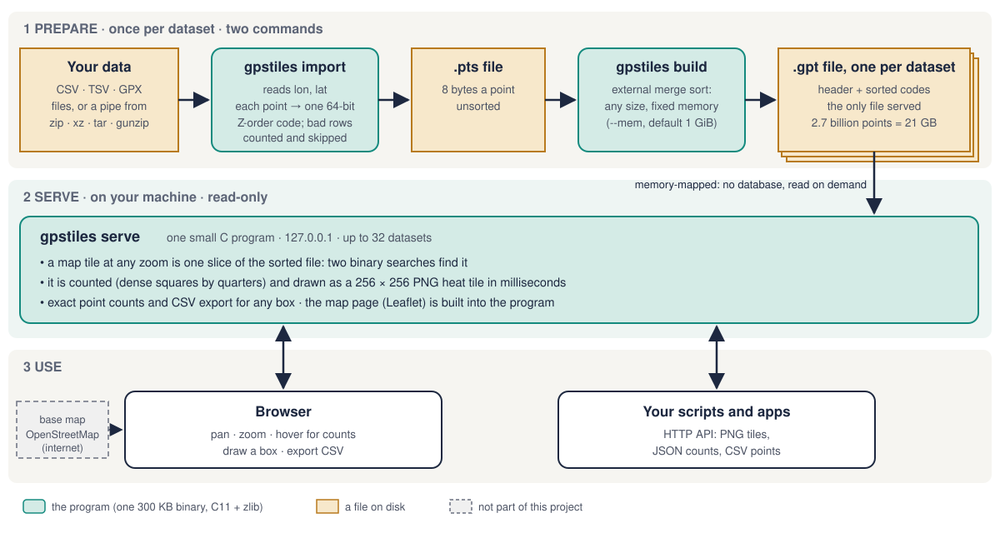

# gpstiles

[](https://github.com/srir84/gps-tile-server/actions/workflows/linux.yml)

**Billions of GPS points → a zoomable heat map in your browser. One small C program, one file per dataset, on a laptop.**


<sub>OpenStreetMap's public GPS traces, 2013: **2,675,901,374 points** in one 21 GB file. Slowest zoom's p99: 52 ms (warm cache, drawing only, no HTTP).</sub>

## In 30 seconds

- **What:** give it places (longitude, latitude); get an interactive heat map, point counts for any box, and CSV export.
- **What it's not:** a database, a GIS or a cloud service. One 300 KB program: C11 + zlib.
- **Scale:** 10 real datasets, 4.5 million to **2.7 billion** points. 2.7 billion points sort in 4 min 43 s using 1 GiB of memory.
- **The trick:** each point becomes a 64-bit [Z-order code](#the-key-idea-z-order), sorted once. Every map tile, at every zoom, is then one contiguous slice of the file, found by two binary searches. No tiles are pre-rendered.
- **Start reading the code at** [`count_cell()` in `src/render.c`](src/render.c): about 30 lines that turned an 83-million-point world tile from 164 ms into 0.6 ms.
- **Data included?** No. You [download datasets](#datasets-none-included) yourself.

<table>
<tr>
<td width="50%"><br><sub><b>Ships:</b> 1.2 billion AIS positions, Jan–May 2023 (NOAA)</sub></td>
<td width="50%"><br><sub><b>Flights:</b> 57 million aircraft positions in one day (OpenSky)</sub></td>
</tr>
<tr>
<td width="50%"><br><sub><b>Earthquakes:</b> 4.8 million since 1900 (USGS)</sub></td>
<td width="50%"><br><sub><b>Taxis:</b> 668 million NYC pickups and dropoffs, street level</sub></td>
</tr>
</table>

## How it works



1. **`import`** turns each row's longitude and latitude into a 64-bit Z-order code. Bad rows are counted by reason and skipped, never guessed.
2. **`build`** sorts the codes into one `.gpt` file (256-byte header + codes) with an external merge sort: memory-sized sorted chunks, then one merge.
3. **`serve`** memory-maps the file. A tile's slice is found by two binary searches; its points are counted per pixel (dense areas by quarters, not point by point) and painted as a PNG.
4. **The browser** shows the tiles with Leaflet, built into the program, over an OpenStreetMap base map.

### The key idea: Z-order

Number the map's squares in a "Z" pattern. In binary, a square's number is its path: two bits per zoom level, each picking a quarter. So **every square inside a tile shares the tile's leading bits, and once sorted they sit side by side.**


One sort serves every zoom: the world is the whole file, each zoom-1 quarter a slice, and so on down to street level.

## Why it's technically interesting

| Idea | What it buys | Measured |
|---|---|---|
| One sorted file per dataset, memory-mapped | No database, nothing to load; the OS cache does the caching | ready in 5 ms with 31 GB of files open |
| Z-order codes | Any tile at any zoom = one slice, two binary searches | no per-zoom index, no tile cache |
| External merge sort | Data far bigger than memory (up to 256 runs: raise `--mem` beyond that) | 2.7 B points (21 GB) sorted with 1 GiB: 20 runs, 4 min 43 s, peak 1.08 GB |
| Counting dense squares by quarters | Zoomed-out tiles don't walk every point | Porto's world tile: 164 ms point by point → 0.6 ms |
| Streaming import | Archives read through pipes, never unpacked | 848,059 GPX files in a 22 GB `tar.xz`: 27 min |
| Exact counts | Every point is counted, none sampled; positions are stored to about 1 cm | box counts match independent tools |
| Small and strict | C11, zlib only, `-Wall -Wextra -Wconversion -Werror`, ASan + UBSan | 3,500 lines of C, 300 KB binary |

### Compared with tools you may know

| Tool | Approach | gpstiles differs by |
|---|---|---|
| tippecanoe | Pre-builds vector tiles for each zoom, usually dropping points at low zooms to fit tile size limits | Pre-builds nothing: each tile is drawn on request from every point |
| datashader | Rasterizes every point on request, in a Python (NumPy, Numba, Dask) stack | The same aggregate-every-point idea, as a 300 KB C server over a pre-sorted file |
| PostGIS | A spatial database: indexes, arbitrary queries | No database: one sort; answers only points-in-tile and points-in-box, fast |

### Speed and size on real data

Apple-silicon MacBook (16 cores, 128 GB), file in the disk cache. Worst p99: the slowest zoom's 99th-percentile time to draw a tile (`gpstiles bench`: 100 tiles a zoom, drawing only, no HTTP).

| Dataset | Points | `.gpt` file | Build (1 GiB buffer) | Worst p99, any zoom |
|---|---:|---:|---|---:|
| Porto taxis | 83 M | 0.7 GB | 1 run | 19 ms |
| OpenSky, one day | 57 M | 0.5 GB | 1 run, 38 s with import | 15 ms |
| GBIF sightings, 2024 | 287 M | 2.3 GB | 3 runs, 14 min with import (`unzip`) | 22 ms |
| NYC taxis 2009–2010 | 668 M | 5.3 GB | 5 runs, 97 s | 50 ms |
| NOAA AIS ships | 1.2 B | 9.7 GB | 10 runs, 149 s | 20 ms |
| OpenStreetMap traces | 2.7 B | 21.4 GB | 20 runs, 283 s | 52 ms |

Cold (file not yet in the disk cache): up to about 0.5 s a tile until the parts in use are read. While other heavy jobs run on the same Mac, OSM's worst p99 has reached 108 ms.

## Quick start

Needs a Mac with the Xcode command line tools (`xcode-select --install`: `cc`, `make`, `zlib`, Python 3). Google Chrome, if installed, runs a few browser tests too.

### 1. Build and test (no data, 2 minutes)

```bash
git clone https://github.com/srir84/gps-tile-server.git
cd gps-tile-server
make
make check
```

`make` builds `build/gpstiles`; `make check` ends with `ALL PASSED (build)`.

### 2. A real map (2 minutes)

4.5 million NYC Uber pickups: 210 MB of CSV from FiveThirtyEight on GitHub, no account.

```bash
mkdir -p data/raw/uber-nyc-2014 data/build
for m in apr may jun jul aug sep; do
  curl -fL -o "data/raw/uber-nyc-2014/uber-raw-data-${m}14.csv" \
    "https://raw.githubusercontent.com/fivethirtyeight/uber-tlc-foil-response/master/uber-trip-data/uber-raw-data-${m}14.csv"
done
build/gpstiles import --lat-col 2 --lon-col 3 --skip 1 -o data/build/uber.pts data/raw/uber-nyc-2014/*.csv
build/gpstiles build -o data/build/uber.gpt data/build/uber.pts
build/gpstiles serve data/build/uber.gpt
```

Expect `rows=4534327 imported=4534327 …` from `import` and `points=4534327 runs=1` from `build`. Then open http://127.0.0.1:8080, zoom into Manhattan, hover for counts, try **Draw a box**.

### 3. Your own data

Delimited text with numeric longitude and latitude columns (counted from 1; quoted fields aren't parsed), or GPX:

```bash
build/gpstiles import --lon-col 3 --lat-col 4 --skip 1 -o mine.pts my-points.csv
build/gpstiles import --gpx -o tracks.pts *.gpx
build/gpstiles build -o mine.gpt mine.pts tracks.pts
build/gpstiles serve mine.gpt
```

`--delim tab` reads TSV. `import` also reads a pipe, so archives need no unpacking: `unzip -p big.zip | build/gpstiles import … /dev/stdin`. It prints how many rows it skipped, by reason (at 0,0, off the map, not a number).

## Datasets: none included

- **The repo has no datasets**: code, tests and docs only (under 10 MB). The tests use tiny fixture files in [`tests/fixtures/`](tests/fixtures) and inputs they generate.
- **No dataset is ever downloaded automatically.** `make check` only talks to its own test server on 127.0.0.1. The map page loads OpenStreetMap's base map from the internet.
- **You fetch what you want** into `data/raw/` (ignored by git): with a script in [`tools/`](tools) that downloads and verifies it, or by hand from the publisher.

| Dataset | Points | You download | How | Account |
|---|---:|---:|---|---|
| [NYC Uber pickups](https://github.com/fivethirtyeight/uber-tlc-foil-response), Apr–Sep 2014 | 4.5 M | 210 MB | `curl` ([Quick start](#2-a-real-map-2-minutes)) | no |
| [T-Drive](https://www.microsoft.com/en-us/research/publication/t-drive-trajectory-data-sample/), Beijing taxis, one week | 10.1 M | 84 MB | manual: Microsoft Research | no |
| [GeoLife](https://www.microsoft.com/en-us/download/details.aspx?id=52367), 182 people's GPS traces | 24.9 M | 313 MB | manual: Microsoft download centre | no |
| [USGS earthquakes](https://earthquake.usgs.gov/fdsnws/event/1/), 1900–2026, worldwide | 4.8 M | 874 MB | script: `tools/fetch-usgs.py` (40 min; checked against USGS's counts) | no |
| [Porto taxis](https://archive.ics.uci.edu/dataset/339/taxi+service+trajectory+prediction+challenge+ecml+pkdd+2015), one year | 83 M | 534 MB | manual: UCI Machine Learning Repository | no |
| [OpenSky aircraft](https://opensky-network.org/data/scientific), one day (2022-06-27) | 57 M | 3.9 GB | script: `tools/fetch-opensky.py` (6 min; checksums verified) | no |
| [NYC yellow taxis](https://www.nyc.gov/site/tlc/about/tlc-trip-record-data.page), 2009–2010 | 668 M | 11 GB | manual: TLC Parquet, via `tools/nyc-taxi.py` (DuckDB) | no |
| [NOAA AIS ships](https://hub.marinecadastre.gov/pages/vesseltraffic), Jan–May 2023 | 1.2 B | 47.6 GB | script: `tools/fetch-ais.sh` (each day verified) | no |
| [OpenStreetMap GPS traces](https://planet.openstreetmap.org/gps/), 2013 | 2.7 B | 22 GB | manual: one `tar.xz` (check its `.md5`) | no |
| [GBIF](https://www.gbif.org/) species sightings, 2024 | 287 M | 35 GB | script: `tools/fetch-gbif.py` (GBIF prepares it: about 25 min) | yes, free |

Terms differ: OpenSky's samples are for non-profit research, education and testing; a GBIF download carries the most restrictive license of its records (2024's: CC BY-NC 4.0, non-commercial) and is cited by its DOI (the script prints it); OpenStreetMap data is © OpenStreetMap contributors.

<details>
<summary><b>The import command for each dataset</b></summary>

`gpstiles` below is `build/gpstiles`: use its full path if you `cd` elsewhere. Then `build` and `serve` as in the Quick start. Where a command writes `X.pts.new` and then `mv`s it, `set -o pipefail` (zsh: `setopt pipefail`) keeps a failed or cut-off source from leaving a short file.

| Dataset | Import |
|---|---|
| T-Drive | unzip into `data/raw/tdrive_txt/`, then `gpstiles import --lon-col 3 --lat-col 4 -o tdrive.pts data/raw/tdrive_txt/*.txt` |
| GeoLife | unzip into `data/raw/geolife/`; from inside `Geolife Trajectories 1.3/Data`: `gpstiles import --lat-col 1 --lon-col 2 --skip 6 -o geolife.pts */Trajectory/*.plt` |
| USGS | `tools/fetch-usgs.py data/raw/usgs`; from inside `data/raw/usgs`: `gpstiles import --lat-col 2 --lon-col 3 --skip 1 -o earthquakes.pts usgs-*.csv` |
| Porto | `train.csv` in `data/raw/porto/`: `gpstiles import --polyline 9 --skip 1 -o porto.pts data/raw/porto/train.csv` (column 9 holds each trip's `[[lon,lat],...]`) |
| OpenSky | `tools/fetch-opensky.py data/raw/opensky 2022-06-27`; for each hour HH: `set -o pipefail; tar -xOf data/raw/opensky/states_2022-06-27-HH.csv.tar '*.csv.gz' \| gunzip \| gpstiles import --lat-col 3 --lon-col 4 --skip 1 -o HH.pts.new /dev/stdin && mv HH.pts.new HH.pts`; then `build` all 24 `.pts` |
| NYC taxis | Parquet files in `data/raw/nyc-taxi/`; `python3 -m venv data/tools/venv && data/tools/venv/bin/pip install duckdb==2.0.0`; then `set -o pipefail; data/tools/venv/bin/python tools/nyc-taxi.py data/raw/nyc-taxi/*.parquet \| gpstiles import --lon-col 1 --lat-col 2 --skip 1 -o nyc.pts.new /dev/stdin && mv nyc.pts.new nyc.pts` |
| NOAA AIS | `tools/fetch-ais.sh data/raw/ais 2023-01-01 2023-05-31`; per day: `set -o pipefail; unzip -p data/raw/ais/AIS_2023_01_01.zip \| gpstiles import --lat-col 3 --lon-col 4 --skip 1 -o AIS_2023_01_01.pts.new /dev/stdin && mv AIS_2023_01_01.pts.new AIS_2023_01_01.pts`; then `gpstiles build -o ais-2023.gpt AIS_2023_*.pts` |
| OSM traces | `gpx-planet-2013-04-09.tar.xz` in `data/raw/osm-gps/`: `set -o pipefail; xz -dc data/raw/osm-gps/gpx-planet-2013-04-09.tar.xz \| tar -xOf - \| gpstiles import --gpx -o osm-gps.pts.new /dev/stdin && mv osm-gps.pts.new osm-gps.pts` (about 30 min) |
| GBIF | a free login at gbif.org, saved in `~/.config/gpstiles/gbif.netrc` as `machine api.gbif.org login USER password PASS` (`chmod 600`); `tools/fetch-gbif.py data/raw/gbif 2024`; then `set -o pipefail; unzip -p data/raw/gbif/KEY.zip \| gpstiles import --delim tab --lat-col LAT --lon-col LON --skip 1 -o gbif.pts.new /dev/stdin && mv gbif.pts.new gbif.pts` (LAT, LON: the columns `decimalLatitude`, `decimalLongitude`) |

Too many files for one command line: run from inside their folder, or import in batches and pass all the `.pts` to `build`.
</details>

## Reference

### Commands

| Command | Does |
|---|---|
| `gpstiles import (--lon-col C --lat-col C \| --polyline C) [--delim D] [--skip N] -o OUT.pts FILE...` | Text rows → `.pts`; prints kept and skipped counts. `--polyline C`: column C holds a list of `[lon,lat]` pairs |
| `gpstiles import --gpx -o OUT.pts FILE...` | GPX track points → `.pts` (no `--delim` or `--skip`) |
| `gpstiles build [--mem 1G] [--tmp DIR] -o OUT.gpt IN.pts...` | Sorts the points into one `.gpt` file; `--mem` sets the sort buffer (at most 256 runs) |
| `gpstiles serve [--host 127.0.0.1] [--port 8080] [--timeout 10] FILE.gpt...` | The map and the API for up to 32 datasets; `--port 0` picks a free port; `--timeout`: seconds a client has to send its request |
| `gpstiles info FILE.gpt` | Point count, file size, bounds, start view, densest pixel per zoom |
| `gpstiles count FILE.gpt Z X Y` | Points in one map tile |
| `gpstiles render FILE.gpt Z X Y -o tile.png` | Draws one tile to a PNG |
| `gpstiles where LON LAT --zoom Z` | The tile `Z/X/Y` containing a place |
| `gpstiles bench FILE.gpt` | Tile drawing speed at each zoom (p50/p99 in ms) |

### HTTP API

Read-only. A dataset's id is its file name without `.gpt` (1 to 32 of `a-z 0-9 - _`). A box is `bbox=west,south,east,north` in degrees, edges included; it can't cross the 180° line (the map page splits such a box in two).

| Request | Returns |
|---|---|
| `GET /api/datasets` | JSON: every dataset's id, points, bounds, start view, densest pixel per zoom |
| `GET /api/datasets/{id}` | JSON: one dataset |
| `GET /api/datasets/{id}/count?bbox=w,s,e,n` | JSON `{"id": ..., "count": N}`: the points in the box |
| `GET /api/datasets/{id}/export.csv?bbox=w,s,e,n[&limit=N]` | CSV `lon,lat` of the points in the box, at most `limit` rows (1 to 1,000,000, the default); headers `X-Total-Points`, `X-Rows` |
| `GET /tiles/{id}/{z}/{x}/{y}.png` | A 256 × 256 heat-map tile; header `X-Points` |

```bash
curl 'http://127.0.0.1:8080/api/datasets/uber/count?bbox=-73.83,40.62,-73.74,40.67'
```

<details>
<summary><b>Run it as a background service on your Mac</b></summary>

| Command | Does |
|---|---|
| `make deploy` | Build, test, install to `~/.local/gpstiles/`, start (and at login), smoke-test; roll back if that fails |
| `make status` | Is it running, which version, does it answer |
| `make rollback` | Back to the previous version |
| `make undeploy` | Stops the service (files stay in `~/.local/gpstiles/`) |

It serves the `.gpt` files listed in `~/.local/gpstiles/datasets.conf`, one absolute path per line. Create it first:

```bash
mkdir -p ~/.local/gpstiles && echo "$PWD/data/build/uber.gpt" > ~/.local/gpstiles/datasets.conf
```

It listens on 127.0.0.1:8080. Another port: `make undeploy`, then `GPSTILES_PORT=8090 make deploy` (and the same prefix on later `make` commands). Logs: `~/.local/gpstiles/logs/serve.log`.
</details>

<details>
<summary><b>Checks</b></summary>

| Command | Runs | Needs data |
|---|---|---|
| `make check` | Unit, random-input, bad-input and end-to-end tests (about 2 minutes) | no |
| `make sanitize` | The same under AddressSanitizer and UndefinedBehaviorSanitizer | no |
| `make check-data` | Each downloaded dataset against `awk`, Python or DuckDB (minutes; a dataset you don't have is SKIPPED) | yes |
| `make verify` | All of the above plus every step's validation script, with screenshots in `build/validate/` (40–90 minutes with every dataset, depending on what is cached) | yes |
</details>

## How it was built

Written with AI coding agents (Claude as builder, Codex as reviewer) in 22 small, reviewed steps, from 10 million Beijing taxi points to 2.7 billion worldwide. Every step was gated by tests:

- **Independent answers:** counts are checked against a separate tool, never against gpstiles itself: `awk` over the raw files, DuckDB, Python's XML parser, or the publisher's own count (USGS, OpenStreetMap, GBIF).
- **Tests that are proven:** each step plants bugs on purpose in a throwaway copy (at least two per step) and shows a test catching each one.
- **Reviews:** every step reviewed by Codex; from step 3a also by a second, independent Claude agent.

Step reports, with real output, planted bugs and review findings: [`docs/steps/`](docs/steps/README.md). Design, with pictures: [`docs/DESIGN.md`](docs/DESIGN.md). Test strategy: [`docs/TESTING.md`](docs/TESTING.md).

```text
src/        the program: import, build (external sort), tilefile (reading .gpt), render, area (counts, export), server
www/        the map page (HTML, CSS, JS) and Leaflet 1.9.4, compiled into the program
tools/      download scripts (fetch-usgs.py, fetch-ais.sh, fetch-opensky.py, fetch-gbif.py), deploy and review scripts
tests/      unit (C), end-to-end (Python), fixtures, data checks, per-step validation scripts
docs/       DESIGN.md, TESTING.md, steps/ (one report per step)
AGENTS.md   instructions for the coding agents (CLAUDE.md and .claude/ point Claude at it); not needed to use gpstiles
```

## Known limits

- **Scripts need macOS.** The program builds and passes `make check` and `make sanitize` on Linux too (gcc and clang, [CI](.github/workflows/linux.yml)); the deploy, data and validation scripts use macOS tools.
- **No time dimension.** Points are places only (adding time would change the file format).
- **Local by default.** It listens on 127.0.0.1, read-only, no logins: not built for the open internet.
- **IPv4 only, no keep-alive.** One IPv4 address; every answer closes its connection (`Connection: close`).
- **The `.gpt` file is trusted.** Opening one checks its header, version, size and stats, not that the points are sorted: a foreign or hand-edited file can give wrong counts (never a read outside the file).
- **Don't overwrite a served `.gpt` in place.** The server memory-maps it, and a file shrunk under it can crash the server (SIGBUS on Linux; macOS kept serving in a test). Write the new file beside it, `mv` it over, restart.
- **GPX comments aren't skipped.** A `<trkpt>` inside an XML comment or CDATA counts as a point (GPS loggers and OpenStreetMap write neither).
- **Base map needs internet.** Offline, the heat map shows on a dark background.

## Licenses

- [Leaflet](https://leafletjs.com) 1.9.4: BSD 2-Clause (`www/leaflet/LICENSE`), compiled into the program.
- Base map tiles: © OpenStreetMap contributors.
- Datasets: their publishers' terms ([Datasets](#datasets-none-included)).
- gpstiles itself: [MIT](LICENSE).
