# gps-tile-server: Design

> **Reading guide.** How it works: §3 (system), §5 (key ideas in pictures), §7 (request flows), §9 (commands, API, file format). The project's record: §12 (the build plan, step by step) and §13 (measured facts). Each step's report: [steps/](steps/README.md).

## What we are building

- **In:** a large set of GPS points (longitude, latitude), from millions to billions of them
- **Out:** a web map that zooms from the whole world down to street level. A heat map shows where the points are dense or sparse
- **You can also:** draw a box to get the exact count inside it, export those points as CSV, or get the same data from an API
- **How:** one preparation step turns the dataset into one sorted file. One small C program then draws map tiles from that file when they are asked for. There is no database and nothing is drawn ahead of time
- **For:** analysts, planners and researchers who have big location datasets
- **First test:** 10 million Beijing taxi GPS points (T-Drive). Roads and hotspots appear, and you can count the points around a place such as the airport

| | |
|---|---|
| **What** | Turns millions to billions of GPS points into an interactive web map, served from **one file per dataset + one small C program**. One server can serve several datasets |
| **Program** | `gpstiles` (commands: `import`, `build`, `serve`) |
| **Language** | C11 + zlib. Map page: HTML/JS + Leaflet 1.9.4, compiled into the program |
| **Runs on** | macOS (the C is portable; the build, deploy and data scripts use macOS tools) |
| **Datasets tested** | 10, from 4.5 million to 2.7 billion points (README) |
| **Status** | Stages 1–5 built (steps 0a–18). Each step's report: `docs/steps/` |

---

## 1. The end product

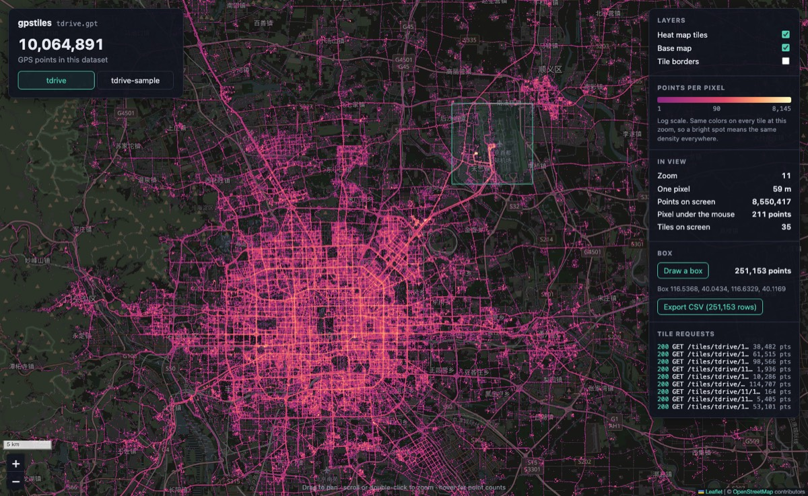

*The real page: T-Drive at zoom 11, a box at Capital Airport.*

| Part of the page | What it shows |
|---|---|
| Map (center) | Base map + heat-map tiles. Bright = many GPS points |
| Top left | Dataset name, point count, and a dataset switch listing every `.gpt` the server was started with |
| Right: Layers | Heat tiles · base map · tile borders on/off |
| Right: Points per pixel | Color legend (log scale) |
| Right: In view | Zoom, ground size of one pixel, points and tiles on screen |
| Right: Tile requests | Tiles the browser asked the server for |
| Hover | Points in the pixel under the cursor: the page asks the area-count endpoint for a pixel-sized box |
| Right: Box | Draw a box → exact count → export CSV |

---

## 2. Who uses it and what they do

| User | Does | Gets |
|---|---|---|
| Analyst / planner | Opens the map, pans, zooms | Where points are dense or missing |
| Analyst | Draws a box | Exact count in that area; compare areas |
| Analyst | Clicks "Export CSV" | `lon,lat` rows for Excel / Python / GIS |
| Script / program | Calls the API | Same counts and exports as JSON / CSV |
| Developer | Runs `import` + `build` once per dataset | One `.gpt` file ready to serve |

---

## 3. System at a glance

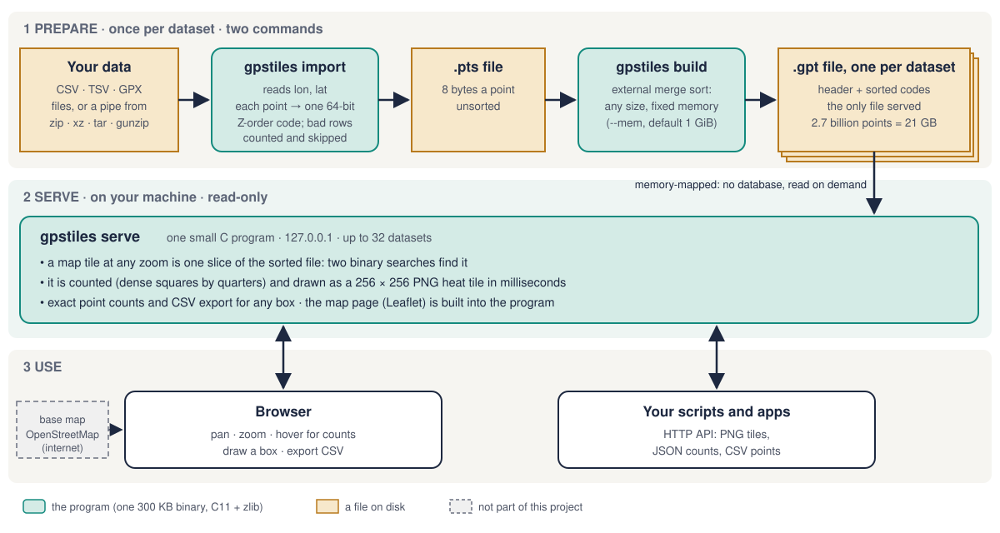

| From | To | What moves | When |
|---|---|---|---|
| Dataset files | `gpstiles import` | Text rows (lon, lat) | Once per dataset |
| `gpstiles import` | `.pts` file | 8-byte codes, unsorted, with bad rows dropped | Once per dataset |
| `.pts` file | `gpstiles build` | The codes | Once per dataset |
| `gpstiles build` | `.gpt` file | Header + codes sorted in Z order (external merge sort, §5.3) | Once per dataset |
| `.gpt` files (one per dataset) | `gpstiles serve` | Each one memory-mapped, read-only. The server never writes them | Mapped at startup · the parts a request touches are read then |
| `www/` (page, Leaflet 1.9.4) | `gpstiles serve` | Compiled into the program (`tools/embed.sh`); served at `/`, `/app.js`, `/app.css`, `/leaflet/…` | Built in |
| Browser → server | | Asks for the page, tiles, a count or an export | Per user action |
| Server → browser | | HTML, PNG tiles, JSON counts, CSV | Per request |
| Scripts ↔ server | | Same API without the map: JSON and CSV | Per call |
| OpenStreetMap tile servers | Browser | Road and label images under our heat tiles | Per pan/zoom |

---

## 4. Data flow (T-Drive numbers)

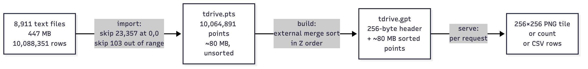

<details><summary>Diagram source (mermaid — flowchart)</summary>

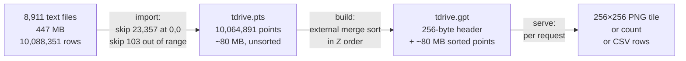

</details>

| Stage of data | Format | Size rule |
|---|---|---|
| Raw dataset | Text (CSV/TSV/GPX) | Varies |
| `.pts` | Flat array of 8-byte Z-order codes, unsorted | 8 bytes × points |
| `.gpt` | 256-byte header + sorted 8-byte codes | 8 bytes × points + 256 |
| Tile | PNG, 256 × 256 RGBA | Small (mostly empty pixels compress well) |

---

## 5. Key ideas in pictures

### 5.1 Tiles: how the map is cut up

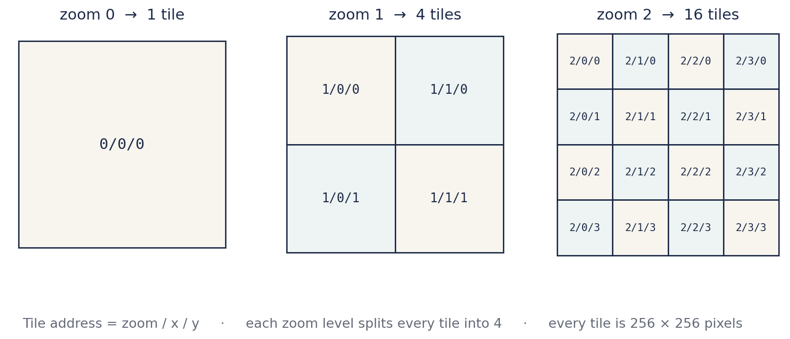

- Address of a tile: `zoom/x/y`
- Tiles at zoom z: `4^z`
- Zoom range: 0 (whole world) to 24 (a few cm per pixel)
- Same numbering as OpenStreetMap, so our tiles line up with any standard base map

### 5.2 The trick: Z order makes every tile one slice

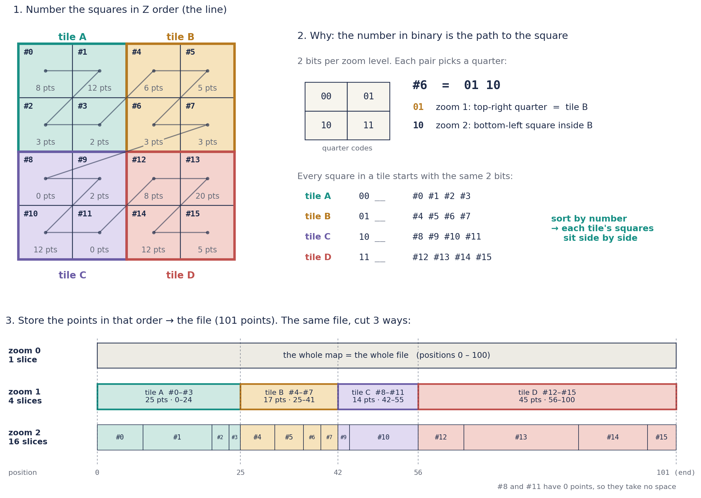

- Each point → one 64-bit **Z-order code** (x bits and y bits interleaved)
- The code in binary is the path: 2 bits per zoom level, each pair picks a quarter
- Sort all codes once → every tile at every zoom is one continuous slice (slices inside slices)

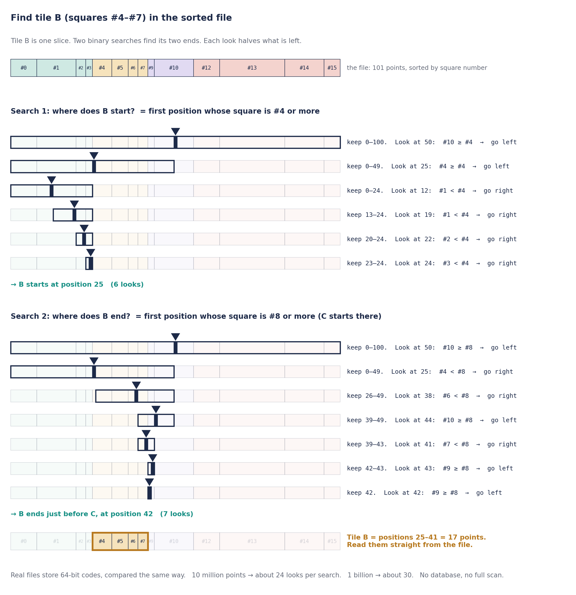

- Find a tile = 2 binary searches: first code ≥ tile start, first code ≥ next tile's start
- Each look halves the range: 10 million points ≈ 24 looks, 1 billion ≈ 30

### 5.3 Sorting: external merge sort

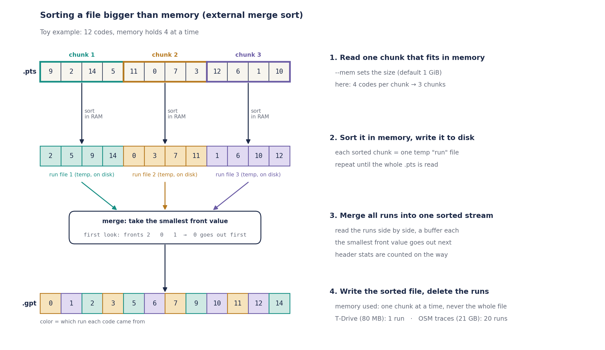

| Rule | Value |
|---|---|
| Why | One code path for any size: T-Drive's 80 MB in 1 run, OpenStreetMap's 21 GB in 20 runs, with the default 1 GiB |
| Memory | `--mem` (default 1 GiB, minimum 1 MiB) sizes the sort buffer: `--mem / 8` codes per chunk. On top of it, fixed extras: 2 histograms (1 MiB) and a 64 KiB read buffer per run during the merge. Never the whole file |
| Sort inside a chunk | `qsort` with a safe compare: `(a > b) - (a < b)`, never `a - b` |
| Run files | Temp files in `--tmp` (default: next to the output). Deleted at the end, even on error |
| Merge | One pass, with a min-heap over the run fronts. More than 256 runs → stop with a clear message (raise `--mem`) |
| Disk needed | About 2 × the `.pts` size while building (runs + output) |
| Header stats | Counted while merging: densest pixel per zoom from runs of equal pixel prefixes. View box from a 65,536-bucket histogram of x and of y (~600 m precision, which is enough for the opening view) |
| Test trick | A tiny `--mem` forces many runs on small data. The output must equal a plain in-memory sort |

### 5.4 The tile file

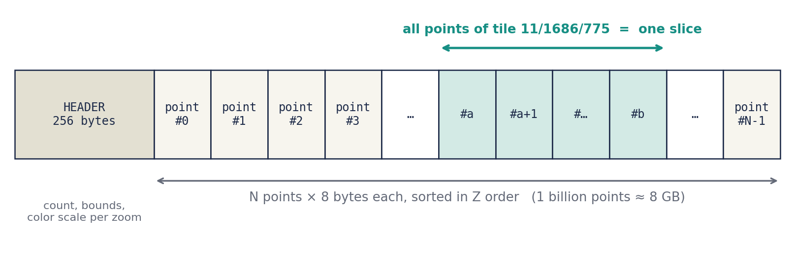

### 5.5 Drawing a tile

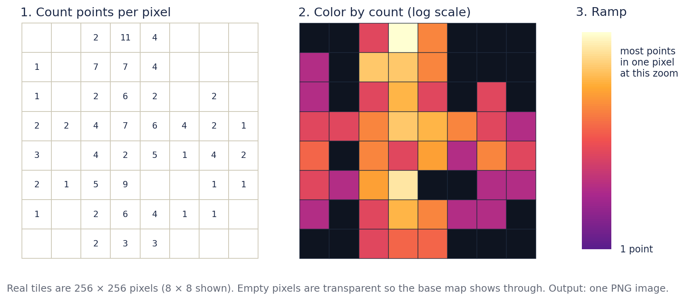

- Color scale fixed per zoom level (stored in the header) → same density = same color on every tile
- Counting: a pixel is itself a slice of the sorted file, and so is every square of pixels. A dense square is cut into its 4 quarters by binary search, down to single pixels, whose count is their slice's length; a sparse one (at most 4 points a pixel) is walked point by point. So a tile's time grows with the pixels its points fill, not with the points: Porto's zoom-0 tile (83 million points in a few pixels) takes 0.6 ms, not 164 ms; a tile with every one of its 65,536 pixels dense, the worst case, about 20 ms (22 ms measured for 40 million evenly spread points, against 81 ms point by point). The pictures are the same as point by point
- Empty pixel = transparent

### 5.6 Counting an area

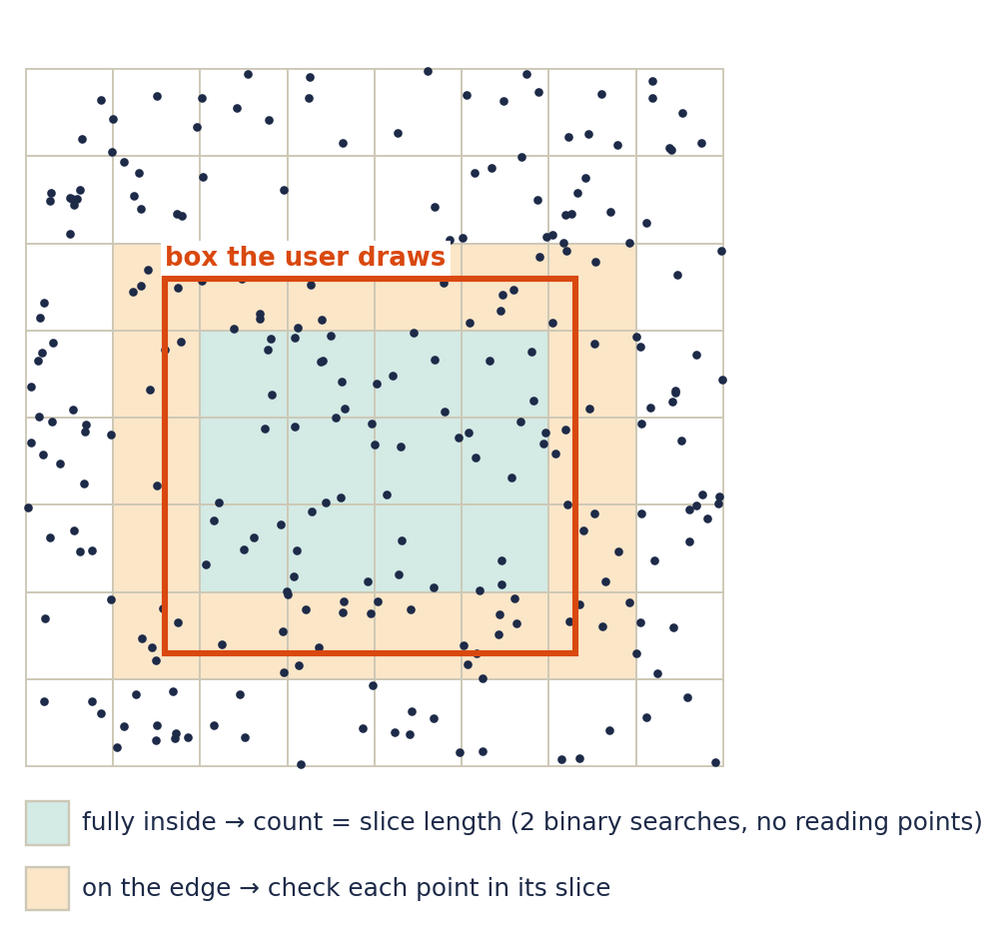

- Squares fully inside the box add their slice length. An edge square with more than 64 points is cut into its 4 quarters and tried again; a smaller one is checked point by point
- Same sorted file, same binary search as tiles
- Export = same box logic, streaming the points out as CSV

---

## 6. Components (source modules)

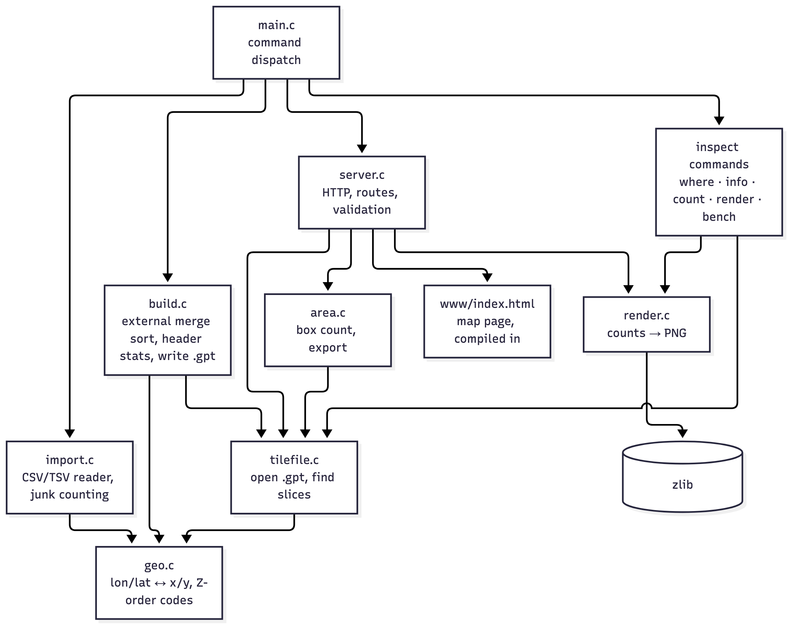

<details><summary>Diagram source (mermaid — flowchart)</summary>

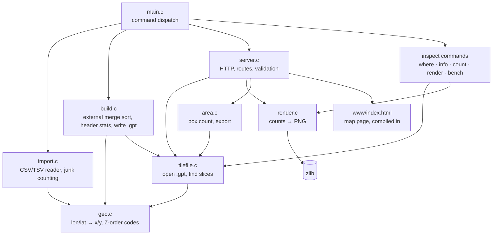

</details>

| Module | Job | Input → Output | Built in step |
|---|---|---|---|
| `geo` | Map math | lon/lat ↔ world x/y ↔ Z-order code | 1 |
| `import` | Read datasets | text rows → `.pts` + skip counts | 2 |
| `build` | External merge sort + write | `.pts` → temp runs → `.gpt` | 3a |
| `tilefile` | Read `.gpt`, find slices | z/x/y or box → index range | 3b |
| `render` | Draw tile | pixel counts → PNG bytes | 4 |
| `server` | HTTP | request → tile / JSON / CSV | 5a |
| `www/index.html` | Map page | browser UI | 6 |
| `area` | Box count + export | bbox → count / rows | 7–8 |

---

## 7. Request flows

### 7.1 Map tile

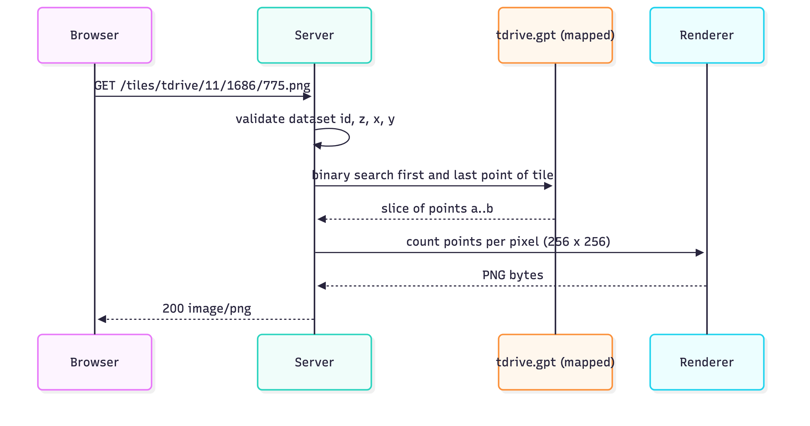

<details><summary>Diagram source (mermaid — sequence diagram)</summary>

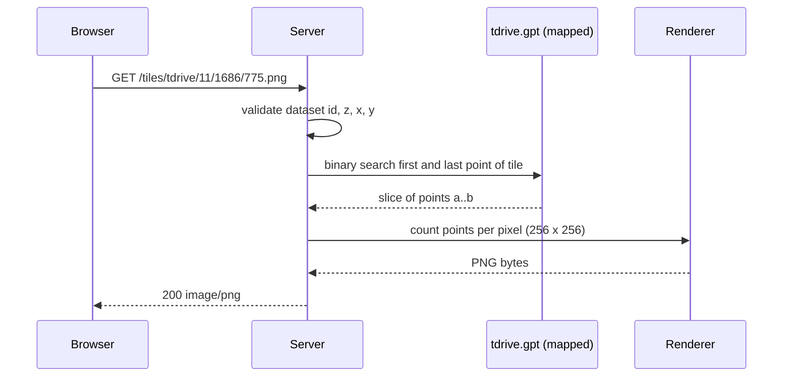

</details>

### 7.2 Area count

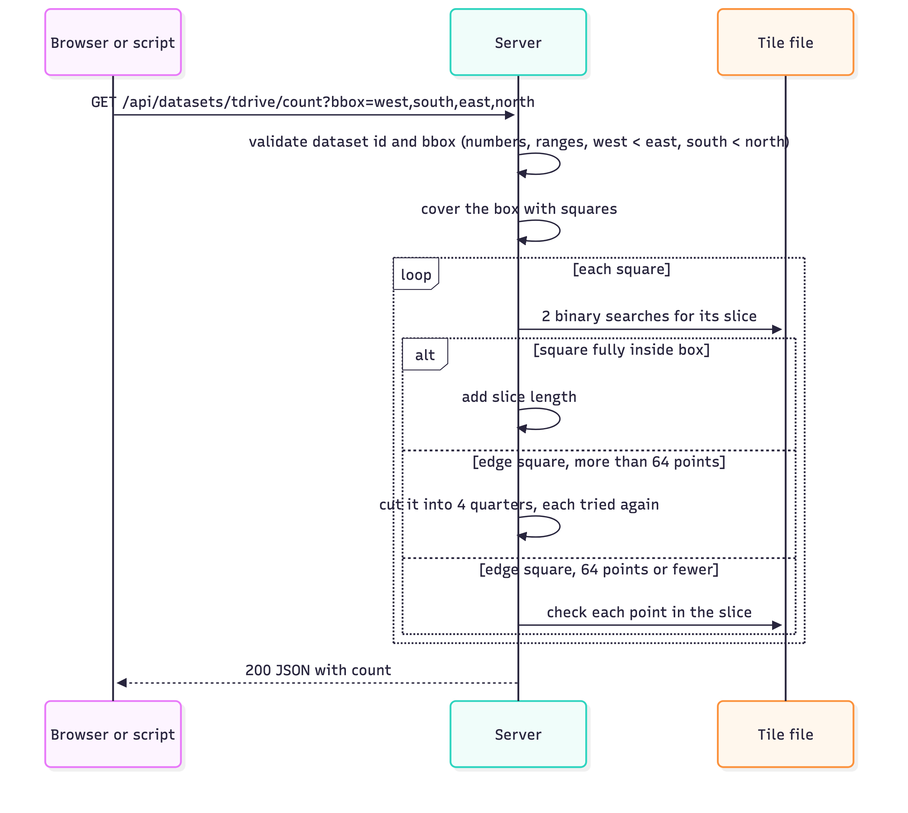

<details><summary>Diagram source (mermaid — sequence diagram)</summary>

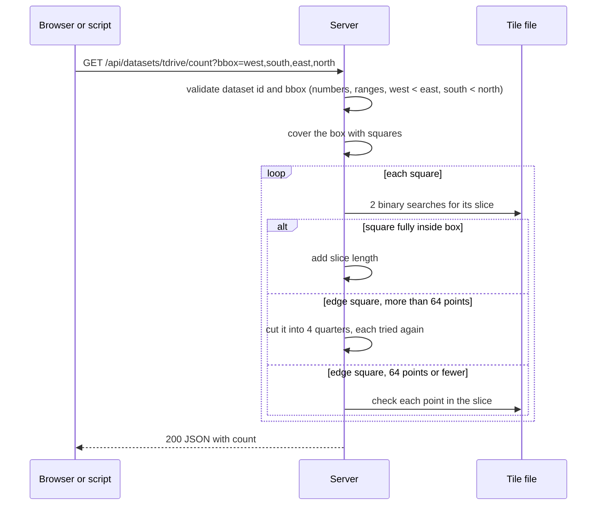

</details>

### 7.3 Export

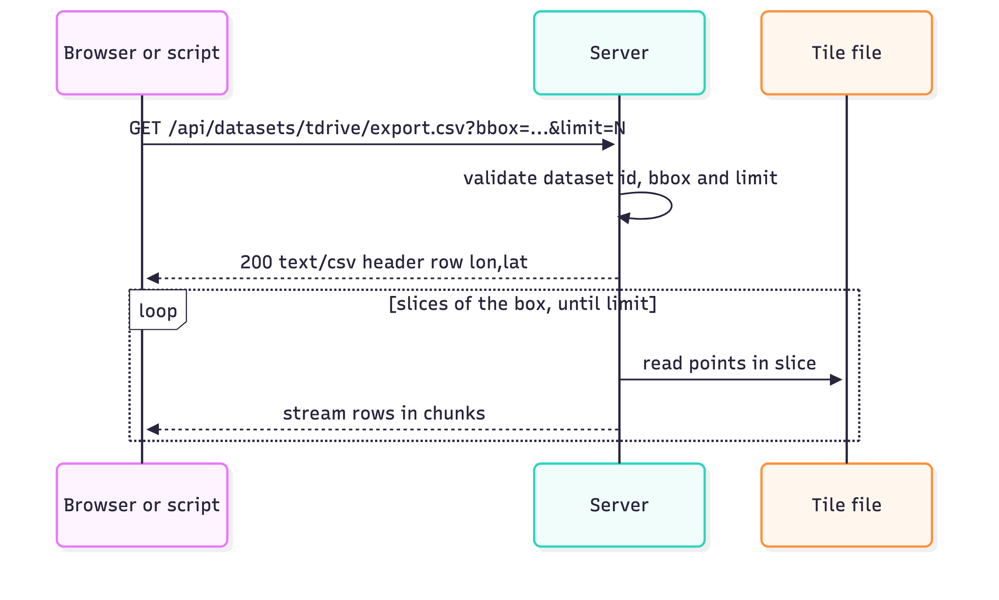

<details><summary>Diagram source (mermaid — sequence diagram)</summary>

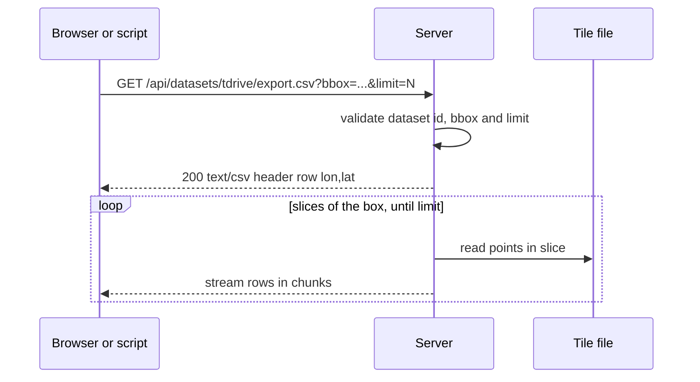

</details>

---

## 8. Importer: what happens to each row

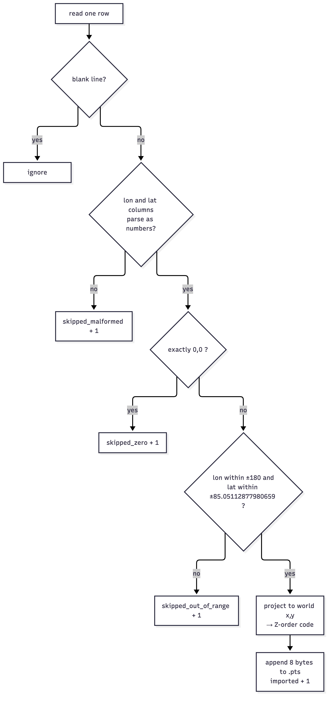

<details><summary>Diagram source (mermaid — flowchart)</summary>

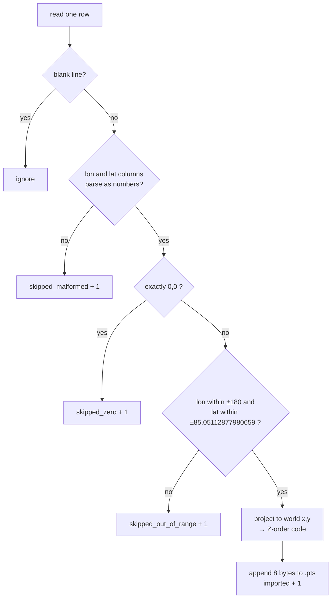

</details>

| Input quirk (real T-Drive data) | Handling |
|---|---|
| Windows line endings (`\r\n`) on every line | Trimmed |
| 23,357 rows at exactly (0,0) | Counted, skipped |
| 103 rows with impossible coordinates (e.g. lon 193, lat 95) | Counted, skipped |
| 21 empty files | Read, nothing imported |

| Rule | Value |
|---|---|
| Columns | Counted from 1 (`--lon-col 3` is the third column) |
| Blank line | Empty, or only `\r`. Not a row, not counted |
| Long line | More than 65,536 bytes before the `\n` (a trailing `\r` counts) → malformed |
| Numbers | Plain decimals only: no quotes, spaces, `nan`, `inf` or hex. `1e999` is a number, but out of range |
| `--skip N` | Skips the first N lines of each file |
| `--delim` | One character that can't be part of a number, or `tab` (with `--polyline`, not `"`, `[` or `]` either) |

**Polyline rows** (`--polyline C`, step 12): a row is one trip, its places in one column as a list of `[lon,lat]` pairs.

| Rule | Value |
|---|---|
| The column | CSV: a field may be quoted (`"..."`, with `""` for a quote inside), so the list's own commas don't split it. Unquoted works too when the list has no delimiter in it |
| The list | Exactly `[[lon,lat],[lon,lat],...]` or `[]`; spaces and tabs allowed between its parts; numbers as for plain rows, at most 63 characters |
| A row that isn't one | Too few columns, a quote not closed or text after a closing quote (in any field of the row), a list not closed or with a missing number, a trailing comma, 3 numbers in a pair: one malformed row, and none of its pairs is kept |
| Each pair | A point, with the plain rows' rules: (0,0) skipped, off the map skipped, else kept |
| Counts | `rows=` trips, `points=` the pairs of the well-formed rows, then `imported`, `skipped_zero`, `skipped_out_of_range` (pairs) and `skipped_malformed` (rows) |
| Long rows | Up to 1,000,000 bytes (a plain row: 65,536; a trailing `\r` counts in both); longer is one malformed row |

**GPX** (`--gpx`, step 16): the input is XML read in chunks, not lines; every `<trkpt` start tag is a row.

| Rule | Value |
|---|---|
| A track point | `<trkpt` followed by a space, tab, CR, LF, `/` or `>`, up to its first `>` outside a quoted value (`<trkptx`, `<wpt>`, `<rtept>` and everything else are skipped) |
| Its place | The `lat` and `lon` attributes, in any order, `name="…"` or `name='…'`, spaces and newlines around `=` allowed; numbers as for plain rows, at most 63 characters |
| Malformed | No closing `>` within 4,096 bytes of `<trkpt` (or before the end), a `<` or a NUL byte before it (even quoted: XML never allows either, so a stray quote or an unclosed tag spoils only itself), attributes that aren't `name="…"` pairs, `lat` or `lon` missing, twice, or not a number |
| Then | (0,0) and off-the-map places are skipped as for plain rows |
| Not read | Comments, CDATA and entities (`&#46;`): a `<trkpt` inside a comment counts. A `>` inside a quoted value doesn't end the tag (as in XML). Spaces are space, tab, CR and LF (a NUL byte is not one). GPX files from GPS loggers and OpenStreetMap have none of these in track points |

---

## 9. Interfaces

### 9.1 Commands

| Command | Does | Step |
|---|---|---|
| `gpstiles import (--lon-col C --lat-col C \| --polyline C \| --gpx) [--delim D] [--skip N] -o out.pts FILE...` | Text → `.pts`, prints counts. `--polyline C`: column C holds a list of `[lon,lat]` pairs; `--gpx`: GPX track points (§8) | 2, 12, 16 |
| `gpstiles build [--mem 1G] [--tmp DIR] -o out.gpt in.pts...` | External merge sort → `.gpt`. `--mem` sizes the sort buffer, plus small fixed extras (§5.3) | 3a |
| `gpstiles serve [--host 127.0.0.1] [--port 8080] [--timeout 10] FILE.gpt...` | Web server for up to 32 datasets; `--port 0` picks a free port; `--timeout`: seconds a client has to send its request | 5a |
| `gpstiles where LON LAT --zoom Z` | Print the tile for a location | 1 |
| `gpstiles info file.gpt` | Print header: count, bounds, size | 3b |
| `gpstiles count file.gpt Z X Y` | Points in one tile | 3b |
| `gpstiles render file.gpt Z X Y -o tile.png` | Draw one tile to a file | 4 |
| `gpstiles bench file.gpt` | Tile speed per zoom (p50/p99) | 9 |

### 9.2 HTTP endpoints

| Endpoint | Returns | Step |
|---|---|---|
| `GET /` | Map page | 6 |
| `GET /api/datasets` | JSON: every served dataset with id, count, bounds and start view | 5a |
| `GET /api/datasets/{id}` | JSON: one dataset: count, bounds, start view, max zoom | 5a |
| `GET /tiles/{id}/{z}/{x}/{y}.png` | 256×256 heat-map tile of dataset `{id}`; header `X-Points` | 5a |
| `GET /api/datasets/{id}/count?bbox=w,s,e,n` | JSON: exact count in box | 7 |
| `GET /api/datasets/{id}/export.csv?bbox=w,s,e,n&limit=N` | CSV `lon,lat` rows in the box, at most `limit` (1 to 1,000,000, default 1,000,000); headers `X-Total-Points`, `X-Rows` | 8 |
| Unknown `{id}` | 404 with a short message | 5a |
| Anything else | 404 / 405 / 400 with a short message | 5a |

**Box rule** (count, export, hover and the Python checks all use it)

| Rule | Value |
|---|---|
| Bounds | `bbox=w,s,e,n` turned into world units with the point encoding (§9.4): `x0 = x(w)`, `x1 = x(e)`, `y0 = y(n)`, `y1 = y(s)` |
| Inside | A stored point (x, y) is inside if `x0 ≤ x ≤ x1` and `y0 ≤ y ≤ y1`. Edges included |
| Shared edges | A point exactly on the edge two boxes share counts in both |
| Rejected (400) | `w > e` (no boxes across the ±180 line), `s > n`, values outside the valid input range, NaN |

**Dataset ids**

| Rule | Value |
|---|---|
| Id | The file name without `.gpt`: `data/build/tdrive.gpt` → `tdrive` |
| Allowed characters | `a–z 0–9 - _`, 1 to 32 long. Anything else → `serve` refuses to start and says which file |
| Duplicates | Two files with the same id → `serve` refuses to start |
| How many | Up to 32 files. Each one is memory-mapped, so adding a file costs almost no RAM up front |
| Default on the page | The first file on the command line |

### 9.3 File formats

**`.pts`** (output of `import`)

| Offset | Content |
|---|---|
| 0 … | `uint64` Z-order codes, little-endian, unsorted, no header |

**`.gpt`** (output of `build`, header finalized in step 3a; all numbers little-endian)

| Offset | Field | Type | Meaning |
|---|---|---|---|
| 0 | magic | 8 bytes | `GPSTILE\0` |
| 8 | version | uint32 | Format version: 1 |
| 12 | header_size | uint32 | 256 |
| 16 | count | uint64 | Number of points |
| 24 | bounds | 4 × uint32 | Min x, min y, max x, max y (world units) of all points |
| 40 | max_pixel_count | 25 × uint64 | Densest pixel at each zoom 0–24 (color scale). A pixel at zoom z is 1/256 of a tile side: the top 2(z + 8) bits of a code |
| 240 | view box | 4 × uint32 | Where the map opens (ignores far-away junk and a few far trips): min x, min y, max x, max y after dropping `count / 20` points (rounded down) at each end of x and of y, widened to whole 65,536-unit buckets. 5 % rather than 1 %, so a few far trips (GeoLife's 1.3 % in North America) don't pull the opening view away from the data |
| 256 | points | count × uint64 | Z-order codes, sorted ascending |

With 0 points every stat is 0. A file whose size isn't 256 + 8 × count, whose label, version or header size differ, or whose stats no build could write (min > max, a densest pixel of 0 or above count, or growing with the zoom) is refused. Replace a `.gpt` that may be open only by renaming a new file over it, as `build` does: rewriting it in place can crash a program that has it mapped.

### 9.4 Point encoding

| Value | Encoding |
|---|---|
| Valid input | `-180 ≤ lon ≤ 180` and `-85.05112877980659 ≤ lat ≤ 85.05112877980659` (both ends included). Anything else is out of range |
| World x | `floor((lon + 180) / 360 × 2^32)`. lon 180 → x = 0, the same line as −180 (T-Drive has one such row). Any lon below 180 stays at most 2^32 − 1 (lon + 180 can round up to 360) |
| World y | Web Mercator, `0` = north edge. Clamped to `2^32 − 1` so the south edge (lat −85.05112877980659) still fits in 32 bits |
| Z-order code | x in even bits, y in odd bits → 64 bits |
| Precision | ~1 cm (finer than GPS) |
| Tile of a point at zoom z | top `2z` bits of its code |

---

## 10. Folder layout

```text
gps-tile-server/
├── AGENTS.md                rules for agents: workflow, commands, done
├── CLAUDE.md                one line: @AGENTS.md
├── Makefile                 build, check, sanitize, verify, deploy (step 0a+)
├── README.md                what it is, quick start, datasets, reference
├── docs/
│   ├── DESIGN.md            this file
│   ├── TESTING.md           test levels, answer sources, tests per step
│   ├── images/              figures
│   ├── diagrams/            rendered diagrams
│   └── steps/               TEMPLATE.md + step-N.md review package per step
├── .claude/settings.json    Stop hook for Claude agents          (step 0b)
├── tools/                   stop-gate.sh, review.sh, pre-commit, deploy scripts
├── src/                     C source (modules in section 6)
├── www/                     map page (index.html, app.css, app.js) + leaflet/, compiled into the program
├── tests/                   layout in TESTING.md section 5
│   ├── check.h, check.c     tiny C test runner
│   ├── unit/                C unit + random + bad-input tests
│   ├── selftest/            a suite that fails on purpose (proves the runner)
│   ├── e2e/                 Python: command line, runner self-test, real HTTP
│   ├── data/                Python + awk: the real-data checks (8 datasets)
│   ├── oracle/              Python: independent answers
│   ├── validate/            step-N.sh: each step's validation, re-run forever
│   └── fixtures/            small sample files with known answers
├── build/                   compiled program, test output     NOT in git
├── dist/                    release packages                  NOT in git
├── .review/                 Codex review rounds (step 0b)     NOT in git
└── data/                    NOT in git: raw/ (your downloads), build/ (.pts and .gpt outputs)
```

---

## 11. Rules and testing

### 11.1 Rules every step follows

| Area | Rule |
|---|---|
| Build | `cc -std=c11` with strict warnings treated as errors |
| Memory safety | All tests also run under AddressSanitizer + UndefinedBehaviorSanitizer |
| Dependencies | C: zlib only. Page: Leaflet 1.9.4, pinned with an integrity hash |
| Server safety | Listens on 127.0.0.1 by default · read-only · every input validated, dataset id included · size limits on requests, connections, exports and number of files |
| Bad data | Counted and skipped, never a crash |
| Tests | Each test names the bug it catches · code broken on purpose to prove tests fail |
| Answers checked against | Independent sources: OpenStreetMap tile formula, `awk` counts, brute-force counts |
| Commits | One git commit per step, after approval |
| Network | Heat tiles and data stay local. Only the base map loads from the internet |

### 11.2 Testing and the closed loop

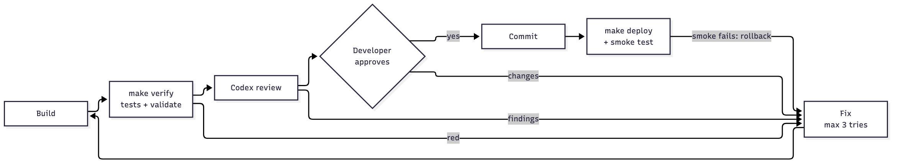

<details><summary>Diagram source (mermaid — flowchart)</summary>

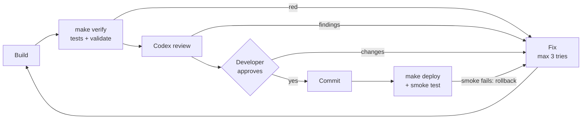

</details>

| Command | Runs | Data needed |
|---|---|---|
| `make check` | Unit, random-input, bad-input and end-to-end tests | Small files in `tests/fixtures/` |
| `make sanitize` | The same tests, with memory-mistake checks on | Same |
| `make check-data` | The §12.2 checks on full T-Drive against `awk` and Python | `data/` |
| `make verify` | All of the above + every step's validation script | `data/` if present |
| Stop hook (Claude Code) | Blocks an agent from ending its turn while `make check` is red | Small files |
| `tools/review.sh N` | Codex reviews the step, read-only, fresh context | none |
| Pre-commit hook | `make check` + `make sanitize` | Same as above |
| `make deploy` | Installs as a local service on this Mac, smoke test, automatic rollback | `.gpt` files |
| `make release VERSION=x.y.z` | Package others can install + smoke test + local git tag | Small files |

Details (closed loop, test levels, answer sources, fixtures, tests per step, deploy, release): **[TESTING.md](TESTING.md)**

---

## 12. Build plan

### 12.1 Review loop (every step)

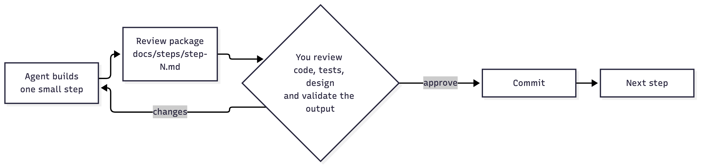

<details><summary>Diagram source (mermaid — flowchart)</summary>

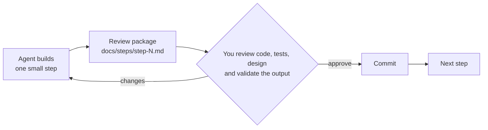

</details>

| Review package contains | |
|---|---|
| Design note | What + why, with a diagram |
| Code | Files changed (`git show`) |
| Tests | What each catches + proof they fail when code is broken |
| Who did what | Main agent, helper agents (e.g. independent reviewer), decisions |
| Validate yourself | Command or page + expected result |
| Not verified | Gaps, stated plainly |

### 12.2 Stage 1 steps (T-Drive)

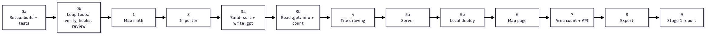

<details><summary>Diagram source (mermaid — flowchart)</summary>

```mermaid
flowchart LR
  S0A["0a<br/>Setup: build + tests"] --> S0B["0b<br/>Loop tools: verify, hooks, review"] --> S1["1<br/>Map math"] --> S2["2<br/>Importer"] --> S3A["3a<br/>Build: sort + write .gpt"] --> S3B["3b<br/>Read .gpt: info + count"] --> S4["4<br/>Tile drawing"]
  S4 --> S5A["5a<br/>Server"] --> S5B["5b<br/>Local deploy"] --> S6["6<br/>Map page"] --> S7["7<br/>Area count + API"] --> S8["8<br/>Export"] --> S9["9<br/>Stage 1 report"]
```

</details>

**In plain English**

| Step | What we build | How we check it |
|---|---|---|
| 0a Set up | Empty project folders. One command builds the program, one runs the tests. A safety mode catches memory mistakes | The empty project builds and a do-nothing test passes · a test that fails on purpose makes the test command fail |
| 0b Loop tools | The automatic loop: a "check everything" command, the Codex review script, and guards that stop agents from finishing a turn or committing while tests fail | A test that fails on purpose is caught by every guard · Codex returns a review |
| 1 Map math | Turns a place (longitude, latitude) into "which map square is it in", plus one number used later for sorting | Central Beijing gives a square number. That same square on OpenStreetMap shows central Beijing |
| 2 Read the raw data | Reads the 8,911 taxi text files. Keeps good rows, skips bad ones (at 0,0 or impossible places) | Counts match a separate tool: 10,088,351 read · 23,357 at 0,0 · 103 impossible · 10,064,891 kept |
| 3a Sort and save | Sorts all points so points close on the map sit close in the file, and saves one file. Works even when the data is too big for memory | Built with lots of memory and with very little, both files are exactly the same · a separate Python sort matches · no leftover temp files |
| 3b Read the saved file | Opens the saved file and quickly finds the points inside any map square. Two small commands: "describe this file" and "count this square" | File says 10,064,891 points · a square's count equals its 4 smaller squares added up · Python counting the slow way gets the same number |
| 4 Draw a map square | Turns one square's points into a picture. Busier spots are brighter | Our picture next to the same OpenStreetMap square: the bright lines sit on the real roads |
| 5a Web server | A small program on your computer that answers the browser: "this square's picture", "which datasets do you have?". Serves several datasets at once | A square's address shows its picture · all of T-Drive and a small sample both show up with their own counts · broken addresses and unknown names give an error, and the server keeps running |
| 5b Local deploy | Installs the server as a background service on this Mac that starts at login. One command updates it, checks it works, and goes back to the old version if not | Before approval: a test install in a temporary folder on a free port answers, a deliberately broken version is rolled back, it survives a restart · after approval: `make deploy` → the map answers on 127.0.0.1:8080 |
| 6 Map page | The page you use: real map underneath, our heat pictures on top, a color key, a dataset switch | Looks like the mockup · ring roads and airport show up · zooming in shows single points on streets · the switch changes the map |
| 7 Count an area | Draw a box to get the exact number of points inside it. Hovering shows the count under your mouse (the same count, for a pixel-sized box). Other programs can get the same answer from a web address | A slow count that looks at every point gives the same number, for a drawn box and for a hovered pixel |
| 8 Download an area | An "Export CSV" button for the box: a spreadsheet of the points inside. Other programs can get it too | Opens in Excel or Numbers · number of rows = box count · every point is inside the box |
| 9 Report + release | Speed measurements, a "how to run it" guide, and a package others can install | A table of build time and how fast squares load · the package unpacks and runs on its own (tested before approval without a tag, made for real after approval) · every check from steps 0–8 ticked |

After every step: stop, show what was built and checked and how you can check it yourself. Nothing moves on until you approve.

**Exact checks (commands and expected output)**

| Step | Builds | You validate by | Expected result |
|---|---|---|---|
| 0a | Layout, git (`data/`, `build/`, `dist/` ignored), Makefile (`all`, `check`, `sanitize`, `clean`), test runner (`tests/check.h`), sanitizers | `make check` · `make sanitize` · add a deliberately failing test | Builds, empty test passes under both · the failing test makes `make check` exit non-zero and prints its `catches:` line |
| 0b | `make verify`, `make hooks` + `tools/pre-commit`, Stop hook (`.claude/settings.json` + `tools/stop-gate.sh`), `tools/review.sh` | Add a deliberately failing test, then try to end the turn and to commit · run `tools/review.sh 0b` | The Stop hook blocks, the commit is refused, `make verify` is red · after removing it all green · Codex returns a review in `.review/step-0b/round-1.md` |
| 1 | `geo`: lon/lat → tile, Z-order code | `gpstiles where 116.391 39.907 --zoom 10`, then open that tile on openstreetmap.org | Prints `10/843/388` · tile shows central Beijing |
| 2 | `import` | Run import on T-Drive | `rows=10088351 imported=10064891 skipped_zero=23357 skipped_out_of_range=103` |
| 3a | `build`: external merge sort, header stats, write `.gpt` | Build T-Drive twice: default `--mem` and `--mem 1M` (~77 runs) · `cmp` the two · a Python script reads the header and compares the points with its own sort of the `.pts` · `/usr/bin/time -l` for peak memory | Both builds identical · header count 10,064,891 · points match Python · peak memory below `--mem` + 16 MiB · no temp files left |
| 3b | `tilefile` (open `.gpt`, find a tile's slice), `info`, `count` | `gpstiles info tdrive.gpt` · `gpstiles count` on a tile and its 4 children · the same tile counted by a Python brute-force scan of the `.pts` | Count, bounds and view box printed · children sum to parent · count equals Python |
| 4 | `render` | Open rendered PNGs beside the same OpenStreetMap tiles | Heat traces line up with roads |
| 5a | `server` (several `.gpt` files), `--port 0` for tests | Build a second, small dataset from the first 500 T-Drive files (`tdrive-sample`) · serve both · open `/api/datasets` and a tile URL for each · try bad URLs and an unknown id | Both listed with their own counts · each tile shows its own data · bad URLs → error, server stays up |
| 5b | `make deploy`, `rollback`, `undeploy`, `status` · launchd agent `local.gpstiles.serve` · smoke test | Before approval: `make deploy-test` (temporary folder in `build/`, test label `local.gpstiles.test`, free port; removed afterwards) incl. a build whose smoke test fails on purpose and a `launchctl kickstart -k` · after approval: `make deploy` · `make status` | Test install: smoke test green, broken build rolled back, back up after restart, nothing left behind · real install: service on 127.0.0.1:8080, smoke test green |
| 6 | Map page + dataset switch | Open `http://127.0.0.1:8080` · switch between `tdrive` and `tdrive-sample` | Looks like the mockup · ring roads, airport, street-level points · the switch changes the tiles and the count |
| 7 | Area count + `/api/datasets/{id}/count` + hover count on the page | Draw a box · hover a pixel · run the brute-force count command for both | Same numbers |
| 8 | Export + `/api/datasets/{id}/export.csv` | Download CSV, open in Numbers/Excel | Row count = box count · all points inside the box |
| 9 | Benchmarks, README, `make release` | Read the report · before approval: `make release-test` (package in `build/`, no tag) · after approval: `make release VERSION=0.1.0` | Build time, tile p50/p99, all stage-1 checks ticked · unpacked test package passes the smoke test · after approval: package + `.sha256` in `dist/`, tag `v0.1.0` |

### 12.3 Stages after stage 1

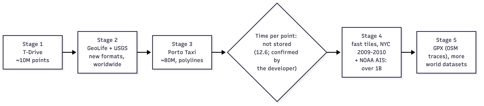

<details><summary>Diagram source (mermaid — flowchart)</summary>

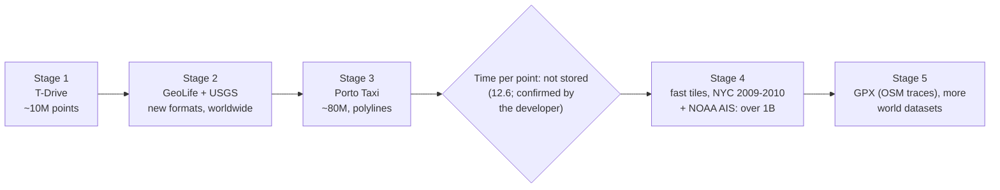

</details>

### 12.4 Stage 2 steps (GeoLife + USGS)

The goal (the project's original plan): a second file layout and points spread over the whole world work with **no code changes beyond import options**. Each stage also repeats the same checks: points land in the right place, the file's count equals the points imported, tile counts add up from one zoom to the next, build time and tile speed are recorded, and area count, export and API stay right.

**In plain English**

| Step | What we build | How we check it |
|---|---|---|
| 10 GeoLife | Reads Microsoft's GeoLife traces: 182 people, mostly in Beijing, walking, driving and biking. A second file layout (`.plt`: 6 header lines, latitude first), read with import options only. Real-data checks for it in `make check-data`. The review script takes two-digit steps | Counts match a separate tool (`awk`) and the dataset's own user guide · every point the Python rules read lands on the same spot · a tile = its 4 smaller tiles added up = a slow count · known places hold the points Python finds there · the map shows the traces on Beijing's streets |
| 11 Worldwide + report | USGS earthquakes since 1900, from USGS's website through a download tool that pages through its 20,000-row limit and checks each period against USGS's own count. Points over the whole globe: both hemispheres, the 180° line, near the poles. Then the stage 2 report: numbers for every dataset | Every period's rows = USGS's count · import counts = `awk` · quakes past 85.05° are counted and skipped · a box across the 180° line counts the same as Python · the world map shows the Pacific Ring of Fire · build time and tile speed for every dataset |

**Exact checks (commands and expected output)**

| Step | Builds | You validate by | Expected result |
|---|---|---|---|
| 10 | `tests/data/row_counts.awk` (DESIGN §8's rules, any columns; not for data with NUL bytes), `tests/data/check_geolife.py` in `make check-data`, fixture `geolife_small.plt`, `tools/review.sh` takes steps 10–99 | In `data/raw/geolife/Geolife Trajectories 1.3/Data`: `gpstiles import --lat-col 1 --lon-col 2 --skip 6 -o "$TMPDIR/geolife.pts" */Trajectory/*.plt` · the same `awk` count · `build`, `info`, `count` Beijing's zoom-6 tile and its 4 children · the page at Beijing, zoom 11 and 16 | `rows=24876978 imported=24876977 skipped_zero=0 skipped_out_of_range=1 skipped_malformed=0` = awk (§13) · `points=24876977` · tile = sum of its children = slow count · traces on the streets, as in the user guide's Figure 1 |
| 11 | `tools/fetch-usgs.py`, `tests/data/check_usgs.py` in `make check-data`, the stage 2 report | `tools/fetch-usgs.py data/raw/usgs` · `gpstiles import --lat-col 2 --lon-col 3 --skip 1` · build · serve · the count API for a box across the 180° line (Fiji–Tonga) and one around Japan · a box drawn across the 180° line on the page · the world map | Every period = USGS's count (`MANIFEST.txt`) · counts = awk · box counts = Python's slow count · the drawn box = its two halves added up · the Ring of Fire · bench for every dataset |

### 12.5 Stage 3 steps (Porto taxis)

The goal (the project's original plan): "Polyline reader works; ~80M points still build and serve quickly". Porto's 1.7 million taxi trips are one CSV row each, their GPS points in one quoted `POLYLINE` column as a JSON list of `[lon,lat]` pairs. The same every-stage checks as §12.4.

| Step | What we build | How we check it |
|---|---|---|
| 12 Porto taxis | `import --polyline C`: column C (a CSV field, quoted or not) holds a list of `[lon,lat]` pairs, each pair a point. Rows up to 1,000,000 bytes. Then the stage 3 report: 83 million points, sorted with a small `--mem` (many runs), and their speed | Counts match Python's own `csv` and `json` reading of the file · every point of a sample = the Python rules · tiles add up · places in Porto hold the points Python finds there · the map shows Porto's streets |

| Step | Builds | You validate by | Expected result |
|---|---|---|---|
| 12 | `import --polyline C` (DESIGN §8), `tests/data/check_porto.py` in `make check-data`, fixture `porto_small.csv`, the stage 3 report | `gpstiles import --polyline 9 --skip 1 -o porto.pts train.csv` · Python's count · `build --mem 256M` · `info`, `count` · the page at Porto, zoom 13 | `rows=1710670 points=83409386 imported=83409386 skipped_zero=0 skipped_out_of_range=0 skipped_malformed=0` = Python (§13) · several runs, the same file as one run · traces on Porto's streets |

### 12.6 Stage 4 steps (over a billion points)

The goal (the project's original plan): "Over 1 billion points; build must work out-of-core (data larger than RAM); tile latency stays in milliseconds". Two facts change the plan's dataset: TLC's files now hold places only for 2009 and 2010 (later years hold zone numbers), about 680 million pickup and dropoff points, short of a billion; and a zoomed-out tile is drawn point by point (164 ms at Porto's 83 million). So: fast tiles first, then NYC's 2009–2010 taxis, then a billion points from NOAA's ship positions (AIS, plain CSV, no account; planned for stage 5, moved here).

**Time per point (§14's decision before stage 4):** not stored, for now. The plan asked for this decision before stage 4 because NYC is where time matters most (its "Time filter (\"only 8–9 am\")") and rebuilding billions of points later is costly. Here that cost looks small: the raw files stay in `data/raw/`, and NYC's 680 million points should import in about 4 minutes and build in about 1 (estimated from one month: 28 million rows in 9 s; step 14 measures it). A time filter needs more than a column: a second sort key or a file per period, and a format change (DESIGN §9.3). Decided by the builder on 2026-11-01 to keep going under the developer's "proceed with all stages"; **confirmed by the developer on 2026-11-02**.

| Step | What we build | How we check it |
|---|---|---|
| 13 Fast tiles | A tile's pixel counts without visiting every point: a dense part of the tile is cut into its 4 quarters (each one slice of the sorted file, found by binary search), down to single pixels, whose count is their slice's length. The pictures don't change | Every tile = the old way's tile, byte for byte, on every dataset · the Python pixel checks · zoomed-out tiles in milliseconds |
| 14 NYC taxis | The 2009–2010 yellow taxi trips, pickups and dropoffs, converted from Parquet by DuckDB (in `data/tools/`, not part of the program) and imported as `lon,lat` rows | Counts = DuckDB's own count · places in Manhattan and at the airports = DuckDB's counts there · the map |
| 15 A billion points | NOAA's AIS ship positions until past a billion points, a sort with a small `--mem` (many runs), the stage 4 report | Counts = `awk` · the build in many runs = one run · tiles in milliseconds at a billion points |

| Step | Builds | You validate by | Expected result |
|---|---|---|---|
| 13 | `render_count` by splitting dense cells; `tests/validate/step-13.sh` | `gpstiles bench` on Porto; at every zoom, the tiles under 16 points of each dataset in `build/validate/` and `data/build/` against the program before this step | zoomed-out tiles of Porto under 5 ms (were 164 ms) · the same PNG bytes |
| 14 | `tools/nyc-taxi.py` (Parquet → `lon,lat` rows), `tests/data/check_nyc.py` | import, `build`, the API in Manhattan | counts = DuckDB (§13) |
| 15 | `tools/fetch-ais.sh`, `tests/data/check_ais.py`, the stage 4 report | import day by day, `build` (the default 1 GiB buffer: several runs), `bench` with the file in the disk cache | counts = `awk` · a billion points in milliseconds |

### 12.7 Stage 5 steps (GPX, world datasets)

The goal (the project's original plan): "GPX reader; multi-billion-point worldwide datasets" (DS-6 OpenStreetMap's GPS traces, DS-7 AIS, DS-8 GBIF, DS-9 OpenSky). DS-7 was done in stage 4 (step 15). DS-8 and DS-9 need accounts, which the builder never makes (`AGENTS.md`): they wait for the developer to register; their import needs no new code (CSV/TSV with named latitude and longitude columns: import options, or Parquet through a converter as in step 14). The developer registered both on 2026-11-02. OpenSky's full history (its Trino database) is only for research institutions, aviation authorities and governments, so DS-9 uses OpenSky's pre-curated public samples for individuals (one Monday a week, 2020–2022; no account needed); DS-8 is one GBIF download, made with the developer's login (kept in a private file outside the repo).

| Step | What we build | How we check it |
|---|---|---|
| 16 GPX | `import --gpx`: every `<trkpt ...>` start tag of an XML stream is a row, its `lat` and `lon` attributes the place (in any order, either quote; tags may span lines). OpenStreetMap's public GPS traces of 2013 (22 GB of `tar.xz`), streamed through `xz -dc \| tar -xOf -` into import, built and served. Then the stage 5 report | Counts = Python's own XML parser on sample files · the dump's track points = Python's count file by file (planned: `metadata.xml`'s sum, which is short by 99 files: §13, step 16's Decisions) · tiles add up · the world map of GPS traces · bench |
| 17 OpenSky | `tools/fetch-opensky.py`: one day of OpenSky's public aircraft positions (Monday 2022-06-27: 24 hourly tars, each kept only when its size and S3 ETag match the bucket's listing); each hour streamed through `tar -xOf \| gunzip` into import, built and served | Counts = `awk` · 2 airports' tiles = Python · tiles add up · the world's flights · bench |
| 18 GBIF | `tools/fetch-gbif.py`: one GBIF occurrence download (every 2024 occurrence with coordinates, tab-separated), requested once with the developer's login and waited for; streamed through `unzip -p` into `import --delim tab` | rows = GBIF's own `totalRecords` · counts = `awk` · tiles add up · bench |

| Step | Builds | You validate by | Expected result |
|---|---|---|---|
| 16 | `import --gpx` (DESIGN §8), `tests/data/check_osm.py`, the stage 5 report | `xz -dc gpx-planet-2013-04-09.tar.xz \| tar -xOf - \| gpstiles import --gpx -o osm.pts /dev/stdin` · `build` · `bench` · the page | rows = `tests/data/osm_count.py` (= `metadata.xml`'s sum + 99 files it undercounts, §13) · samples = Python's XML parser · tiles in milliseconds |
| 17 | `tools/fetch-opensky.py`, `tests/data/check_opensky.py` | per hour `tar -xOf … \| gunzip \| gpstiles import --lat-col 3 --lon-col 4 --skip 1` · `build` · `bench` · the page | counts = `awk` over the whole day · airports' tiles = Python |
| 18 | `tools/fetch-gbif.py`, `tests/data/check_gbif.py`, the stage 5 report | `unzip -p … \| gpstiles import --delim tab` (columns from the header) · `build` · `bench` · the page | rows = GBIF's `totalRecords` · counts = `awk` |

---

## 13. Validation facts (known answers)

| Fact | Value | Source |
|---|---|---|
| T-Drive files | 8,911 (21 empty) | Counted after download, 2026-10-28 |
| T-Drive rows | 10,088,351 | `awk` |
| Rows at (0,0) | 23,357 | `awk` |
| Rows out of range | 103 | `awk` |
| Malformed rows | 0 | `awk` |
| Valid points | 10,064,891 | rows − zero − out of range |
| Beijing (116.391, 39.907) at zoom 10 | tile `10/843/388` | OpenStreetMap formula |
| New York (−74.006, 40.7128) at zoom 12 | tile `12/1205/1540` | OpenStreetMap formula |
| GeoLife archive | `Geolife Trajectories 1.3.zip`: 313,164,406 bytes, SHA-256 `1107c5ac064d0a23c8d021a8736a77e53abc75b227062e6260342c6a8d86bdb6` | download.microsoft.com, 2026-11-01 |
| GeoLife files | 18,670 `.plt` in 182 user folders | Counted after unzip · the user guide's Figure 7 |
| GeoLife rows | 24,876,978 | `awk` · the user guide's Figure 7 ("Number of points") |
| GeoLife rows out of range | 1: `020/Trajectory/20110911000506.plt` line 6782, latitude 400.166666666667 | `awk` |
| GeoLife rows at (0,0), malformed | 0, 0 | `awk` |
| GeoLife valid points | 24,876,977 | rows − out of range |
| USGS earthquakes, 1900-01-01 to 2026-10-01 (`eventtype=earthquake`) | 58 files (1900–1969, then a year each), 4,771,181 rows, each file = USGS's count of its period | `tools/fetch-usgs.py`, 2026-11-01 (`MANIFEST.txt`) |
| USGS rows at (0,0), out of range, malformed | 9, 565 (all nearer the North Pole than 85.05112877980659°, none south), 0 | `awk` |
| USGS valid points | 4,770,607 | rows − zero − out of range |
| Porto archive | `taxi+service+trajectory+prediction+challenge+ecml+pkdd+2015.zip` (UCI): 534,065,916 bytes, SHA-256 `a33e2a5e145607ae2bad0db5d21b7548c88b7e0f9db1ce15839f24c4c61f8c76`; inside, `train.csv.zip` → `train.csv`, 1,942,848,724 bytes | archive.ics.uci.edu, 2026-11-01 |
| NOAA AIS January–May 2023 | 151 zips (`AIS_2023_01_01.zip` … `AIS_2023_05_31.zip`, 47.6 GB) from MarineCadastre, 2026-11-01 · `rows=1216355904 imported=1216355854 skipped_zero=0 skipped_out_of_range=39 skipped_malformed=11` | each day's `gpstiles import` added up = `awk` over every day (`row_counts.awk`, LON=4 LAT=3 SKIP=1) |
| OpenStreetMap GPS traces 2013 | `gpx-planet-2013-04-09.tar.xz` from planet.openstreetmap.org/gps/: 22,261,751,900 bytes, MD5 `ef0ac17afbaccd3a8f0bce6776a6e675` (= its `.md5`); 848,059 `.gpx` files and `metadata.xml` | Downloaded 2026-11-01, `md5` |
| OSM track points | 2,676,451,044 in the dump · `metadata.xml` lists 2,674,972,244: its count matches the file for 847,960 files; 99 early uploads (ids 105,565–123,773) hold 1,478,800 more, their points repeated (Python's XML parser on the 15 biggest: the same count as the file, only 25–50% of (lat, lon, time) distinct) | `tests/data/osm_count.py` (Python's `tarfile` and a regular expression, file by file) · `xml.etree` |
| OSM import | `rows=2676451044 imported=2675901374 skipped_zero=546151 skipped_out_of_range=3519 skipped_malformed=0` | rows = `osm_count.py`; the other numbers from gpstiles only (checked on sample files) |
| OpenSky aircraft positions, Monday 2022-06-27 | 24 hourly `states_2022-06-27-HH.csv.tar` from s3.opensky-network.org/data-samples (OpenSky's public samples, no account), 3,860,377,600 bytes; each = the bucket's listing in size and ETag (MD5, or for hours 14–17 the multipart ETag of 42 parts of 5 MiB) | `tools/fetch-opensky.py`, 2026-11-02 |
| OpenSky rows and points | `rows=61296085 imported=56869562 skipped_zero=0 skipped_out_of_range=0 skipped_malformed=4426523`: the malformed rows are exactly the 4,426,523 with no position (empty `lat` and `lon`) | `awk` over every hour (`row_counts.awk`, LON=4 LAT=3 SKIP=1; `data/raw/opensky/awk-hours.txt`) · `awk -F,` count of empty positions |
| GBIF occurrences of 2024 with coordinates | Download `0023351-261023074918325` (DOI 10.15468/dl.rb4bz5, 4,617 datasets), made 2026-11-02 with the developer's login: a 34,921,376,760-byte zip (= GBIF's size, every CRC checked) holding one 161,182,389,797-byte tab-separated CSV; latitude column 22, longitude 23 | `tools/fetch-gbif.py` · GBIF's `download.json` |
| GBIF rows and points | `rows=287451215 imported=287450825 skipped_zero=381 skipped_out_of_range=4 skipped_malformed=5`: rows = GBIF's own `totalRecords` (287,451,215) | `awk` over the whole file (`row_counts.awk`, LON=23 LAT=22 SKIP=1 DELIM=tab; `data/raw/gbif/awk-counts.txt`) |
| NYC taxis 2009–2010 (TLC) | 24 Parquet files, 11 GB · 339,897,217 trips → 679,794,434 pickup and dropoff points: 668,475,278 on the map, 11,315,804 at (0,0), 3,242 off the map, 110 without a place | DuckDB, 2026-11-01 |
| Porto trips (rows) and points | 1,710,670 trips (5,901 with no point), 83,409,386 points, all on the map, none at (0,0), no malformed row; longest line 84,640 bytes | Python's `csv` and `json` |

---

## 14. Limits and non-goals

| Feature | When |
|---|---|
| Time filter / time animation | Not stored (decided 2026-11-01, confirmed by the developer 2026-11-02, §12.6): would change the file format |
| Compare two datasets | Not built |
| Filter by other columns (fare, vehicle) | Later; needs a new index design |
| Linux-only speedups (io_uring, O_DIRECT) | Not built (see Linux) |
| Linux | `gpstiles` is portable C; the data scripts and checks use macOS's tools (bsdtar's `tar -xOf F '*.csv.gz'`, `ls -lnT`, `date -j`, `stat -f`): they would need porting first |
| Logins, HTTPS, public hosting | Not planned (local tool) |

---

## 15. Glossary

| Term | Meaning |
|---|---|
| Tile | One 256×256 map image at address `z/x/y` |
| Zoom (z) | Detail level; each +1 doubles detail, 4× the tiles |
| Web Mercator | The standard square world map projection used by web maps |
| World x/y | A point's position on that square map as two 32-bit numbers |
| Z-order code | x and y bits interleaved into one 64-bit number; sorting by it keeps nearby points together |
| Slice | Consecutive run of points in the sorted file (one tile, or one square of a box) |
| `.pts` | Unsorted points written by `import` |
| `.gpt` | Sorted tile file written by `build`, read by `serve` |
| bbox | Box as `west,south,east,north` in degrees |
| p50 / p99 | Typical / worst-1% response time |
| Sanitizers | Compiler checks that catch memory bugs and undefined behavior while tests run |
