# gps-tile-server: Design

## What we are building

- **In:** a large set of GPS points (longitude, latitude), from millions to billions of them
- **Out:** a web map that zooms from the whole world down to street level. A heat map shows where the points are dense or sparse
- **You can also:** draw a box to get the exact count inside it, export those points as CSV, or get the same data from an API
- **How:** one preparation step turns the dataset into one sorted file. One small C program then draws map tiles from that file when they are asked for. There is no database and nothing is drawn ahead of time
- **For:** analysts, planners and researchers who have big location datasets
- **First test:** 10 million Beijing taxi GPS points (T-Drive). Roads and hotspots appear, and you can count the points around a place such as the airport

| | |
|---|---|
| **What** | Turns millions to billions of GPS points into an interactive web map, served from **one file per dataset + one small C program**. One server can serve several datasets |
| **Program** | `gpstiles` (commands: `import`, `build`, `serve`) |
| **Language** | C11 + zlib. Map page: HTML + Leaflet |
| **Runs on** | macOS laptop first, Linux later |
| **First dataset** | T-Drive (Beijing taxis, ~10M points) |
| **Status** | Design only. Nothing built yet |
| **Plan source** | `../../PROJECT_IDEAS.md` sections 8–10 |

---

## 1. The end product

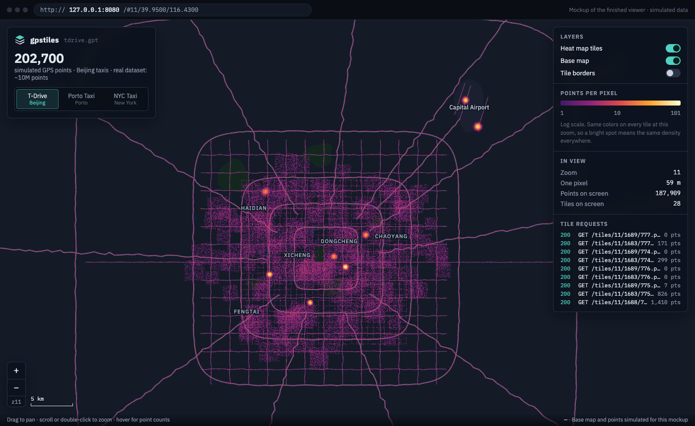

*Mockup with simulated data. Live mockup: https://claude.ai/artifact/6eS7M1H57qtoZ7oYseCbST*

| Part of the page | What it shows |
|---|---|
| Map (center) | Base map + heat-map tiles. Bright = many GPS points |
| Top left | Dataset name, point count, and a dataset switch listing every `.gpt` the server was started with |
| Right: Layers | Heat tiles · base map · tile borders on/off |
| Right: Points per pixel | Color legend (log scale) |
| Right: In view | Zoom, ground size of one pixel, points and tiles on screen |
| Right: Tile requests | Tiles the browser asked the server for |
| Hover (from step 7) | Points in the pixel under the cursor: the page asks the area-count endpoint for a pixel-sized box |
| Box tool (step 7–8) | Draw a box → exact count → export CSV |

---

## 2. Who uses it and what they do

| User | Does | Gets |
|---|---|---|
| Analyst / planner | Opens the map, pans, zooms | Where points are dense or missing |
| Analyst | Draws a box | Exact count in that area; compare areas |
| Analyst | Clicks "Export CSV" | `lon,lat` rows for Excel / Python / GIS |
| Script / program | Calls the API | Same counts and exports as JSON / CSV |
| Developer | Runs `import` + `build` once per dataset | One `.gpt` file ready to serve |

---

## 3. System at a glance

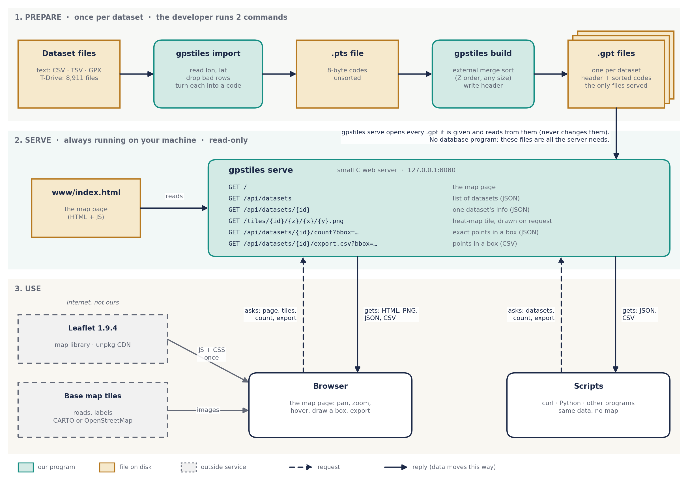

| From | To | What moves | When |
|---|---|---|---|
| Dataset files | `gpstiles import` | Text rows (lon, lat) | Once per dataset |
| `gpstiles import` | `.pts` file | 8-byte codes, unsorted, with bad rows dropped | Once per dataset |
| `.pts` file | `gpstiles build` | The codes | Once per dataset |
| `gpstiles build` | `.gpt` file | Header + codes sorted in Z order (external merge sort, §5.3) | Once per dataset |
| `.gpt` files (one per dataset) | `gpstiles serve` | Each one memory-mapped, read-only. The server never writes them | Mapped at startup · the parts a request touches are read then |
| `www/index.html` | `gpstiles serve` | The map page | Per `GET /` |
| Browser → server | | Asks for the page, tiles, a count or an export | Per user action |
| Server → browser | | HTML, PNG tiles, JSON counts, CSV | Per request |
| Scripts ↔ server | | Same API without the map: JSON and CSV | Per call |
| Leaflet (unpkg CDN) | Browser | Map library JS + CSS | Once per page load |
| Base map provider | Browser | Road and label images under our heat tiles | Per pan/zoom |

---

## 4. Data flow (T-Drive numbers)


<details><summary>Diagram source (mermaid — flowchart)</summary>

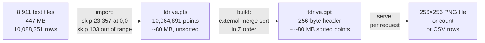

</details>

| Stage of data | Format | Size rule |
|---|---|---|
| Raw dataset | Text (CSV/TSV/GPX) | Varies |
| `.pts` | Flat array of 8-byte Z-order codes, unsorted | 8 bytes × points |
| `.gpt` | 256-byte header + sorted 8-byte codes | 8 bytes × points + 256 |
| Tile | PNG, 256 × 256 RGBA | Small (mostly empty pixels compress well) |

---

## 5. Key ideas in pictures

### 5.1 Tiles: how the map is cut up


- Address of a tile: `zoom/x/y`
- Tiles at zoom z: `4^z`
- Zoom range: 0 (whole world) to 24 (a few cm per pixel)
- Same numbering as OpenStreetMap, so our tiles line up with any standard base map

### 5.2 The trick: Z order makes every tile one slice


- Each point → one 64-bit **Z-order code** (x bits and y bits interleaved)
- The code in binary is the path: 2 bits per zoom level, each pair picks a quarter
- Sort all codes once → every tile at every zoom is one continuous slice (slices inside slices)


- Find a tile = 2 binary searches: first code ≥ tile start, first code ≥ next tile's start
- Each look halves the range: 10 million points ≈ 24 looks, 1 billion ≈ 30

### 5.3 Sorting: external merge sort


| Rule | Value |
|---|---|
| Why | Works for any file size: 80 MB (T-Drive) up to 16+ GB (NYC) on the same code path |
| Memory | `--mem` (default 1 GiB, minimum 1 MiB) sizes the sort buffer: `--mem / 8` codes per chunk. On top of it, fixed extras: 2 histograms (1 MiB) and a 64 KiB read buffer per run during the merge. Never the whole file |
| Sort inside a chunk | `qsort` with a safe compare: `(a > b) - (a < b)`, never `a - b` |
| Run files | Temp files in `--tmp` (default: next to the output). Deleted at the end, even on error |
| Merge | One pass, with a min-heap over the run fronts. More than 256 runs → stop with a clear message (raise `--mem`) |
| Disk needed | About 2 × the `.pts` size while building (runs + output) |
| Header stats | Counted while merging: densest pixel per zoom from runs of equal pixel prefixes. View box from a 65,536-bucket histogram of x and of y (~600 m precision, which is enough for the opening view) |
| Test trick | A tiny `--mem` forces many runs on small data. The output must equal a plain in-memory sort |

### 5.4 The tile file


### 5.5 Drawing a tile


- Color scale fixed per zoom level (stored in the header) → same density = same color on every tile
- Empty pixel = transparent

### 5.6 Counting an area


- Same sorted file, same binary search as tiles
- Export = same box logic, streaming the points out as CSV

---

## 6. Components (planned source modules)


<details><summary>Diagram source (mermaid — flowchart)</summary>

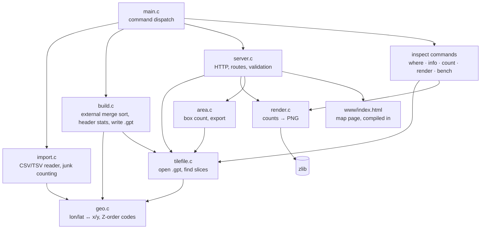

</details>

| Module | Job | Input → Output | Built in step |
|---|---|---|---|
| `geo` | Map math | lon/lat ↔ world x/y ↔ Z-order code | 1 |
| `import` | Read datasets | text rows → `.pts` + skip counts | 2 |
| `build` | External merge sort + write | `.pts` → temp runs → `.gpt` | 3a |
| `tilefile` | Read `.gpt`, find slices | z/x/y or box → index range | 3b |
| `render` | Draw tile | pixel counts → PNG bytes | 4 |
| `server` | HTTP | request → tile / JSON / CSV | 5a |
| `www/index.html` | Map page | browser UI | 6 |
| `area` | Box count + export | bbox → count / rows | 7–8 |

---

## 7. Request flows

### 7.1 Map tile


<details><summary>Diagram source (mermaid — sequence diagram)</summary>

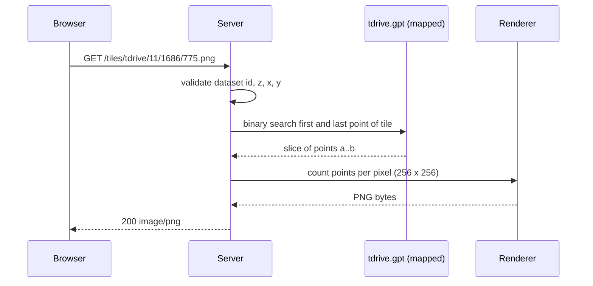

</details>

### 7.2 Area count

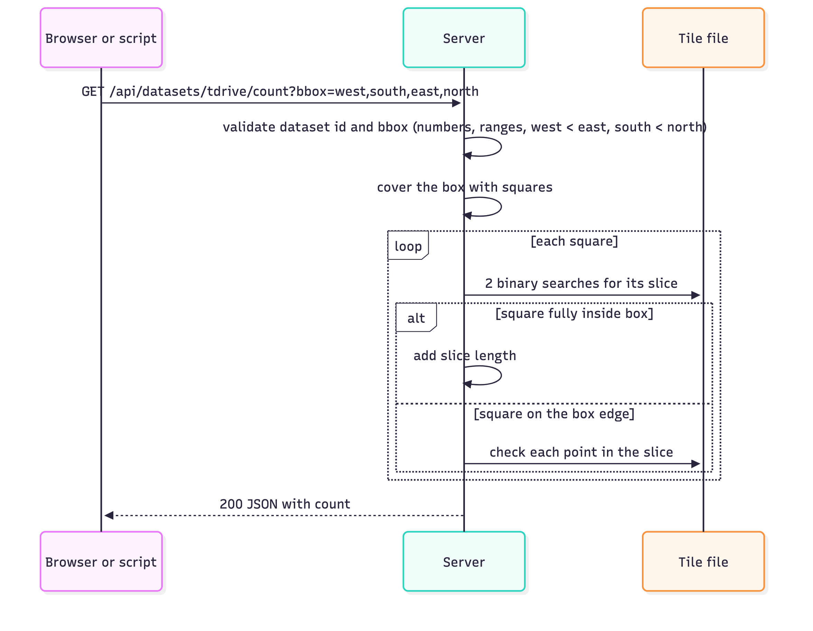

<details><summary>Diagram source (mermaid — sequence diagram)</summary>

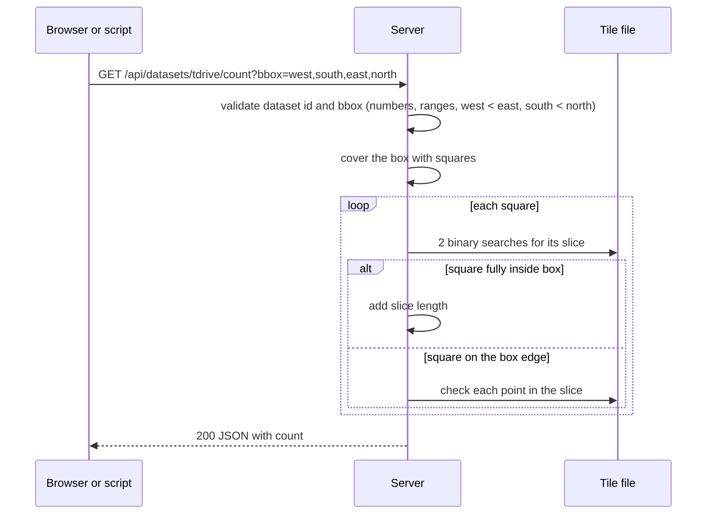

</details>

### 7.3 Export


<details><summary>Diagram source (mermaid — sequence diagram)</summary>

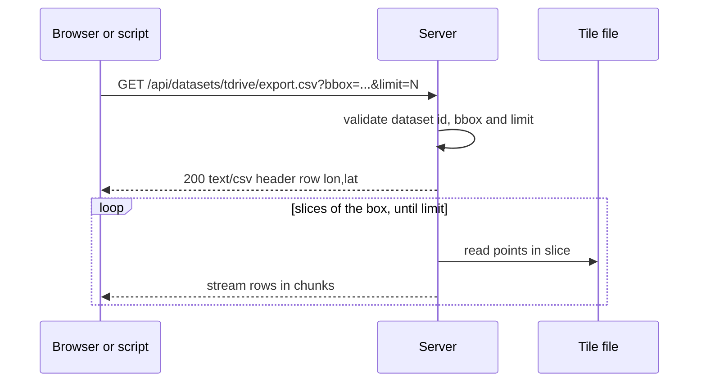

</details>

---

## 8. Importer: what happens to each row


<details><summary>Diagram source (mermaid — flowchart)</summary>

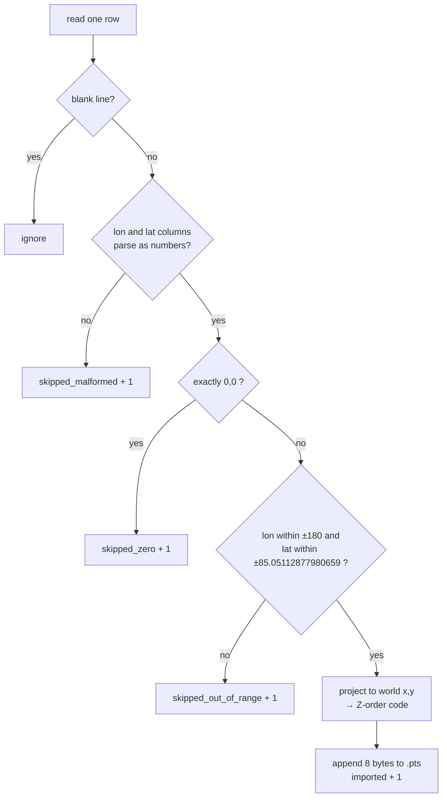

</details>

| Input quirk (real T-Drive data) | Handling |
|---|---|
| Windows line endings (`\r\n`) on every line | Trimmed |
| 23,357 rows at exactly (0,0) | Counted, skipped |
| 103 rows with impossible coordinates (e.g. lon 193, lat 95) | Counted, skipped |
| 21 empty files | Read, nothing imported |

---

## 9. Interfaces

### 9.1 Commands

| Command | Does | Step |
|---|---|---|
| `gpstiles import --lon-col C --lat-col C [--delim D] [--skip N] -o out.pts FILE...` | Text → `.pts`, prints counts | 2 |
| `gpstiles build [--mem 1G] [--tmp DIR] -o out.gpt in.pts...` | External merge sort → `.gpt`. `--mem` sizes the sort buffer, plus small fixed extras (§5.3) | 3a |
| `gpstiles serve [--host 127.0.0.1] [--port 8080] FILE.gpt [FILE.gpt ...]` | Run the web server for one or more datasets | 5a |
| `gpstiles where LON LAT --zoom Z` | Print the tile for a location | 1 |
| `gpstiles info file.gpt` | Print header: count, bounds, size | 3b |
| `gpstiles count file.gpt Z X Y` | Points in one tile | 3b |
| `gpstiles render file.gpt Z X Y -o tile.png` | Draw one tile to a file | 4 |
| `gpstiles bench file.gpt` | Tile speed per zoom (p50/p99) | 9 |

### 9.2 HTTP endpoints

| Endpoint | Returns | Step |
|---|---|---|
| `GET /` | Map page | 6 |
| `GET /api/datasets` | JSON: every served dataset with id, count, bounds and start view | 5a |
| `GET /api/datasets/{id}` | JSON: one dataset: count, bounds, start view, max zoom | 5a |
| `GET /tiles/{id}/{z}/{x}/{y}.png` | 256×256 heat-map tile of dataset `{id}` | 5a |
| `GET /api/datasets/{id}/count?bbox=w,s,e,n` | JSON: exact count in box | 7 |
| `GET /api/datasets/{id}/export.csv?bbox=w,s,e,n&limit=N` | CSV: `lon,lat` rows in box | 8 |
| Unknown `{id}` | 404 with a short message | 5a |
| Anything else | 404 / 405 / 400 with a short message | 5a |

**Box rule** (count, export, hover and the Python checks all use it)

| Rule | Value |
|---|---|
| Bounds | `bbox=w,s,e,n` turned into world units with the point encoding (§9.4): `x0 = x(w)`, `x1 = x(e)`, `y0 = y(n)`, `y1 = y(s)` |
| Inside | A stored point (x, y) is inside if `x0 ≤ x ≤ x1` and `y0 ≤ y ≤ y1`. Edges included |
| Shared edges | A point exactly on the edge two boxes share counts in both |
| Rejected (400) | `w > e` (no boxes across the ±180 line), `s > n`, values outside the valid input range, NaN |

**Dataset ids**

| Rule | Value |
|---|---|
| Id | The file name without `.gpt`: `data/build/tdrive.gpt` → `tdrive` |
| Allowed characters | `a–z 0–9 - _`, 1 to 32 long. Anything else → `serve` refuses to start and says which file |
| Duplicates | Two files with the same id → `serve` refuses to start |
| How many | Up to 32 files. Each one is memory-mapped, so adding a file costs almost no RAM up front |
| Default on the page | The first file on the command line |

### 9.3 File formats

**`.pts`** (output of `import`)

| Offset | Content |
|---|---|
| 0 … | `uint64` Z-order codes, little-endian, unsorted, no header |

**`.gpt`** (output of `build`, header finalized in step 3a)

| Field | Type | Meaning |
|---|---|---|
| magic | 8 bytes | `GPSTILE\0` |
| version | uint32 | Format version |
| header_size | uint32 | 256 |
| count | uint64 | Number of points |
| bounds | 4 × uint32 | Min/max world x and y of all points |
| max_pixel_count | 25 × uint64 | Densest pixel at each zoom 0–24 (color scale) |
| view box | 4 × uint32 | Middle 98% of points: where the map opens (ignores far-away junk) |
| points | count × uint64 | Z-order codes, sorted ascending |

### 9.4 Point encoding

| Value | Encoding |
|---|---|
| Valid input | `-180 ≤ lon ≤ 180` and `-85.05112877980659 ≤ lat ≤ 85.05112877980659` (both ends included). Anything else is out of range |
| World x | `floor((lon + 180) / 360 × 2^32)`, then `mod 2^32`: lon 180 is the same line as −180, so it wraps to x = 0 (T-Drive has one such row) |
| World y | Web Mercator, `0` = north edge. Clamped to `2^32 − 1` so the south edge (lat −85.05112877980659) still fits in 32 bits |
| Z-order code | x in even bits, y in odd bits → 64 bits |
| Precision | ~1 cm (finer than GPS) |
| Tile of a point at zoom z | top `2z` bits of its code |

---

## 10. Planned folder layout

```text
gps-tile-server/
├── AGENTS.md                rules for agents: workflow, commands, done
├── CLAUDE.md                one line: @AGENTS.md
├── PROGRESS.md              handoff: current step, status, next action
├── Makefile                 build, check, sanitize, verify, deploy (step 0a+)
├── README.md                how to run                       (step 9)
├── docs/
│   ├── DESIGN.md            this file
│   ├── TESTING.md           test levels, answer sources, tests per step
│   ├── images/              figures
│   ├── diagrams/            rendered diagrams
│   └── steps/               TEMPLATE.md + step-N.md review package per step
├── .claude/settings.json    Stop hook for Claude agents          (step 0b)
├── tools/                   stop-gate.sh, review.sh, pre-commit, deploy scripts
├── src/                     C source (modules in section 6)
├── www/index.html           map page                          (step 6)
├── tests/                   layout in TESTING.md section 5
│   ├── check.h, check.c     tiny C test runner
│   ├── unit/                C unit + random + bad-input tests
│   ├── selftest/            a suite that fails on purpose (proves the runner)
│   ├── e2e/                 Python: command line, runner self-test, real HTTP
│   ├── data/                Python: real T-Drive checks
│   ├── oracle/              Python: independent answers
│   ├── validate/            step-N.sh: each step's validation, re-run forever
│   └── fixtures/            small sample files with known answers
├── build/                   compiled program, test output     NOT in git
├── dist/                    release packages                  NOT in git
├── .review/                 Codex review rounds (step 0b)     NOT in git
└── data/                    NOT in git
    ├── raw/tdrive/          downloaded zips (80 MB)
    ├── raw/tdrive_txt/      extracted text (447 MB, 8,911 files)
    └── build/               .pts and .gpt outputs
```

---

## 11. Rules and testing

### 11.1 Rules every step follows

| Area | Rule |
|---|---|
| Build | `cc -std=c11` with strict warnings treated as errors |
| Memory safety | All tests also run under AddressSanitizer + UndefinedBehaviorSanitizer |
| Dependencies | C: zlib only. Page: Leaflet 1.9.4, pinned with an integrity hash |
| Server safety | Listens on 127.0.0.1 by default · read-only · every input validated, dataset id included · size limits on requests, connections, exports and number of files |
| Bad data | Counted and skipped, never a crash |
| Tests | Each test names the bug it catches · code broken on purpose to prove tests fail |
| Answers checked against | Independent sources: OpenStreetMap tile formula, `awk` counts, brute-force counts |
| Commits | One git commit per step, after approval |
| Network | Heat tiles and data stay local. Only the base map loads from the internet |

### 11.2 Testing and the closed loop


<details><summary>Diagram source (mermaid — flowchart)</summary>

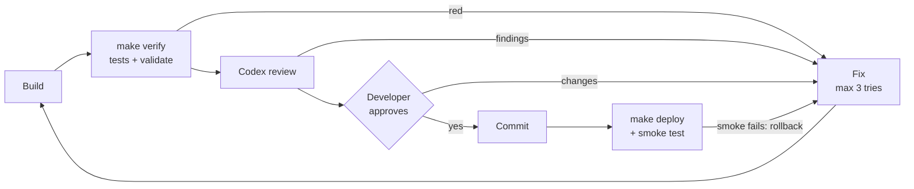

</details>

| Command | Runs | Data needed |
|---|---|---|
| `make check` | Unit, random-input, bad-input and end-to-end tests | Small files in `tests/fixtures/` |
| `make sanitize` | The same tests, with memory-mistake checks on | Same |
| `make check-data` | The §12.2 checks on full T-Drive against `awk` and Python | `data/` |
| `make verify` | All of the above + every step's validation script | `data/` if present |
| Stop hook (Claude Code) | Blocks an agent from ending its turn while `make check` is red | Small files |
| `tools/review.sh N` | Codex reviews the step, read-only, fresh context | none |
| Pre-commit hook | `make check` + `make sanitize` | Same as above |
| `make deploy` | Installs as a local service on this Mac, smoke test, automatic rollback | `.gpt` files |
| `make release VERSION=x.y.z` | Package others can install + smoke test + local git tag | Small files |

Details (closed loop, test levels, answer sources, fixtures, tests per step, deploy, release): **[TESTING.md](TESTING.md)**

---

## 12. Build plan

### 12.1 Review loop (every step)


<details><summary>Diagram source (mermaid — flowchart)</summary>

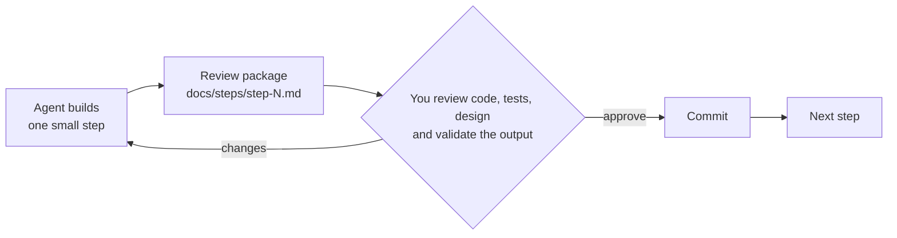

</details>

| Review package contains | |
|---|---|
| Design note | What + why, with a diagram |
| Code | Files changed (`git show`) |
| Tests | What each catches + proof they fail when code is broken |
| Who did what | Main agent, helper agents (e.g. independent reviewer), decisions |
| Validate yourself | Command or page + expected result |
| Not verified | Gaps, stated plainly |

### 12.2 Stage 1 steps (T-Drive)


<details><summary>Diagram source (mermaid — flowchart)</summary>

```mermaid
flowchart LR
  S0A["0a<br/>Setup: build + tests"] --> S0B["0b<br/>Loop tools: verify, hooks, review"] --> S1["1<br/>Map math"] --> S2["2<br/>Importer"] --> S3A["3a<br/>Build: sort + write .gpt"] --> S3B["3b<br/>Read .gpt: info + count"] --> S4["4<br/>Tile drawing"]
  S4 --> S5A["5a<br/>Server"] --> S5B["5b<br/>Local deploy"] --> S6["6<br/>Map page"] --> S7["7<br/>Area count + API"] --> S8["8<br/>Export"] --> S9["9<br/>Stage 1 report"]
```

</details>

**In plain English**

| Step | What we build | How we check it |
|---|---|---|
| 0a Set up | Empty project folders. One command builds the program, one runs the tests. A safety mode catches memory mistakes | The empty project builds and a do-nothing test passes · a test that fails on purpose makes the test command fail |
| 0b Loop tools | The automatic loop: a "check everything" command, the Codex review script, and guards that stop agents from finishing a turn or committing while tests fail | A test that fails on purpose is caught by every guard · Codex returns a review |
| 1 Map math | Turns a place (longitude, latitude) into "which map square is it in", plus one number used later for sorting | Central Beijing gives a square number. That same square on OpenStreetMap shows central Beijing |
| 2 Read the raw data | Reads the 8,911 taxi text files. Keeps good rows, skips bad ones (at 0,0 or impossible places) | Counts match a separate tool: 10,088,351 read · 23,357 at 0,0 · 103 impossible · 10,064,891 kept |
| 3a Sort and save | Sorts all points so points close on the map sit close in the file, and saves one file. Works even when the data is too big for memory | Built with lots of memory and with very little, both files are exactly the same · a separate Python sort matches · no leftover temp files |
| 3b Read the saved file | Opens the saved file and quickly finds the points inside any map square. Two small commands: "describe this file" and "count this square" | File says 10,064,891 points · a square's count equals its 4 smaller squares added up · Python counting the slow way gets the same number |
| 4 Draw a map square | Turns one square's points into a picture. Busier spots are brighter | Our picture next to the same OpenStreetMap square: the bright lines sit on the real roads |
| 5a Web server | A small program on your computer that answers the browser: "this square's picture", "which datasets do you have?". Serves several datasets at once | A square's address shows its picture · all of T-Drive and a small sample both show up with their own counts · broken addresses and unknown names give an error, and the server keeps running |
| 5b Local deploy | Installs the server as a background service on this Mac that starts at login. One command updates it, checks it works, and goes back to the old version if not | Before approval: a test install in a temporary folder on a free port answers, a deliberately broken version is rolled back, it survives a restart · after approval: `make deploy` → the map answers on 127.0.0.1:8080 |
| 6 Map page | The page you use: real map underneath, our heat pictures on top, a color key, a dataset switch | Looks like the mockup · ring roads and airport show up · zooming in shows single points on streets · the switch changes the map |
| 7 Count an area | Draw a box to get the exact number of points inside it. Hovering shows the count under your mouse (the same count, for a pixel-sized box). Other programs can get the same answer from a web address | A slow count that looks at every point gives the same number, for a drawn box and for a hovered pixel |
| 8 Download an area | An "Export CSV" button for the box: a spreadsheet of the points inside. Other programs can get it too | Opens in Excel or Numbers · number of rows = box count · every point is inside the box |
| 9 Report + release | Speed measurements, a "how to run it" guide, and a package others can install | A table of build time and how fast squares load · the package unpacks and runs on its own (tested before approval without a tag, made for real after approval) · every check from steps 0–8 ticked |

After every step: stop, show what was built and checked and how you can check it yourself. Nothing moves on until you approve.

**Exact checks (commands and expected output)**

| Step | Builds | You validate by | Expected result |
|---|---|---|---|
| 0a | Layout, git (`data/`, `build/`, `dist/` ignored), Makefile (`all`, `check`, `sanitize`, `clean`), test runner (`tests/check.h`), sanitizers | `make check` · `make sanitize` · add a deliberately failing test | Builds, empty test passes under both · the failing test makes `make check` exit non-zero and prints its `catches:` line |
| 0b | `make verify`, `make hooks` + `tools/pre-commit`, Stop hook (`.claude/settings.json` + `tools/stop-gate.sh`), `tools/review.sh` | Add a deliberately failing test, then try to end the turn and to commit · run `tools/review.sh 0b` | The Stop hook blocks, the commit is refused, `make verify` is red · after removing it all green · Codex returns a review in `.review/step-0b/round-1.md` |
| 1 | `geo`: lon/lat → tile, Z-order code | `gpstiles where 116.391 39.907 --zoom 10`, then open that tile on openstreetmap.org | Prints `10/843/388` · tile shows central Beijing |
| 2 | `import` | Run import on T-Drive | `rows=10088351 imported=10064891 skipped_zero=23357 skipped_out_of_range=103` |
| 3a | `build`: external merge sort, header stats, write `.gpt` | Build T-Drive twice: default `--mem` and `--mem 1M` (~77 runs) · `cmp` the two · a Python script reads the header and compares the points with its own sort of the `.pts` · `/usr/bin/time -l` for peak memory | Both builds identical · header count 10,064,891 · points match Python · peak memory below `--mem` + 16 MiB · no temp files left |
| 3b | `tilefile` (open `.gpt`, find a tile's slice), `info`, `count` | `gpstiles info tdrive.gpt` · `gpstiles count` on a tile and its 4 children · the same tile counted by a Python brute-force scan of the `.pts` | Count, bounds and view box printed · children sum to parent · count equals Python |
| 4 | `render` | Open rendered PNGs beside the same OpenStreetMap tiles | Heat traces line up with roads |
| 5a | `server` (several `.gpt` files), `--port 0` for tests | Build a second, small dataset from the first 500 T-Drive files (`tdrive-sample`) · serve both · open `/api/datasets` and a tile URL for each · try bad URLs and an unknown id | Both listed with their own counts · each tile shows its own data · bad URLs → error, server stays up |
| 5b | `make deploy`, `rollback`, `undeploy`, `status` · launchd agent `local.gpstiles.serve` · smoke test | Before approval: `make deploy-test` (temporary folder in `build/`, test label `local.gpstiles.test`, free port; removed afterwards) incl. a build whose smoke test fails on purpose and a `launchctl kickstart -k` · after approval: `make deploy` · `make status` | Test install: smoke test green, broken build rolled back, back up after restart, nothing left behind · real install: service on 127.0.0.1:8080, smoke test green |
| 6 | Map page + dataset switch | Open `http://127.0.0.1:8080` · switch between `tdrive` and `tdrive-sample` | Looks like the mockup · ring roads, airport, street-level points · the switch changes the tiles and the count |
| 7 | Area count + `/api/datasets/{id}/count` + hover count on the page | Draw a box · hover a pixel · run the brute-force count command for both | Same numbers |
| 8 | Export + `/api/datasets/{id}/export.csv` | Download CSV, open in Numbers/Excel | Row count = box count · all points inside the box |
| 9 | Benchmarks, README, `make release` | Read the report · before approval: `make release-test` (package in `build/`, no tag) · after approval: `make release VERSION=0.1.0` | Build time, tile p50/p99, all stage-1 checks ticked · unpacked test package passes the smoke test · after approval: package + `.sha256` in `dist/`, tag `v0.1.0` |

### 12.3 Stages after stage 1

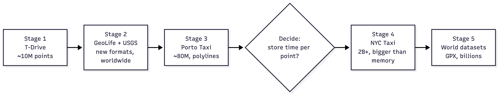

<details><summary>Diagram source (mermaid — flowchart)</summary>

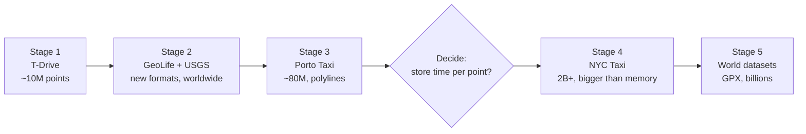

</details>

---

## 13. Validation facts (known answers)

| Fact | Value | Source |
|---|---|---|
| T-Drive files | 8,911 (21 empty) | Counted after download, 2026-10-28 |
| T-Drive rows | 10,088,351 | `awk` |
| Rows at (0,0) | 23,357 | `awk` |
| Rows out of range | 103 | `awk` |
| Malformed rows | 0 | `awk` |
| Valid points | 10,064,891 | rows − zero − out of range |
| Beijing (116.391, 39.907) at zoom 10 | tile `10/843/388` | OpenStreetMap formula |
| New York (−74.006, 40.7128) at zoom 12 | tile `12/1205/1540` | OpenStreetMap formula |

---

## 14. Not in scope yet

| Feature | When |
|---|---|
| Time filter / time animation | Decide before stage 4 (changes the file format) |
| Compare two datasets | After the time decision |
| Filter by other columns (fare, vehicle) | Later; needs a new index design |
| Linux-only speedups (io_uring, O_DIRECT) | After macOS stages work |
| Logins, HTTPS, public hosting | Not planned (local tool) |

---

## 15. Glossary

| Term | Meaning |
|---|---|
| Tile | One 256×256 map image at address `z/x/y` |
| Zoom (z) | Detail level; each +1 doubles detail, 4× the tiles |
| Web Mercator | The standard square world map projection used by web maps |
| World x/y | A point's position on that square map as two 32-bit numbers |
| Z-order code | x and y bits interleaved into one 64-bit number; sorting by it keeps nearby points together |
| Slice | Consecutive run of points in the sorted file (one tile, or one square of a box) |
| `.pts` | Unsorted points written by `import` |
| `.gpt` | Sorted tile file written by `build`, read by `serve` |
| bbox | Box as `west,south,east,north` in degrees |
| p50 / p99 | Typical / worst-1% response time |
| Sanitizers | Compiler checks that catch memory bugs and undefined behavior while tests run |
