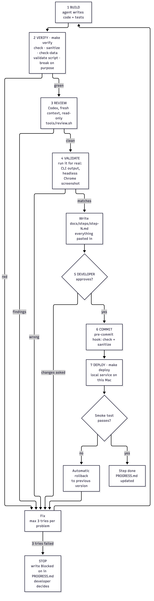
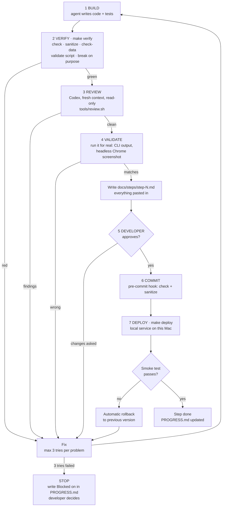

# gps-tile-server: Testing and feedback loop

How every step is tested, and how agents get fast feedback while building. Summary in `DESIGN.md` §11.2. This file has the details.

---

## 1. The closed loop

Agents build, test, review, validate and fix on their own inside a step. The developer is needed only at the approval gate, and before publishing a release.



<details><summary>Diagram source (mermaid — flowchart)</summary>



</details>

| Gate | Command / tool | Pass rule | On fail | Details |
|---|---|---|---|---|
| 1 Build | Agent | Compiles, no warnings | Fix | AGENTS.md |
| 2 Verify | `make verify` | Every check green, at least 2 deliberate breaks caught | Fix | §2–§9, §12.1 |
| — Enforce | Claude Code Stop hook | Agent cannot end its turn while `make check` is red | Keeps fixing | §12.2 |
| 3 Review | `tools/review.sh` → `codex exec` (read-only) | No high-severity findings | Fix, or explain in the step file. Max 2 rounds, then the developer decides | §12.3 |
| 4 Validate | `tests/validate/step-N.sh` · headless Chrome | Output equals DESIGN §12.2 expected · screenshot looks right | Fix | §12.4 |
| 5 Developer | Step file | Approval | Back to fix | AGENTS.md |
| 6 Commit | Pre-commit hook | `make check` + `make sanitize` green | Commit refused | §12.5 |
| 7 Deploy | `make deploy` (from step 5b) | Smoke test green | Automatic rollback | §12.6 |
| Release | `make release` (from step 9) | Smoke test of the packaged build green | No tag, no package | §12.7 |

---

## 2. Test levels

| Level | What it is | Where | Runs in | Time budget |
|---|---|---|---|---|
| 1. Unit | One function, known input → known answer | `tests/unit/` (C) | `make check` | < 1 s |
| 2. Random input | Thousands of random inputs from a fixed seed, each checked against a rule that must always hold | `tests/unit/` (C) | `make check` | < 5 s |
| 3. Bad input | Broken rows, broken files, broken requests → clean error, never a crash | `tests/unit/` + `tests/e2e/` | `make check` | < 5 s |
| 4. End-to-end | Start the real server on a small test file, send real HTTP requests | `tests/e2e/` (Python) | `make check` | < 5 s |
| 5. Memory safety | Levels 1–4 again with AddressSanitizer + UndefinedBehaviorSanitizer | same | `make sanitize` | < 30 s |
| 6. Real data | The §12.2 checks on full T-Drive, against `awk` and Python | `tests/data/` (Python + shell) | `make check-data` | < 5 min |

Levels 1–5 use only the small files in `tests/fixtures/`, so they never need `data/`. Level 6 needs `data/`. If it is missing, `make check-data` prints `SKIPPED: <reason>` and exits 0. A skip is not a pass: the step file lists it under "Not verified".

---

## 3. Commands

| Command | Does | Exit code |
|---|---|---|
| `make check` | Build, then levels 1–4 | 0 = all passed |
| `make sanitize` | Rebuild with sanitizers, then levels 1–4 | 0 = all passed, no memory errors |
| `make check-data` | Level 6 on real T-Drive | 0 = every known answer matched |
| `TEST_SEED=N make check` | Re-run random tests with a given seed | same as `make check` |

What `make check` prints (short, so it can be pasted into a step file):

```text
unit       42 passed   0 failed
random      6 passed   0 failed   seed=1
badinput   18 passed   0 failed
e2e        12 passed   0 failed
ALL PASSED  (3.1 s)
```

On a failure: file, line, test name, the bug it was written to catch, expected vs actual, and the seed.

```text
FAIL tests/unit/test_geo.c:57 tile_beijing_z10
  catches: y axis flipped (north/south swapped)
  expected 10/843/388   got 10/843/635
```

---

## 4. Rules

| Rule | Why |
|---|---|
| Expected answers come from somewhere else (section 6), never from our program's own output | A test that copies the program's answer can't catch the program being wrong |
| Every test has a `catches:` line naming the real bug it would find | No filler tests. A reviewer can see what each one protects |
| Random tests use a fixed seed and print it on failure | Any failure can be repeated exactly |
| Each step proves its tests work by breaking the code on purpose (section 8) | A test that never fails proves nothing |
| No test is weakened or deleted to make it pass | AGENTS.md "Never" list |
| No new installs. C runner = one header in the repo. Python = built-in modules only, run with `python3 -I -B` (no bytecode files left in the repo) | Anyone can run the tests on a fresh Mac |
| Tests write only to a temp folder and delete it | Running tests leaves the repo clean |

---

## 5. Where tests live

```text
tests/
├── check.h, check.c     tiny C test runner: CHECK(), CHECK_EQ_U64(), catches: label, seed (step 0a), check_rand() (step 1)
├── unit/
│   ├── main.c, suites.h  runs every suite; each step adds its module's suite      (step 0a)
│   └── test_<module>.c  one file per module: test_runner.c, test_geo.c, ...
├── selftest/
│   └── always_fails.c   fails on purpose: proves a failing test fails the run      (step 0a)
├── e2e/
│   ├── run.py           runs every test_*.py, requires a catches: docstring; a test returning "SKIPPED: why" is counted apart (0a, 6)
│   ├── test_cli.py      command-line exit codes and messages                       (step 0a)
│   ├── test_check_runner.py  runs selftest/always_fails, checks the runner fails loudly (step 0a)
│   ├── test_e2e_runner.py    runs run.py on fake test folders, checks it fails loudly    (step 0a)
│   ├── test_stop_gate.py     tools/stop-gate.sh with a fake check                        (step 0b)
│   ├── test_review_script.py tools/review.sh with a fake codex                           (step 0b)
│   ├── test_where.py         `gpstiles where` vs places.csv and the OSM formula, bad input (step 1)
│   ├── test_import.py        `gpstiles import` vs the fixtures and oracle/import_rules.py, bad input (step 2), GeoLife's layout (step 10), polylines (step 12)
│   ├── test_build.py         `gpstiles build` vs oracle/gpt_rules.py, big and tiny --mem, file errors, killed builds (step 3a)
│   ├── test_info_count.py    `gpstiles info` / `count` vs oracle/gpt_rules.py and slow counts, broken_*.gpt (step 3b)
│   ├── test_render.py        `gpstiles render`: PNGs decoded by oracle/tile_rules.py, pixel by pixel (step 4)
│   ├── test_server.py        `gpstiles serve` over real HTTP: endpoints, bad requests, 50 at once (step 5a)
│   ├── test_page.py          the map page: Leaflet's pinned hashes, CSP, headless Chrome clicks (step 6)
│   ├── browser.py            drives headless Chrome over its DevTools pipe: open, run JavaScript, mouse, screenshot (step 6)
│   ├── test_area.py          box counts and hover boxes vs oracle/box_rules.py slow counts; hover and a drawn box in Chrome (step 7)
│   ├── test_export.py        CSV export vs slow counts, row limit, clients that hang up or stop reading, the page's Export link (step 8)
│   ├── test_bench.py         `gpstiles bench`: one row per zoom, p50 ≤ p99 ≤ max, the tiles Python expects (step 9)
│   ├── test_fetch_usgs.py    tools/fetch-usgs.py against a fake USGS: windows, counts, errors, resuming (step 11)
│   ├── test_nyc_taxi.py      tools/nyc-taxi.py on tiny Parquet files (needs DuckDB in data/tools/venv, else SKIPPED) (step 14)
│   ├── test_fetch_ais.py     tools/fetch-ais.sh against a fake server: whole days only, resuming (step 15)
│   └── test_<feature>.py   real HTTP against a running server                       (step 5a+)
├── validate/
│   ├── lib.sh           shared helpers: scratch copy, the deliberately failing test    (step 0b)
│   └── step-N.sh        each step's validation (§12.4): step-0a.sh, step-0b.sh, ...   (step 0b+)
├── data/
│   ├── check_tdrive.py  level 6: real-data checks (`make check-data`): import (step 2), build (step 3a), info + count (step 3b), render (step 4)
│   ├── check_geolife.py the same for GeoLife: counts = awk = DESIGN §13, codes = Python, tiles add up, known places (step 10)
│   ├── check_usgs.py    the same for the USGS earthquakes, worldwide (step 11)
│   ├── check_porto.py   the same for the Porto taxis: polylines, counts = csv + json, a many-runs build (step 12)
│   ├── check_nyc.py     the same for the NYC taxis 2009–2010: counts and places = DuckDB, 680 million points (step 14)
│   ├── check_ais.py     NOAA AIS, light: 3 of 151 days = awk, a day's codes and 3 ports = Python (step 15)
│   └── row_counts.awk   the row rules in awk, any columns: independent counts           (step 2; any columns from step 10)
├── oracle/
│   └── *.py             independent answers: slow counts, plain sorts, PNG decoding
└── fixtures/
    └── small files with known answers (section 7)
```

---

## 6. Where expected answers come from

| Answer | Independent source |
|---|---|
| Place → map square | OpenStreetMap tile formula, computed by hand or in Python |
| Row counts, skipped rows | `awk` over the raw files; for polylines (Porto), Python's own `csv` and `json` modules; for Parquet (NYC), DuckDB's SQL |
| Sorted order | Python `sorted()` on the same `.pts` |
| Points in a square or a box | Python slow count: look at every point |
| Tile picture | Python decodes the PNG (`zlib`) and checks pixel colors and the transparent pixels |
| Row counts in an export | Python reads the CSV and checks each point is inside the box |
| Known T-Drive numbers | `DESIGN.md` §13 |
| GeoLife's number of points | its own user guide (Figure 7), and `awk` |
| USGS rows per period | USGS's own count service, asked for each period and each window by `tools/fetch-usgs.py` (`MANIFEST.txt`) |

---

## 7. Test files (fixtures)

| File | Contents | Known answer | Step |
|---|---|---|---|
| `places.csv` | Named places: Beijing, NYC, the 4 world corners | Their squares at several zooms | 1 |
| `tdrive_small.txt` | 50 real-style rows incl. (0,0), out-of-range, CRLF, no final newline | Kept and skipped counts | 2 |
| `bad_rows.txt` | Empty lines, letters for numbers, missing columns (the 1 MB line is made by the test, not stored) | Empty lines skipped and not counted as rows (DESIGN §8). Every other line counted as malformed. No crash | 2 |
| Generated `.pts` | Random codes from a seed (made by the test, not stored) | Plain sort of the same codes | 3a |
| `tiny.gpt` | A few hundred points built by the test | Slow counts per square | 3b |
| `broken_*.gpt` | Wrong label, cut short, size mismatch | Refused with a clear message | 3b |
| `two_datasets/` | Two tiny `.gpt` files | Each listed with its own count | 5a |
| `porto_small.csv` | Porto's layout with made-up trips: quoted fields, an empty trip, a trip with (0,0), one with a latitude of 192, a list with a trailing comma, spaces inside a list | 8 rows, 16 points, 14 kept, 1 at (0,0), 1 off the map, 1 malformed row | 12 |
| `geolife_small.plt` | GeoLife's real layout with made-up places near Beijing: the 6 header lines, CRLF, latitude first, an altitude of -777, and a latitude of 400 as in the real data | 12 rows, 11 kept, 1 out of range | 10 |

---

## 8. Proof the tests catch bugs

| Do | Detail |
|---|---|
| 1. Copy | Copy the repo to a scratch folder. Never break the real tree |
| 2. Break | Make one realistic mistake, e.g. swap x/y, `<` → `<=`, compare with `a - b`, drop the last point of a slice |
| 3. Run | `make check`. At least one test must fail, and its `catches:` line should match the mistake |
| 4. Record | Put the mistake and the failing test in the step file's "Proof the tests catch bugs" table |
| 5. Clean up | Delete the scratch copy. `git status` in the real tree is unchanged |

At least 2 deliberate breaks per step from step 1 on. Steps 0a and 0b use a setup proof instead: 0a, a deliberately failing test makes `make check` fail. 0b, the same failing test is caught by `make verify`, the Stop hook and the pre-commit hook (run in a scratch copy, §12.4).

---

## 9. Tests added in each step

| Step | Unit + random | Bad input + end-to-end |
|---|---|---|
| 0a | Do-nothing test proves the runner works and a failing test turns the exit code non-zero | none |
| 0b | none | A deliberately failing test: the Stop hook blocks, the pre-commit hook refuses, `make verify` is red · `tools/review.sh 0b` returns a review |
| 1 | Known places → known squares · random place → code → back gives the same place within 1 world unit on each axis (≈ 0.93 cm), longitude compared across the ±180 wrap | Latitude just past ±85.05112877980659 (rejected) and exactly at it (accepted, south edge clamped) · longitude 180 wraps to x = 0 · NaN, infinity |
| 2 | `tdrive_small.txt` counts | `bad_rows.txt`, empty file, no final newline, CRLF |
| 3a | Random codes, tiny `--mem` (many runs) = plain sort · same input gives a byte-identical file | Missing temp folder, unwritable output → clean error, no temp files left |
| 3b | Square count = sum of its 4 smaller squares (random data) · count = slow count | `broken_*.gpt` refused |
| 4 | Pixel counts for a hand-made square · PNG decodes to the expected colors | Empty square → fully transparent tile |
| 5a | none | Status, content type and body per endpoint · bad URLs, 10 KB request line, unknown dataset → error and the next request still works · 50 requests at once |
| 5b | none | Smoke test after deploy · a deliberately broken build is rolled back automatically · the service is back after a restart |
| 6 | none | Page loads, asks for the right tile URLs, dataset list matches the served files |
| 7 | Box count = slow count for random boxes, incl. boxes on square edges and pixel-sized boxes (hover) | West > east, NaN, outside the world → 400 |
| 8 | Export rows = box count · every row inside the box | Row limit respected · client disconnects halfway → server fine |
| 9 | `bench` records speed (not pass/fail) | `make release`: the unpacked package passes the smoke test on its own |
| 10 | `geolife_small.plt` (the real layout: 6 header lines, CRLF, latitude first, the real glitch at latitude 400) → known counts and codes · `row_counts.awk` gives the Python rules' counts on every fixture | One header line too few (`--skip 5`) → that line is a malformed row · the columns swapped → no point kept · `tools/review.sh 10` runs with its own rows only, `100` and `05` are refused |
| 11 | `fetch-usgs.py` against a fake USGS: pages joined with no row lost or doubled where a page ends (several quakes at the last row's time), each period = the fake's count | A server error retried, then a clean failure that leaves no half-written file · a period whose rows ≠ its count refused · an empty period · an unexpected header refused |
| 12 | `porto_small.csv` (Porto's layout: quoted fields, an empty trip, a trip with a point at (0,0) and one off the map) → known counts and codes = the Python rules (their own CSV and list reader) · random polylines = the Python rules | Broken lists (unclosed, a missing number, a trailing comma, letters, 3 numbers in a pair), an unclosed quote, a row over 1,000,000 bytes → malformed rows, nothing of them imported · `--polyline` with `--lon-col` refused |
| 13 | Random dense tiles (clusters, repeats, every zoom 0–24): the new pixel counts = counting point by point · the old render tests (Python pixel counts) unchanged | A tile with one point, an empty tile, a whole tile in one pixel |
| 14 | `tools/nyc-taxi.py` on tiny Parquet files made by DuckDB (2009's and 2010's column names; NULL, NaN, infinity, (0,0), the map's edges): known counts (SKIPPED without DuckDB) | Output to a file and a file with zone numbers refused · `make check-data`: counts = DuckDB's own SQL count and DESIGN §13; a build in several runs; Manhattan's tile and 3 places = DuckDB's counts inside their edges · `step-14.sh`: the API at JFK = DuckDB, the page, bench |
| 15 | `tools/fetch-ais.sh` against a fake server: a whole day kept, a corrupt one (right size) refused with nothing left, a rerun resumes, a missing day, impossible or backwards dates refused, a damaged or empty kept day fetched again, a 2-CSV zip and a size other than stated refused | `make check-data`: 3 days = `awk` (one with skipped rows), a day's every code and 3 ports = Python, 3 days in 4 runs = in 1 · `step-15.sh`: 151 days = DESIGN §13 (`awk`), a build in several runs = with a 2 GiB buffer, tiles add up, the page, p99 at 1.2 billion points |

---

## 10. What the code must offer so it can be tested

| Feature | Used by | Step |
|---|---|---|
| Every command exits non-zero on error with a one-line message | All test levels | 0a+ |
| `TEST_SEED` env var for random tests (default 1) | Level 2 | 0a |
| `build --mem SIZE --tmp DIR` | Many-run sort tests | 3a |
| `serve --port 0` picks a free port and prints it on the first line | End-to-end tests run side by side | 5a |
| Pure functions for the math, counting and drawing (no files, no network) | Unit tests | 1–4 |

---

## 11. Decisions

| Decision | Chosen | Rejected and why |
|---|---|---|
| End-to-end and answer checks | Python, built-in modules only | C: more code for the same checks. Extra Python packages: an install step |
| Real-data checks | Separate `make check-data` | Inside `make check`: needs 447 MB of data and takes minutes |
| Fuzzing tool | Not now. Level 3 random bad input covers the basics | libFuzzer / AFL: extra setup. Revisit after step 5 |
| Code coverage | Not now | `llvm-cov` report: maybe in step 9 |
| CI | Local pre-commit hook | GitHub Actions: only once there is a GitHub repo |
| Closed loop | Codex reviewer · Stop hook · local service + release (decision 2026-10-28) | Claude subagent reviewer: same model family as the builder, a less independent read. Public server: out of scope (DESIGN §14) |

---

## 12. Closed loop details

### 12.1 `make verify`

| Runs, in order | Stops at first failure |
|---|---|
| `make check` → `make sanitize` → `make check-data` → `tests/validate/step-N.sh` for every step done so far | Yes, prints which part failed |

| Rule | Value |
|---|---|
| Exists from | Step 0b. In step 0a, run `make check` + `make sanitize` instead |
| `make check-data` before step 2 | Prints `check-data: no real-data checks yet` and passes |
| Data-dependent parts | `check-data` and any validation script that needs `data/` print `SKIPPED: <reason>` when the data is missing. A skip is not a pass: list it under "Not verified" in the step file |

The "break on purpose" proof is not part of `make verify`. The agent does it by hand (§8) and records it in the step file.

### 12.2 Stop hook (Claude Code)

| Item | Value |
|---|---|
| Where | `.claude/settings.json` (in git) → `tools/stop-gate.sh` |
| When | Every time a Claude agent tries to end its turn |
| Does | If `src/`, `tests/` or the `Makefile` differ from the last commit (new files included), run `make -s check` |
| Red | Block the stop (exit 2) and send the last 40 lines back to the agent |
| Loop guard | After 3 blocks in a row, let the agent stop. It must write the problem under "Blocked on" in `PROGRESS.md`. Counter: `build/stop-gate.count` (ignored, cleared by `make clean`). A green check resets it |
| Time | `make check` stays under 10 s, so every stop stays fast |
| Codex as builder | Codex has no Stop hook. AGENTS.md rule instead: run `make check` before ending a turn |

### 12.3 Codex review

| Item | Value |
|---|---|
| Command | `tools/review.sh N` → `codex exec -s read-only -C <repo> -o .review/step-N/round-K.md` |
| Files | `.review/step-N/`: `round-K.diff` (input), `round-K.prompt.md`, `round-K.md` (findings), `round-K.log`. Git-ignored, and outside `build/` so `make clean` can't delete them |
| Codex gets | The step's full change, new files included, built in a temporary index so the real one is untouched: `git add -A` then `git diff --cached <base>`. `<base>` = the last commit (the last approved step), or the empty tree before the first commit. The step file and `PROGRESS.md` are left out. Plus its DESIGN §12.2 rows · TESTING §9 row · AGENTS.md rules. **Not** the builder's summary or opinion |
| Codex is asked for | Bugs, missing tests, security problems at inputs (files, HTTP), drift from DESIGN. Each finding: severity, `file:line`, how it fails |
| Codex never | Edits files. The sandbox is read-only |
| Builder then | Fixes each finding, or writes why not in the step file under "Review" |
| Rounds | Max 2, enforced: round 2 is told to check each round-1 finding, a 3rd run is refused. A failed Codex run, or a reply that doesn't end with `SUMMARY: high=N medium=N low=N`, doesn't use up a round. One review per step at a time (lock `.review/step-N.lock`). Findings left after round 2 → listed for the developer to decide |
| In the step file | Review round count, findings, and what happened to each |

### 12.4 Validation scripts

| Item | Value |
|---|---|
| Where | `tests/validate/step-N.sh`, one per step, written in that step. Shared helpers in `tests/validate/lib.sh` |
| Does | Runs the step's DESIGN §12.2 "validate by" commands and compares with "expected" |
| Visual steps (4, 6) | Headless Chrome (already installed, nothing to add) saves a screenshot to `build/validate/`. The script checks what it can (tile not empty, bright pixels at the airport). The agent looks at the screenshot too and says what it sees in the step file |
| Kept forever | Later steps re-run all earlier scripts through `make verify`, so old behavior can't silently break |
| Never recursive | A validation script never calls `make verify`. Step 0b's guard checks (failing test → hooks block) run in a scratch copy with a deliberately failing test, never in the real tree |
| Before approval | Steps 5b and 9 validate with `make deploy-test` and `make release-test`: temporary folders in `build/`, test service label, free port, no tag. Removed afterwards. The real `make deploy` / `make release` run only after approval |

### 12.5 Pre-commit hook

| Item | Value |
|---|---|
| Where | `tools/pre-commit` · `make hooks` installs it into `.git/hooks/` |
| Runs | `make check` + `make sanitize` on exactly the staged files, exported to a temp folder (`git checkout-index`). Unstaged edits can't make a commit pass or fail |
| Red | Commit refused |

### 12.6 Deploy: local service on this Mac

| Item | Value |
|---|---|
| When | After the developer approves and the commit is made. From step 5b on |
| Install folder | `~/.local/gpstiles/releases/<commit>/` · `current` link → the running version · `previous` link → the one before |
| Datasets | `~/.local/gpstiles/datasets.conf`: one `.gpt` path per line |
| Service | macOS launchd user agent `local.gpstiles.serve`: starts at login, restarts if it crashes, listens on 127.0.0.1:8080 |
| Logs | `~/.local/gpstiles/logs/` |
| `make deploy` | Build → `make check` → copy to `releases/<commit>` → switch `current` → restart service → smoke test |
| Smoke test | `/api/datasets` lists every file in `datasets.conf` · one tile per dataset returns a real PNG · a bad URL returns 404 |
| Smoke red | Switch `current` back to `previous`, restart, run the smoke test again, exit non-zero. First install (no `previous`): stop and unload the service, remove `current`, exit non-zero |
| Other commands | `make rollback` · `make undeploy` (stop the service, keep the files) · `make status` · `make deploy-test` (pre-approval check, §12.4) |
| Tests and the service | Tests use `serve --port 0`, so they never clash with the service on 8080 |

### 12.7 Release (a package others can install)

| Item | Value |
|---|---|
| When | From step 9. Only on an approved commit with a clean tree |
| `make release-test` | Same package and smoke test in `build/release-test/`, no tag. Used before approval |
| `make release VERSION=x.y.z` | Optimized build of the commit itself (`git archive`), for macOS 13 or later → `dist/gpstiles-x.y.z-macos-arm64.tar.gz` (binary, README, Leaflet's license, and `LICENSE` once there is one) + `.sha256` file → local git tag `vx.y.z` |
| Smoke test | Unpack into a temp folder. The unpacked `gpstiles` imports a 10-row CSV the test writes there, builds it, serves it on `--port 0`, and the smoke checks run against it |
| Publishing | Uploading anywhere (e.g. GitHub Releases) is outward-facing: only after the developer says so, and only once a GitHub repo exists |
| Later | Linux build (stage 5+) |

### 12.8 Limits that stop runaway loops

| Limit | Value | Then |
|---|---|---|
| Fix tries for the same problem | 3 | Stop, "Blocked on" in PROGRESS.md |
| Review rounds | 2 | Developer decides on the leftover findings |
| Stop-hook blocks in a row | 3 | Agent may stop, must record the blocker |
| Builder and reviewer disagree | none | Developer decides. Neither one overrules the other |

