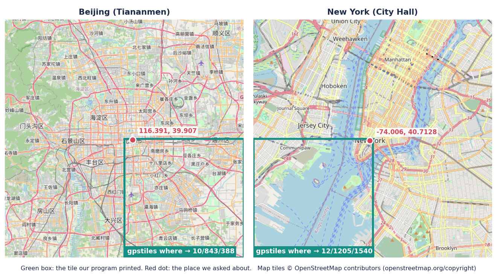

# Step 1: Map math

## Summary

| | |
|---|---|
| **Built** | `src/geo.c` (place → world x/y → Z-order code → tile, and back) · `gpstiles where LON LAT --zoom Z` · unit, random and end-to-end tests · `tests/validate/step-1.sh` |
| **Status** | waiting for review |
| **Date** | 2026-10-28 |
| **Agent(s)** | Claude Opus 5.5 (builder) · Codex CLI (reviewer, read-only, via `tools/review.sh 1`) |

## Design
- **One chain, four forms of the same place.** Later steps store only the 64-bit code. Tiles, sorting and counting all come from it.
- **World x/y are 32 bits each,** so one unit is about 0.93 cm at the equator, finer than GPS.
- **Tile = the code's top 2 × zoom bits.** No separate tile maths, which is why one sort (step 3a) makes every tile one slice.
- **Same expression as OpenStreetMap's formula,** so our tiles line up with any standard base map. Checked against an independent Python copy of the formula.
- **The edges follow DESIGN §9.4:** lon 180 wraps to x = 0, the exact map edge (±85.05112877980659) is accepted, and the south edge is clamped into the last row.

```text
 place (degrees)          world x, y (32 bits each)       Z-order code (64 bits)               tile at zoom z
 116.391, 39.907   ──►    x = floor((lon+180)/360 · 2^32)  ──►  x bits in even places,  ──►  top 2z bits of the code
                          y = Web Mercator, 0 = north          y bits in odd places          10/843/388
                   ◄──    geo_lon / geo_lat (back, within 1 unit)   ◄── geo_split
```

| Input | Result |
|---|---|
| lon 180 | x = 0, the same line as −180 |
| lon just below 180 (e.g. `179.99999999999997`, where lon + 180 rounds to 360) | last column, not wrapped (Codex round 1) |
| lat exactly ±85.05112877980659 | accepted · north → y = 0 · south → y = 2^32 − 1 (clamped) |
| lat one decimal past the edge, lon past ±180 | refused, exit 2 |
| `nan`, `inf`, `1e999`, `0x10`, spaces, trailing junk | refused, exit 2 (only plain decimals are parsed) |
| zoom outside 0–24, or not a whole number | refused, exit 2 |

## Files changed

| File | Change | Why |
|---|---|---|
| `src/geo.h`, `src/geo.c` | added (130 lines) | the map math: valid ranges, world x/y, inverse, code, split, tile |
| `src/main.c` | changed (+81) | `where` command: argument parsing (plain decimals only, zoom 0–24), one-line errors, help line |
| `Makefile` | changed (+1) | `LDLIBS += -lm` (math library; built in on macOS, needed on Linux) |
| `tests/check.h`, `tests/check.c` | changed (+15) | `check_rand()`: seeded random numbers, restarted before each test |
| `tests/unit/test_geo.c` | added (144) | 7 geo tests |
| `tests/unit/test_runner.c` | changed (+19) | 2 tests for `check_rand` |
| `tests/unit/main.c`, `suites.h` | changed (+3) | run the geo suite |
| `tests/e2e/test_where.py` | added (112) | 10 command-line tests |
| `tests/oracle/osm_tile.py` | added (14) | OpenStreetMap formula in Python: the independent answer |
| `tests/fixtures/places.csv` | added (13 places) | known places and their tiles |
| `tests/validate/step-1.sh` | added (17) | the DESIGN §12.2 check: Beijing and New York |
| `docs/TESTING.md` §5 | changed | lists `test_where.py` and `check_rand()` |
| `docs/images/step-1-where-on-osm.png` | added | the visual check (below) |

Review the full change: `.review/step-1/round-2.diff` (the final one).

## Tests

| Test | Checks | Bug it would catch |
|---|---|---|
| `known_places_land_in_known_tiles` | Beijing z10 → 843/388, New York z12 → 1205/1540 (DESIGN §13) | y flipped, x/y swapped, wrong scale |
| `edges_of_the_world` | lon ±180 → x 0 · lon one unit west of 180, and the double just below 180 → x max · lon 0, lat 0 → 2^31 · lat ±edge → y 0 / y max | 180 not wrapped, a lon just below 180 wrapped too, south edge overflowing 32 bits |
| `valid_range_includes_both_ends_and_nothing_past` | ±85.05112877980659 and ±180 accepted, the next double past each refused, NaN and ∞ refused | `<` instead of `<=`, too wide a range, NaN slipping through |
| `code_puts_x_in_even_bits_and_y_in_odd_bits` | 4 fixed values + 100,000 random pairs vs a slow bit-by-bit version | x/y swapped in the code, a wrong mask |
| `split_undoes_code` | 100,000 random codes → split → code is unchanged | points coming back in the wrong place |
| `tile_of_code_matches_world_position_at_every_zoom` | zoom 0 → 0/0/0 · 10,000 random x/y × zooms 1–24: tile = x, y shifted | off-by-one shift, shift by 64 at zoom 0 |
| `random_place_round_trips_within_one_world_unit` | 100,000 random places → code → back: within 1 unit on each axis, lon compared across ±180 | a wrong inverse, so bounds and exports show the wrong places |
| `random_numbers_start_from_the_seed`, `…_restart_for_each_test` | `check_rand` changes between draws and restarts before each test | random tests testing one case, or a seed that doesn't repeat a failure |
| `test_known_places_print_known_tiles` | 13 rows of `places.csv`: Beijing (z0, 10, 24), New York, London, Sydney, (0,0), 4 corners, 2 just-inside corners | a wrong tile for a real place, or extra output |
| `test_random_places_match_the_openstreetmap_formula` | 100 random places and zooms vs `tests/oracle/osm_tile.py` (seeded by `TEST_SEED`) | drift from OpenStreetMap numbering away from the known places |
| `test_map_edge_is_accepted_and_just_past_it_is_refused` | edge → `10/512/0` and `10/512/1023` · `85.0511287798066`, `±180.0000001` → exit 2 | `<` for `<=`, overflow at the south edge |
| `test_longitude_180_is_the_same_line_as_minus_180` | `where 180 …` = `where -180 …` at z1, 10, 24 · `180 0` → `1/0/1` | 180 landing in column 2^zoom |
| `test_longitude_just_below_180_stays_in_the_last_column` | `179.99999999999997 0` → `1/1/1`, `10/1023/512`, `24/16777215/8388608` | a place just west of 180 wrapped to the far-west column (Codex round 1) |
| `test_not_a_number_is_refused` | 16 bad values (`nan`, `inf`, `1e999`, `0x10`, `" 1"`, `1,5`, …) for lon and for lat | garbage accepted as a coordinate |
| `test_bad_zoom_is_refused` | `25`, `100`, `-1`, `1.5`, `""`, `abc`, spaces, a 21-digit number | a zoom that shifts bits past the code |
| `test_wrong_arguments_are_a_usage_error` | missing, extra, unknown (`--zom`), `--zoom` twice or with no value | a typo silently printing some tile |
| `test_arguments_can_come_in_either_order` | `--zoom 10 116.391 39.907` | `--zoom` first misread as a coordinate |
| `test_huge_or_control_character_argument_stays_one_short_line` | 5,000-character and multi-line latitude → one line under 200 chars | breaking the one-line error rule |

```text
make check     unit 10 passed 0 failed · e2e 43 passed 0 failed · ALL PASSED (build)       5.9 s
make sanitize  unit 10 passed 0 failed · e2e 43 passed 0 failed · ALL PASSED (build/san)   8.0 s
make check-data  check-data: no real-data checks yet
TEST_SEED = 2, 3, 42, 12345, 18446744073709551615: unit 10/0 · e2e 42/0 each (before the fix) · 2, 42, 18446744073709551615: 10/0 · 43/0 (after)
make verify (from make clean, after the review fix): VERIFY PASSED
--- tests/validate/step-0a.sh   2 ok
--- tests/validate/step-0b.sh   7 ok
--- tests/validate/step-1.sh
  ok  where 116.391 39.907 --zoom 10 → 10/843/388
  ok  where -74.006 40.7128 --zoom 12 → 12/1205/1540
```

One-off stress check (not part of `make check`): 3,000 places on or one double away from tile edges, zooms 1–24, against the Python formula: **0 differ** (run before and after the round-1 fix).

## Review (Codex)

Run with `tools/review.sh 1`. Files in `.review/step-1/`.

| Round | Finding (severity, file:line) | What happened |
|---|---|---|
| 1 | Low, `src/geo.c:21–22`: a longitude just below 180 wraps too early. `where 179.99999999999997 0 --zoom 10` printed `10/0/512` (far-west column) instead of `10/1023/512`, because lon + 180 rounds to 360 and `mod 2^32` wraps it. The Python oracle repeated the same rounding | Fixed: only lon exactly 180 wraps to 0. Anything that rounds up to 2^32 is clamped to the last column. Oracle fixed the same way. Tests: `edges_of_the_world` (+1 check), new `test_longitude_just_below_180_stays_in_the_last_column`. Undoing the fix is caught (R1) |
| 2 | Round-1 finding: "Fixed", with file:line of the fix, both tests and the oracle. No new findings | `SUMMARY: high=0 medium=0 low=0` |

Left for the developer to decide: the DESIGN §9.4 wording (see Decisions)

## Proof the tests catch bugs

Each break in a fresh scratch copy. `make check` and `make sanitize` were both red for every one.

| # | Deliberate break | Tests that failed |
|---|---|---|
| B1 | y axis flipped (`1.0 - asinh` → `1.0 + asinh`) | `known_places…`, `edges_of_the_world`, `random_place_round_trips…` · e2e alone: `known_places`, `random_places…openstreetmap`, `map_edge…`, `either_order` |
| B2 | `<=` → `<` at the latitude edge | `valid_range_includes_both_ends…` |
| B3 | lon 180 clamped instead of wrapped (the `lon == 180` line removed) | `edges_of_the_world` · e2e alone: `known_places`, `longitude_180…` |
| B4 | x and y swapped in the code | 5 geo tests |
| B5 | zoom-0 guard removed (shift by 64) | `tile_of_code…` · sanitize: `runtime error: shift exponent 64 is too large for 64-bit type` |
| B6 | off-by-one shift in `geo_tile_of` | `tile_of_code…`, `known_places…` · e2e alone: 5 `where` tests |
| B7 | radians/degrees swapped in `geo_lat` | `random_place_round_trips…` |
| B8 | zoom upper bound (24) dropped | `test_bad_zoom_is_refused` |
| B9 | random numbers not restarted before each test | `random_numbers_restart_for_each_test` |
| B10 | one bit lost in an interleave mask | `code_puts_x…`, `split_undoes_code`, `random_place_round_trips…` |
| R1 | Round-1 fix undone (`mod 2^32` again) | `edges_of_the_world` · e2e alone: `test_longitude_just_below_180_stays_in_the_last_column` |

"e2e alone": a failing unit test stops `make check` before the e2e tests run, so for B1, B3, B6 and R1 the e2e tests were also run on their own, to show they catch the break independently.

The code was restored exactly afterwards: yes (`git status` and checksums of every file in `src/`, `tests/` and the `Makefile` match before and after).

## Validate it yourself

| Do this | Expected | Actual (agent's run) |
|---|---|---|
| `build/gpstiles where 116.391 39.907 --zoom 10` | `10/843/388` | `10/843/388` |
| Open https://tile.openstreetmap.org/10/843/388.png | central Beijing | Beijing, south-east of the centre: the "北京市" (Beijing) label is in its top-left corner, where our place is (picture below) |
| `build/gpstiles where -74.006 40.7128 --zoom 12` | `12/1205/1540` | `12/1205/1540` |
| `build/gpstiles where 0 95 --zoom 3` | one-line error, exit 2 | `gpstiles where: bad latitude '95' (want a number from -85.05112877980659 to 85.05112877980659)`, exit 2 |
| `bash tests/validate/step-1.sh` | 2 `ok` lines | 2 `ok` lines |



The place sits near a corner of its tile in both cases (Beijing top-left, New York top-right), so the picture shows 2 × 2 tiles with the printed tile outlined. Map tiles © OpenStreetMap contributors.

## Deploy (from step 5b, after approval)

none (step 5b)

## Who did what

| Agent | Did |
|---|---|
| Claude Opus 5.5 | built `geo`, `where`, the tests, the oracle, the breaks, the picture, the docs |
| Codex CLI | reviewed the diff read-only through `tools/review.sh 1`, 2 rounds: 1 low finding, fixed |

## Decisions
- **Proposed change to DESIGN §9.4 (not applied):** the World x row says "then `mod 2^32`". Taken literally that is the round-1 bug. Proposed wording: "lon 180 → x = 0 (the same line as −180). Any lon below 180 stays at most 2^32 − 1 (lon + 180 can round up to 360)." The code and tests already follow this.
- **Only plain decimals are accepted** (`[0-9+-.eE]`, then `strtod`). Rejected: plain `strtod`, which also accepts `nan`, `inf`, hex and leading spaces.
- **`where` accepts `--zoom` before or after the place.** It costs nothing, and a negative longitude (`-74.006`) is never mistaken for an option because only `--` starts one.
- **Inverse functions (`geo_lon`, `geo_lat`) built now,** although `where` doesn't use them. TESTING §9 asks for the round-trip test in this step, and steps 3b and 7 need them for bounds and boxes.
- **`check_rand()` restarts from the seed before each test.** A failing random test then repeats with its seed alone, whatever ran before it.
- **Random tests are counted in the `unit` line.** TESTING §3's sample output shows a separate `random` line. Splitting them would need a second suite list for no new check. The seed is printed on every failure as §4 asks. Proposal: change the §3 sample to match (not applied).
- **The visual check fetched 8 tiles once from tile.openstreetmap.org** (with an identifying User-Agent) to make the picture. The tests never use the network.

## Not verified
- **Linux:** built and run only on macOS (Apple clang). `-lm` was added for Linux but not tried there.
- **Python's `math` vs C's `libm`:** the random e2e test assumes both compute the same `tan` and `asinh`. They did for every place tried (100 per seed × 6 seeds, plus 3,000 tile-edge places), but a different `libm` could round one place differently right on a tile edge.
- **`make check-data`** is still a placeholder (step 2).

## Next
- Step 2: the importer (`gpstiles import`), reading the 8,911 T-Drive files. Needs your approval of step 1 and "start step 2".
