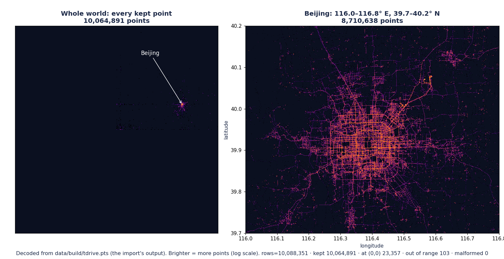

# Step 2: Importer

## Summary

| | |
|---|---|
| **Built** | `src/import.c` (text rows → Z-order codes + skip counts) · `gpstiles import` · `make check-data` (real T-Drive checks) · unit, random and end-to-end tests · `tests/validate/step-2.sh` |
| **Status** | approved |
| **Date** | 2026-10-29 |
| **Agent(s)** | Claude Opus 5.5 (builder) · Codex CLI (reviewer, read-only, via `tools/review.sh 2`) |

## Design
- **One pass, one line at a time.** Each file is read in 1 MiB blocks and split into lines, and each line is sorted into one of five buckets (below). Kept points go to the `.pts` as 8-byte codes.
- **Memory stays bounded.** A line longer than 65,536 bytes is counted as malformed and skipped to its end. The 1 MB and 3 MB lines in the tests use no extra memory.
- **The same number reader as `where`.** Only plain decimals are accepted. `nan`, `inf`, hex, spaces and quotes make a row malformed.
- **A failed import never touches an existing output.** It writes `OUT.pts.tmp-XXXXXX` next to the output, renames it into place only on success, and keeps the replaced file's permissions (Codex rounds 1 and 2).
- **Three independent answers.** DESIGN §13's numbers, an `awk` count, and the same rules re-written in Python (`tests/oracle/import_rules.py`), which checks every one of the 10,064,891 codes.

```text
 each line ──► blank (empty, or only "\r")? ───────────────────► ignored, not a row
           ──► > 65,536 bytes, column missing, not a number? ──► skipped_malformed
           ──► exactly (0, 0)? ─────────────────────────────────► skipped_zero
           ──► outside ±180 / ±85.05112877980659? ──────────────► skipped_out_of_range
           ──► else: code (step 1) ─► 8 bytes, little-endian ───► imported
```

| T-Drive | |
|---|---|
| Input | 8,911 files, 447 MB, `id,time,lon,lat` with `\r\n` |
| Command | `gpstiles import --lon-col 3 --lat-col 4 -o data/build/tdrive.pts data/raw/tdrive_txt/*.txt` |
| Time | 2.0 s |
| Output | `data/build/tdrive.pts`, 80,519,128 bytes = 10,064,891 × 8 |

## Files changed

| File | Change | Why |
|---|---|---|
| `src/import.h`, `src/import.c` | added (225 lines) | number reader, one row, line reader, the import loop |
| `src/main.c` | changed (+189) | `import` command: options, temp file + rename, one-line errors, exit 1 for file errors · `where` now uses the shared number reader |
| `Makefile` | changed | `check-data` runs `tests/data/check_tdrive.py` |
| `.gitignore` | changed | `/data/` etc. anchored to the top level, so `tests/data/` is no longer hidden (Codex round 1) |
| `tests/unit/test_import.c` | added (227) | 7 tests |
| `tests/e2e/test_import.py` | added (249) | 15 tests |
| `tests/oracle/import_rules.py` | added (83) | the row rules in Python: the independent answer |
| `tests/data/check_tdrive.py`, `tdrive_counts.awk` | added (90) | `make check-data` |
| `tests/fixtures/tdrive_small.txt`, `bad_rows.txt` | added | 50 T-Drive-style rows (CRLF, no final newline) · 17 bad rows + 4 blank lines |
| `tests/validate/step-2.sh` | added (30) | the DESIGN §12.2 check, plus "no project file is git-ignored" |
| `tests/validate/lib.sh` | changed | scratch copy skips only the top-level `data/` (BSD `tar --exclude ./data` also dropped `tests/data/`) |
| `tests/unit/main.c`, `suites.h` | changed | run the import suite |
| `docs/TESTING.md` §5 | changed | lists the new test files |
| `docs/images/step-2-imported-points.png` | added | the visual check (below) |

Review the full change: `.review/step-2/round-2.diff` (the round-2 permissions fix came after it: `git diff` of `src/main.c` and `tests/e2e/test_import.py`).

## Tests

| Test | Checks | Bug it would catch |
|---|---|---|
| `plain_decimals_parse_and_nothing_else_does` | 7 good forms · 17 bad ones (`nan`, `inf`, `0x10`, `" 1"`, `1,5`, …) · a NUL inside a field | junk accepted as a coordinate |
| `delimiters_cannot_be_part_of_a_number` | `,` tab `;` space ok · digits, `+-.eE`, line endings, NUL refused | a delimiter that splits numbers in half |
| `a_row_becomes_its_known_tile` | a CRLF row at Beijing → tile `10/843/388` (DESIGN §13) | CRLF left on the latitude, wrong columns |
| `rows_are_sorted_into_the_right_bucket` | blank, zero (`-0.0,0.0` too), out of range (`1e999` too), malformed, extra columns, lat-first TSV, `--delim x` with `0x10` | a row in the wrong bucket, strtod reading into the delimiter |
| `codes_are_written_as_8_little_endian_bytes` | byte by byte | big-endian or short codes, so step 3 reads garbage |
| `header_lines_are_skipped_before_counting` | `--skip 2` with a header and a blank line | header lines counted as rows |
| `random_files_split_into_the_same_lines_as_by_hand` | 4 random 3 MiB files (long lines, `\r`, with and without a final newline) vs splitting by hand | lines dropped, merged or split at the 1 MiB buffer edge |
| `test_tdrive_small_gives_its_known_counts_and_codes` | rows 50 · imported 44 · zero 3 · out of range 3 · codes = Python | CRLF, last line lost, bad rows kept |
| `test_bad_rows_are_counted_as_malformed_and_blank_lines_are_not_rows` | 17 malformed, 0 imported, 4 blank lines not counted | a bad row imported, blank lines counted |
| `test_long_lines_are_malformed_and_the_next_line_still_imports` | 1 MB and 3 MB lines, exactly 65,536 (kept) and 65,537 (malformed) bytes | a crash or lost rows after a long line |
| `test_long_line_at_the_end_without_a_newline_is_one_malformed_row` | a 2 MB last line | it counted twice or lost |
| `test_empty_file_and_no_final_newline` | empty file → 0 rows · one row, no newline → imported | crash on T-Drive's 21 empty files, last row dropped |
| `test_crlf_and_lf_give_the_same_points` | same counts and codes | Windows line endings breaking the latitude |
| `test_files_are_imported_in_order_and_counts_add_up` | 3 files → 117 rows, codes in file order | wrong order, counts reset |
| `test_header_lines_tab_delimiter_and_latitude_first` | TSV, `--skip 1` per file, lat in column 1 | `--skip` once, `--delim` ignored, columns mixed up |
| `test_number_edges_follow_the_rules` | the map edges, just past them, `1e999`, `-0`, `.5`, `1.`, NUL bytes, `179.99999999999997` | edge rows in the wrong bucket |
| `test_random_rows_match_the_python_rules` | 60,000 random lines (≈ 1.3 MB) vs Python, seeded by `TEST_SEED` | any disagreement with DESIGN §8 |
| `test_bad_arguments_are_a_usage_error` | 14 bad commands → exit 2, one line, no output file | a typo silently importing the wrong thing |
| `test_file_errors_exit_1_and_leave_no_output` | missing input, a folder as input, a missing output folder → exit 1, nothing left behind | errors ignored, half-written files left |
| `test_a_failed_import_leaves_an_existing_output_unchanged` | missing input, read-only folder → old output intact, no temp files · success replaces it | a typo destroying the old dataset (Codex round 1) |
| `test_replacing_an_output_keeps_its_permissions` | new file → umask default · replacing a `0600` file keeps `0600` | private GPS data made readable by others (Codex round 2) |
| `test_delimiter_x_does_not_turn_fields_into_hex` | `0x10` with `--delim x` → lon 0, lat 10 | hex parsing across fields (Codex round 1) |
| `make check-data` | all of T-Drive: counts vs DESIGN §13 and `awk`, every code vs Python | anything the small tests miss on real data |

```text
make check       unit 17 passed 0 failed · e2e 58 passed 0 failed · ALL PASSED (build)      6.4 s
make sanitize    unit 17 passed 0 failed · e2e 58 passed 0 failed · ALL PASSED (build/san)
make check-data  check-data: import counts = DESIGN §13 = awk: rows=10088351 imported=10064891 skipped_zero=23357 skipped_out_of_range=103 skipped_malformed=0 (1.8 s)
                 check-data: all 10,064,891 codes in the .pts = the Python rules                 35 s
TEST_SEED = 2, 7, 99, 18446744073709551615: unit 17/0 · e2e 55/0 each (before the review fixes)
umask 077: make check e2e 58/0
make verify (from make clean, after all fixes): VERIFY PASSED, 1 min 38 s
--- tests/validate/step-0a.sh   2 ok
--- tests/validate/step-0b.sh   7 ok
--- tests/validate/step-1.sh    2 ok
--- tests/validate/step-2.sh
  ok  no file in src/, tests/, tools/ or docs/ is git-ignored
  ok  import → rows=10088351 imported=10064891 skipped_zero=23357 skipped_out_of_range=103 skipped_malformed=0
  ok  tdrive.pts is 80519128 bytes = 10,064,891 points × 8
```

## Review (Codex)

Run with `tools/review.sh 2`. Files in `.review/step-2/`.

| Round | Finding (severity, file:line) | What happened |
|---|---|---|
| 1 | Medium, `Makefile:60`: `.gitignore`'s `data/` also hides `tests/data/`, so the check-data scripts would never be committed and `make verify` fails on a clean checkout | Fixed: `/data/`, `/build/`, `/dist/`, `/.review/`. `step-2.sh` now fails if any file in `src/ tests/ tools/ docs/` is git-ignored. Undoing the fix is caught (R1) |
| 1 | Medium, `src/main.c:201`: the output is emptied before the inputs are read, and deleted on failure, so `-o existing.pts` plus a typo destroys the old dataset | Fixed: write `OUT.tmp-XXXXXX` beside it, rename on success, remove the temp file on failure. Tests `test_a_failed_import_…`, `test_file_errors_…`. Caught (R2, R2b) |
| 1 | Low, `src/import.c:22`: with `--delim x`, strtod reads `0x10` as one hex number | Fixed: each field ends in `'\0'` before strtod. Tests in `rows_are_sorted_…` and `test_delimiter_x_…`. Caught (R3) |
| 2 | All three round-1 findings: "Fixed". Notes that real write/close failures (disk full) are untested | See "Not verified" |
| 2 | Medium, `src/main.c:176`: the temp file gets the umask's permissions, so replacing a `0600` dataset makes it `0644` (other users can read the GPS data) | Fixed after round 2: the temp file copies the replaced file's permissions, and new files still get the umask default. Test `test_replacing_an_output_keeps_its_permissions`. Caught (R4). **Not reviewed by Codex** (2-round limit) |

Left for the developer to decide: whether the round-2 fix needs another review (the limit is 2 rounds). The fix is 2 lines in `open_temp_beside`, `src/main.c`.

## Proof the tests catch bugs

Each break in a fresh scratch copy. `make check` and `make sanitize` were both red for every one.

| # | Deliberate break | Tests that failed |
|---|---|---|
| D1 | `\r` not stripped | `a_row_becomes_its_known_tile`, `rows_are_sorted…` · e2e: `tdrive_small`, `bad_rows`, `crlf_and_lf`, `files_in_order`, `random_rows` |
| D2 | last line without a newline dropped | `codes_are_written…` · e2e: `tdrive_small`, `empty_file_and_no_final_newline`, `number_edges`, `long_lines`, `random_rows`, `files_in_order` |
| D3 | blank lines counted as rows | `random_files_split…` · e2e: `bad_rows`, `files_in_order`, `random_rows` |
| D4 | zero test `\|\|` instead of `&&` | `rows_are_sorted…` · e2e: `number_edges`, `random_rows` |
| D5 | range test `&&` instead of `\|\|` | `rows_are_sorted…` · sanitize also: `runtime error: nan is outside the range of representable values` · e2e: `tdrive_small`, `number_edges`, `random_rows`, `files_in_order` |
| D6 | a too-long line's tail read as a new row | `random_files_split…` · e2e: `long_line_at_the_end…` |
| D7 | last line handled as if it had a newline | unit tests crash · sanitize: `AddressSanitizer` bad read · e2e: 9 import tests |
| D8 | `--skip` once, not per file | `header_lines_are_skipped…` · e2e: `header_lines_tab_delimiter…` |
| D9 | codes written big-endian | `codes_are_written…`, `random_files_split…` · e2e: 10 import tests |
| D10 | number reader accepts whatever strtod does | `plain_decimals…` · e2e: `bad_rows`, `random_rows`, `files_in_order`, `where`'s `not_a_number` |
| D12 | columns off by one | 5 unit tests · e2e: 10 import tests |
| R1 | round-1 fix 1 undone (`data/` again), in a scratch git repo | `step-2.sh`: `FAIL step-2: git ignores project files: tests/data/check_tdrive.py tests/data/tdrive_counts.awk` |
| R2 | round-1 fix 2 undone (write in place, remove on failure) | `test_a_failed_import_…`, `test_file_errors_…` |
| R2b | temp file not removed after an error | `test_a_failed_import_…`, `test_file_errors_…` |
| R3 | round-1 fix 3 undone (fields not ended before strtod) | `rows_are_sorted…` · e2e: `test_delimiter_x_…` |
| R4 | round-2 fix undone (permissions from the umask only) | `test_replacing_an_output_keeps_its_permissions` |

D11 (keep a half-written output) was replaced by R2b once the temp file existed. "e2e": the e2e tests run on their own, because a failing unit test stops `make check` before them.

The code was restored exactly afterwards: yes (`git status` and checksums of every file in `src/`, `tests/` and the `Makefile` match before and after D1–D12).

## Validate it yourself

| Do this | Expected | Actual (agent's run) |
|---|---|---|
| `build/gpstiles import --lon-col 3 --lat-col 4 -o data/build/tdrive.pts data/raw/tdrive_txt/*.txt` | `rows=10088351 imported=10064891 skipped_zero=23357 skipped_out_of_range=103` | `rows=10088351 imported=10064891 skipped_zero=23357 skipped_out_of_range=103 skipped_malformed=0` (2.0 s) |
| `ls -l data/build/tdrive.pts` | 10,064,891 × 8 = 80,519,128 bytes | `-rw-r--r-- … 80519128 … tdrive.pts` |
| `make check-data` | counts = DESIGN §13 = awk, every code = Python | both lines printed, 35 s |
| `bash tests/validate/step-2.sh` | 3 `ok` lines | 3 `ok` lines |
| Look at the points (picture below) | taxis on Beijing's roads | the ring roads, the street grid and the airport expressway to Capital Airport (bright, top right) |



The world view also shows real GPS noise: thin horizontal lines of points west of Beijing, with plausible latitudes but wrong longitudes. They are in range, so they are kept. DESIGN plans for this: step 3a's view box uses the middle 98% of points.

## Deploy (from step 5b, after approval)

none (step 5b)

## Who did what

| Agent | Did |
|---|---|
| Claude Opus 5.5 | built `import`, `check-data`, the tests, the Python and awk answers, the breaks, the picture, the docs |
| Codex CLI | reviewed the diff read-only through `tools/review.sh 2`, 2 rounds: 3 findings in round 1 (all fixed), 1 new in round 2 (fixed, not re-reviewed) |

## Decisions
- **Proposed additions to DESIGN §8 (not applied).** These rules aren't in DESIGN yet, and the code, tests and awk all follow them:
  - columns are counted from 1;
  - a blank line is empty, or only `\r`;
  - a line longer than 65,536 bytes is malformed;
  - only plain decimals are numbers (no quotes, spaces, `nan`, `inf`, hex);
  - `1e999` is a number but out of range;
  - `--skip N` applies to each file;
  - `--delim` is one character that can't be in a number, or `tab`.
- **Exit code 1 for a file that can't be read or written** (2 stays for usage errors). Written in `main.c`'s header comment.
- **The 1 MB line is made by the test, not stored in `bad_rows.txt`.** It keeps the repo small. TESTING §7 lists it in the fixture. Proposal: reword that row (not applied).
- **Counts line has a 5th field, `skipped_malformed=0`.** DESIGN §12.2 shows four fields. Malformed is one of DESIGN §8's buckets, so it's printed.
- **The output is written to a temp file and renamed** (Codex round 1). Rejected: write in place, which destroys the old output on any error.
- **`make check-data` checks all 10 million codes, not a sample.** It takes 35 s, well inside the 5-minute budget.
- **`data/build/tdrive.pts` was created** (git-ignored), ready for step 3a.

## Not verified
- **Real write or close failures** (disk full) aren't tested. macOS has no `/dev/full`. The read-only-folder test covers "can't create the output".
- **Replacing an output keeps its permissions, but not its owner, ACLs, extended attributes or hard links.** A rename makes a new file.
- **The round-2 permissions fix has not been reviewed by Codex** (2-round limit).
- **Linux:** not run there. `mkstemp`, `fchmod` and `stat` are POSIX, but untested on Linux.
- **The DESIGN §9.4 wording** (open decision from step 1) is still not applied.

## Next
- Step 3a: external merge sort of `data/build/tdrive.pts` into `tdrive.gpt`. Needs your approval of step 2 and "start step 3a".
