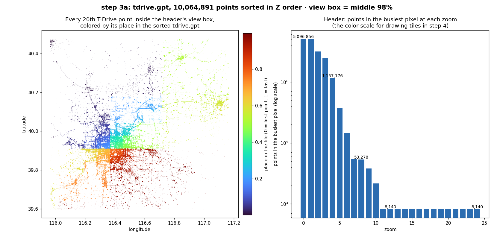

# Step 3a: Build: external sort + write `.gpt`

## Summary

| | |
|---|---|
| **Built** | `src/build.c` (external merge sort + header stats) · `gpstiles build` · unit, random and end-to-end tests · T-Drive build checks in `make check-data` · `tests/validate/step-3a.sh` |
| **Status** | approved (developer's go-ahead 2026-10-31) |
| **Date** | 2026-10-30 · reviews and fixes 2026-10-31 |
| **Agent(s)** | Claude Opus 5.5 (builder) · Codex CLI gpt-6-astra (reviewer, read-only, via `tools/review.sh 3a`) · Claude Opus 5.5 skeptic (separate agent, adversarial review) |

## Design
- **Sort piece by piece.** Codes are read in chunks of `--mem / 8`. Each chunk is sorted with `qsort` (safe compare) and appended to **one** run file. The runs are merged with a min-heap, using a 64 KiB window per run.
- **One code path.** One chunk or 256 chunks, it's the same code: always runs, then a merge. T-Drive with `--mem 1M` gives 77 runs, and the file is identical to the 1-run build. The merge's per-run windows share the `--mem` budget (4–64 KiB each), so 256 runs at `--mem 1M` peak at 3 MiB.
- **Header stats are counted during the merge.** Points arrive sorted, so all the points of a pixel arrive together, and counting each run of equal pixels finds the busiest one. The view box comes from two 65,536-bucket histograms.
- **Nothing left behind.** The run file's name is removed the moment it's created, so it disappears even if the program is killed. The `.gpt` is written to `OUT.tmp-XXXXXX` and renamed into place only on success, the same as `import`. If a temp file can't be removed, the error names it (Codex rounds 1 and 2). Ctrl-C, `kill` and a closed terminal remove the temp output too (Claude review).
- **Errors first, work second.** Missing or wrong inputs (a folder, a cut `.pts`, a `.gpt`), `-o` naming a folder and a `--mem` too small for 256 runs are refused before the sort starts.

```text
 tdrive.pts ──► chunk of --mem/8 codes ──► qsort ──► run 1 ┐
 (unsorted)     chunk ──────────────────► qsort ──► run 2 ├─ one run file, name removed at once
                ...                                 run N ┘  (N ≤ 256, else "raise --mem")
                                                      │
                     min-heap: take the smallest front code, 64 KiB per run
                                                      ▼
            count stats ◄── each code ──► tdrive.gpt.tmp-XXXXXX ──rename──► tdrive.gpt
```

**`.gpt` header: 256 bytes, little-endian**

| Offset | Field | T-Drive value |
|---|---|---|
| 0 | magic `GPSTILE\0` | `GPSTILE\0` |
| 8 | version (uint32) | 1 |
| 12 | header size (uint32) | 256 |
| 16 | count (uint64) | 10,064,891 |
| 24 | bounds: min x, min y, max x, max y (4 × uint32) | x 0 … 4,290,592,752 · y 66,020,780 … 2,147,483,648 |
| 40 | busiest pixel at zoom 0 … 24 (25 × uint64) | 5,096,856 at zoom 0 · 8,145 at zoom 11 · 8,140 at zooms 12–24 |
| 240 | view box: min x, min y, max x, max y (4 × uint32) | 115.97°…117.17° E · 39.60°…40.48° N |
| 256 | points: sorted uint64 codes | 80,519,128 bytes |

| T-Drive | |
|---|---|
| Command | `gpstiles build -o data/build/tdrive.gpt data/build/tdrive.pts` |
| Prints | `points=10064891 runs=1` (default `--mem 1G`) · `points=10064891 runs=77` (`--mem 1M`) |
| Time | 1.0 s either way |
| Peak memory | 79 MiB (default) · 7 MiB (`--mem 1M`) |
| Output | `data/build/tdrive.gpt`, 80,519,384 bytes = 256 + 10,064,891 × 8 (git-ignored, ready for 3b) |



What the picture shows:

- **Left:** the file walks the map in Z order: north-west (dark blue), then north-east (cyan), south-west (yellow) and south-east (red), with each quarter split the same way again. Points close on the map are close in the file. That's what makes a tile one slice in step 3b.
- **Right:** the color scale step 4 will use. From zoom 12 to 24 the busiest pixel holds 8,140 points at **one exact spot** (identical coordinates, probably a parked taxi). See "Next".

## Files changed

| File | Change | Why |
|---|---|---|
| `src/build.h`, `src/build.c` | added (58 + 327 lines) | chunk sort, run file, heap merge, header stats, header encoding |
| `src/main.c` | changed | `build` command: `--mem`, `--tmp`, `-o`, run file, temp output + rename, one-line errors · `file_error` takes the command name and prints the whole path · `finish_temp` renames or removes the temp output and reports one it can't remove (`import` too) · the temp output is removed if the program is killed (`on_fatal_signal`) · `check_build_files` refuses bad inputs, a folder as `-o` and a too-small `--mem` before any work · fixed a double free when the output folder is missing (found by a new test) |
| `tests/unit/test_build.c` | added | 8 tests |
| `tests/e2e/test_build.py` | added | 13 tests |
| `tests/oracle/gpt_rules.py` | added (80) | the `.gpt` written in plain Python: the independent answer |
| `tests/data/check_tdrive.py` | changed | builds T-Drive twice and compares with Python |
| `tests/validate/step-3a.sh` | added | the DESIGN §12.2 check, plus the memory rule at 256 runs and the 257-run refusal |
| `tests/unit/main.c`, `suites.h` | changed | run the build suite |
| `docs/TESTING.md` §5 | changed | lists the new test files |
| `docs/images/step-3a-sorted-points.png` | added | the picture above |
| `PROGRESS.md` | changed | step status (also step 2's commit hash, not committed yet) |

Review the full change: `git show` of the step 3a commit. `.review/step-3a/round-2.diff` is the state Codex saw in round 2; the Claude review's fixes came after it.

## Tests

| Test | Checks | Bug it would catch |
|---|---|---|
| `random_codes_sort_the_same_with_any_chunk_size` | 20,002 random codes (many equal, plus 0 and max) over 1–5 input files, with chunks of 2^20, 20,002, 6,007, 1,000 and 79 codes (1 → 254 runs) vs `qsort` · the whole file is the same every time | codes lost, repeated or misordered across runs, inputs or equal codes · a file that depends on `--mem` |
| `header_stats_match_slow_counts` | 1,500 clustered points: busiest pixel per zoom by comparing every pair · bounds and view box from sorted x and y | the pixel counted at tile size or split across runs · wrong bounds or view box |
| `a_known_set_of_points_gives_a_known_header` | 5 points on one spot + 1 far away: every field worked out by hand | x/y or min/max swapped · view box not widened |
| `header_fields_sit_at_their_documented_offsets` | every field at its offset, little-endian | step 3b reading garbage |
| `more_than_256_runs_is_refused` | 256 runs ok · 257 refused | run 257 written past the run table |
| `a_partial_code_is_refused_and_no_points_give_just_the_header` | a 12-byte input → refused · 0 points → 256-byte header, stats 0 | a cut `.pts` silently dropped · junk on empty input |
| `a_gpt_given_as_input_is_refused` | after 1 code in a 2-code chunk: a finished `.gpt` and a killed build's unfinished one (version 0) → refused · the label alone (version 2) is still read | a `.gpt` or a leftover read as points: its header becomes 32 junk points (Claude L3, round 2 N2) |
| `an_unfinished_gpt_says_so_until_its_header_is_written` | a build whose final header write fails (a pipe can't seek): what was written starts `GPSTILE`, version 0, size 256, then the sorted points | a killed build's leftover starting with 256 zero bytes, which a later build takes in (round 2 N3) |
| `test_random_codes_build_to_the_oracle_file_with_any_mem` | 300,000 codes in 2 files, default and `--mem 1M` (3 runs) = Python's file byte for byte · `--tmp` empty afterwards | anything the unit tests miss through the real command |
| `test_tdrive_small_imports_and_builds_to_the_oracle_file` | `import` then `build` on the 50-row fixture = Python | wrong stats on clustered real-style points |
| `test_an_empty_pts_builds_to_just_a_header` | empty `.pts` → `points=0 runs=0`, 256 bytes | a crash on a dataset with no points |
| `test_bad_arguments_are_a_usage_error` | 21 bad commands (12 bad `--mem` values, empty `-o` and `--tmp`, an option after the inputs) → exit 2, one line, no files · `1M`, `1024k`, `64G`, `1g` accepted | a typo building with the wrong memory, overwriting an input, or putting runs in `/` (Claude L5) |
| `test_file_errors_exit_1_and_leave_no_files` | missing input, a folder as input, a cut `.pts`, a `.gpt` as input, missing `--tmp`, missing or read-only output folder, `-o` naming a folder → exit 1, old output unchanged, no temp files · then a good build replaces it | errors ignored, half-written files left (Claude L3, L4) |
| `test_a_run_file_that_cannot_be_hidden_is_reported_not_filled` | `--tmp` folder that allows creating but not deleting (macOS ACL) → stops before writing, names the file | runs written to a file that stays behind (Codex round 1) |
| `test_a_temp_output_that_cannot_be_removed_is_reported` | the same ACL on the output folder, for `build` and `import` → the leftover is named | a temp output left behind silently (Codex round 2) |
| `test_more_than_256_runs_is_refused_at_once_with_the_mem_that_works` | a sparse 256 MiB + 8 byte input at `--mem 1M` → exit 2 in under 2 s, "use --mem 2M or more", no files | 256 runs sorted and written before saying "raise --mem" (Claude L4) |
| `test_a_killed_build_or_import_leaves_no_temp_file` | `build` and `import` waiting on a named pipe, killed with SIGTERM, SIGINT, SIGHUP and SIGQUIT → only the old output is left | a half-written `OUT.tmp-XXXXXX` left behind and later read as points (Claude M1, round 2 N3) |
| `test_a_signal_ignored_at_start_stays_ignored` | a build started with SIGHUP ignored (as `nohup` does) or SIGINT ignored (a background job) survives that signal, then SIGTERM still cleans up | `nohup gpstiles build` dying when the terminal closes (round 2 N1) |
| `test_inputs_are_checked_before_any_is_read` | a never-written named pipe first, then a `.gpt` or an unreadable file → refused at once, not after reading the pipe | a bad later input found only after the earlier ones are sorted (round 2 N4) |
| `test_the_run_file_goes_next_to_the_output_by_default` | the ACL on the output folder, no `--tmp` → the error names `OUTDIR/gpstiles-runs-…` | runs written to the system temp folder, which can fill the system disk (Claude test gap 2) |
| `test_a_file_size_limit_is_a_clean_error` | a 4,000-byte and an 8,100-byte file size limit → `runs: File too large` / `out/x.gpt: File too large`, exit 1, old output kept, nothing left | a failed write killing the program (SIGXFSZ) or skipping the cleanup (Claude test gap 3) |
| `make check-data` | all of T-Drive built twice (1 run and 77 runs): identical, and equal byte for byte to Python's `sorted()` + `Counter` file | anything the small tests miss on real data |

```text
make check       unit 25 passed 0 failed · e2e 71 passed 0 failed · ALL PASSED (build)
make sanitize    unit 25 passed 0 failed · e2e 71 passed 0 failed · ALL PASSED (build/san)
make check-data  check-data: import counts = DESIGN §13 = awk: rows=10088351 imported=10064891 skipped_zero=23357 skipped_out_of_range=103 skipped_malformed=0 (2.5 s)
                 check-data: all 10,064,891 codes in the .pts = the Python rules
                 check-data: build --mem default: points=10064891 runs=1 (1.1 s)
                 check-data: build --mem 1M: points=10064891 runs=77 (1.1 s)
                 check-data: the two builds are identical
                 check-data: .gpt = the Python rules: header (count 10,064,891) and every point
TEST_SEED = 2, 7, 99: unit 25/0 · e2e 71/0 each
make verify (2026-10-31, after both Claude review rounds): VERIFY PASSED, 2 min 57 s
--- tests/validate/step-0a.sh   2 ok
--- tests/validate/step-0b.sh   7 ok
--- tests/validate/step-1.sh    2 ok
--- tests/validate/step-2.sh    3 ok
--- tests/validate/step-3a.sh
  ok  256 runs at --mem 1M → points=33554432 runs=256 · peak memory 3 MiB < --mem + 16 MiB
  ok  257 runs refused before any work: gpstiles build: --mem is too small for 268435464 bytes of input (more than 256 sorted runs); use --mem 2M or more
  ok  build default → points=10064891 runs=1 · peak memory 79 MiB < --mem + 16 MiB
  ok  build mem-1M → points=10064891 runs=77 · peak memory 3 MiB < --mem + 16 MiB
  ok  the default and --mem 1M builds are byte-for-byte identical
  ok  header count 10064891 · file 80519384 bytes = 256 + 10,064,891 × 8
  ok  no temp files left in --tmp or next to the output
```

## Review (Codex)

Run with `tools/review.sh 3a`. Files in `.review/step-3a/`.

| Round | Finding (severity, file:line) | What happened |
|---|---|---|
| 1 | Low, `src/main.c:329`: if the run file is created but its name can't be removed, the build carries on and leaves the sorted runs in a file nobody is told about | Fixed: stop before writing anything and name the file. Test `test_a_run_file_that_cannot_be_hidden_…` (macOS ACL). Undoing the fix is caught (R1) |
| 1 | Low, `tests/unit/test_build.c:228`: the partial-input test opens a temp stream it never closes | Fixed |
| 2 | Both round-1 findings: "Fixed" | |
| 2 | Low, `src/main.c:459`: if removing the temp `.gpt` after a failure fails, it stays behind unreported | Fixed after round 2 with `remove_temp`, for `build` and `import` (same code). Test `test_a_temp_output_that_cannot_be_removed_is_reported`. Caught (R2). **Not reviewed by Codex** (2-round limit) |

## Review (Claude skeptic, separate agent)

An adversarial review by a second Claude Opus 5.5 agent with a fresh context, working only in its own copy of the repo. It reproduced every finding before reporting it. Reports: `step-3a-claude.md`, `step-3a-claude-round2.md` (in the session scratchpad).

| Round | Finding (severity, file:line) | What happened |
|---|---|---|
| 1 | Medium M1, `src/main.c` (`open_temp_beside`): Ctrl-C, `kill` or a closed terminal leaves `OUT.tmp-XXXXXX`, which a later `build out/*` reads as points | Fixed: signal handlers remove it (`on_fatal_signal`), SIGXFSZ ignored. Tests `test_a_killed_build…`, `test_a_file_size_limit…`. Caught (C1–C3) |
| 1 | Low L1, `tests/validate/step-3a.sh:50`: the "no temp files" filter also hid `default.gpt.tmp-…` | Fixed: exact names. Round 2 re-ran the `rename`→`link` break: now caught |
| 1 | Low L2, `src/build.c` (`merge`): 256 runs × 64 KiB windows broke "`--mem` + 16 MiB" (20.9 MB measured) | Fixed: windows share the `--mem` budget. 3 MiB at 256 runs. Caught by the validation script (C9) |
| 1 | Low L3, `src/build.c`: a `.gpt` accepted as a `.pts` (32 junk points) | Fixed, then completed in round 2 (N2–N4). Caught (C4, D2, D5) |
| 1 | Low L4: `-o` folder, too many runs, an option after the inputs found only after the sort | Fixed: `check_build_files`. Caught (C5, C6) |
| 1 | Low L5: empty `-o` / `--tmp` accepted (`--tmp ""` puts runs in `/`) | Fixed: usage errors, in `import` too. Caught (C8) |
| 1 | Low L6: "left behind" paths cut at 256 characters | Fixed: the whole path is printed, in one write |
| 1 | Test gaps 1–5 (interrupt, default run folder, write failure, 256 runs through the command, the blind filter) | All closed by the tests above. Round 2 broke the code behind each new test: each one fails as it should |
| 2 | Medium N1, `src/main.c` (`install_signal_handlers`): the handlers replaced signals ignored at start, so `nohup` builds died when the terminal closed | Fixed: an ignored signal stays ignored. Test `test_a_signal_ignored_at_start_stays_ignored`. Caught (D1) |
| 2 | Low N2, `src/build.c` (`build_add`): the `.gpt` check skipped when the chunk had one code of room | Fixed: the first 16 bytes are read on their own. Caught (D2) |
| 2 | Low N3: SIGQUIT not handled; a SIGKILL leftover starts with zeros and is read as points | Fixed: SIGQUIT handled; the header space says "unfinished" (version 0) until the end. Caught (D3, D4) |
| 2 | Low N4, `check_build_files`: an unreadable input or a `.gpt` found only after earlier inputs were sorted | Fixed: each regular input is opened and its first 16 bytes checked up front. Caught (D5, D6) |
| 2 | Nits: a signal between `mkstemp` and recording the file; leftovers of the 256/257-run builds unchecked; the 257-run test's timing guard is weak; `file_error` wrote byte by byte | Fixed the first, second and fourth (signals blocked around `mkstemp`; a leftover check after those builds, which now run even without T-Drive; one `fprintf`). The timing guard stays: the message check is what catches the bug |

Left for the developer to decide: none. The round-2 fixes were not reviewed again (2 rounds per reviewer, TESTING §12.8); each one is guarded by a test that a deliberate break showed failing (D1–D6).

## Proof the tests catch bugs

Each break was made in a fresh scratch copy. B1–B11 were red under both `make check` and `make sanitize`. B5, B12, R1, R2, C1–C8 and D1–D6 were run with `make check` after the Claude review's fixes (C1 and C4 again after round 2). C9 is caught by the validation script, which is the only check that measures memory.

| # | Deliberate break | Tests that failed |
|---|---|---|
| B1 | compare with `(int)(a - b)` | `random_codes_sort…`, `header_stats…`, `a_known_set…` |
| B2 | the last code of each 64 KiB merge window dropped | `random_codes_sort…`, `header_stats…`, `a_known_set…` |
| B3 | pixel twice too big (top 2(z+7) bits) | `header_stats_match_slow_counts` |
| B4 | view box not widened to whole buckets | `header_stats…`, `a_known_set…` |
| B5 | run file name not removed | e2e `random_codes_build…` (run files left), `file_errors…`, `killed…`, `file_size_limit…`, `run_file_goes_next_to_the_output…` |
| B6 | run limit `>` instead of `==` | `more_than_256_runs_is_refused` · sanitize: `index 256 out of bounds for type 'uint64_t[256]'` |
| B7 | min y taken from x | `header_stats_match_slow_counts` |
| B8 | bounds stored y before x | `header_fields_sit_at_their_documented_offsets` |
| B9 | a cut `.pts` accepted | `a_partial_code_is_refused…` |
| B10 | a new pixel's count starts at 0 | `header_stats…`, `a_known_set…` |
| B11 | temp name not cleared after a failed open | e2e `file_errors…` (crash) · sanitize: `AddressSanitizer: double-free main.c in cmd_build` |
| B12 | half-written temp output not removed after an error | e2e `file_errors…`, `file_size_limit…`, `temp_output_that_cannot_be_removed…` and 4 more |
| R1 | round-1 fix undone (unlink failure ignored) | e2e `test_a_run_file_that_cannot_be_hidden_…`, `run_file_goes_next_to_the_output…` |
| R2 | round-2 fix undone (failed removal ignored) | e2e `test_a_temp_output_that_cannot_be_removed_…`, `run_file_goes_next_to_the_output…` |
| C1 | no signal handlers (Claude M1 undone) | e2e `test_a_killed_build_or_import_leaves_no_temp_file` |
| C2 | the handler doesn't remove the temp output | e2e `test_a_killed_build_or_import_leaves_no_temp_file` |
| C3 | SIGXFSZ not ignored | e2e `test_a_file_size_limit_is_a_clean_error` |
| C4 | a `.gpt` input accepted (L3 undone) | unit `a_gpt_given_as_input_is_refused` |
| C5 | the run limit found only after sorting (L4 undone) | e2e `test_more_than_256_runs_is_refused_at_once…` |
| C6 | `-o` naming a folder found only at the end | e2e `test_file_errors_exit_1_and_leave_no_files` |
| C7 | runs in the system temp folder by default | e2e `test_the_run_file_goes_next_to_the_output_by_default` |
| C8 | empty `--tmp` accepted (L5 undone) | e2e `test_bad_arguments_are_a_usage_error` |
| C9 | merge windows back to 64 KiB each (L2 undone) | `tests/validate/step-3a.sh`: "256 runs at --mem 1M: peak memory 19857408 bytes, limit 17 MiB" |
| D1 | handlers replace signals ignored at start (round 2 N1 undone) | e2e `test_a_signal_ignored_at_start_stays_ignored` |
| D2 | `.gpt` check skipped with one code of room in the chunk (N2 undone) | unit `a_gpt_given_as_input_is_refused` |
| D3 | the header space all zeros until the end (N3 undone) | unit `an_unfinished_gpt_says_so_until_its_header_is_written` |
| D4 | SIGQUIT not handled | e2e `test_a_killed_build_or_import_leaves_no_temp_file` |
| D5 | inputs' first bytes not checked up front (N4 undone) | e2e `test_inputs_are_checked_before_any_is_read` |
| D6 | an unreadable input not checked up front | e2e `test_inputs_are_checked_before_any_is_read` |

The code was restored exactly afterwards: yes. Every break was in a deleted scratch copy, and the real tree was not touched.

## Validate it yourself

| Do this | Expected | Actual (agent's run) |
|---|---|---|
| `bash tests/validate/step-3a.sh` | 7 `ok` lines | 7 `ok` (output above) |
| `build/gpstiles build -o /tmp/a.gpt data/build/tdrive.pts` | `points=10064891 runs=1` | `points=10064891 runs=1` |
| `mkdir /tmp/runs && build/gpstiles build --mem 1M --tmp /tmp/runs -o /tmp/b.gpt data/build/tdrive.pts` | `points=10064891 runs=77` · `/tmp/runs` empty | `points=10064891 runs=77` · empty |
| `cmp /tmp/a.gpt /tmp/b.gpt` | no output (identical) | identical |
| `xxd -l 32 data/build/tdrive.gpt` | `GPSTILE.`, then version 1, size 256, count `fb93 9900…` (10,064,891) | `4750 5354 494c 4500 0100 0000 0001 0000` · `fb93 9900 0000 0000 …` |
| `make check-data` | the six `check-data:` lines above | as above |

## Deploy (from step 5b, after approval)

| Command | Smoke test | Rolled back? |
|---|---|---|
| none (deploy starts at step 5b) | | |

## Who did what

| Agent | Did |
|---|---|
| Claude Opus 5.5 (main) | code, tests, Python answer, breaks, validation, this file |
| Codex CLI (gpt-6-astra) | review rounds 1 and 2 (read-only) |
| Claude Opus 5.5 (separate skeptic agent, fresh context, own scratch copy) | adversarial review after Codex: 1 medium + 6 low, each reproduced; round 2 checked the fixes |

## Decisions
- **Proposed additions to DESIGN §9.3 (not applied).** DESIGN lists the header fields but not their exact layout. Proposed:
  - the byte offsets in the table above;
  - bounds and view box in the order min x, min y, max x, max y;
  - a pixel at zoom z is 1/256 of a tile side, which is the top 2(z+8) bits of a code;
  - the view box: drop `count / 100` points (rounded down) at each end of x and of y, then widen to 65,536-unit buckets;
  - with 0 points, every stat is 0.
- **One run file instead of one per run.** macOS allows 256 open files by default, and the merge can need 256 runs plus the output. With one file, the run file's name can be removed at once, so it can't be left behind. Rejected: a file per run.
- **Always write runs, even for one chunk.** One code path, and the 1-run and 77-run builds are compared byte for byte. It costs about 0.1 s on T-Drive. Rejected: a separate in-memory path for small inputs.
- **`--mem` needs a unit:** `K`, `M` or `G` (powers of 1024), from `1M` to `64G`. DESIGN gives the minimum but no maximum or syntax. A bare number is refused, so `--mem 1024` can't silently mean 1 KiB.
- **More than 256 runs → exit 2** ("raise --mem"), because the fix is an argument.
- **`build` prints `points=N runs=R`.** DESIGN doesn't say what it prints. The run count shows whether `--mem` caused many runs.
- **The sort buffer is allocated at the `--mem` size**, but memory is only used as it fills: 79 MiB peak for T-Drive with `--mem 1G`.
- **`import` got the same temp-removal fixes** (`finish_temp`, removal when killed), because the code is shared and had the same gaps.
- **Killed mid-build:** SIGINT, SIGTERM, SIGHUP and SIGQUIT remove the temp output, then end the program as the signal intended (exit by signal). A signal that was ignored when the program started stays ignored, so `nohup` builds survive a closed terminal (round 2 N1). The signals are blocked for the instant the temp file is created, so none can slip in between. SIGXFSZ is ignored so a file-size limit becomes a normal write error. SIGKILL can't be caught: a `kill -9` still leaves the temp output, but it now starts with an "unfinished" header (version 0), so a later build refuses it as input and `info` won't read it. Rejected: writing to a hidden temp folder instead (a leftover would still take disk space).
- **Checked before any work** (`check_build_files`): inputs exist, aren't folders and can be opened; regular inputs are a multiple of 8 bytes and don't start with a `.gpt` header; `-o` isn't a folder; and `--mem` gives at most 256 runs for the inputs' total size (the message names the `--mem` that works). Pipes can be read only once, so they are checked while read.
- **The merge windows share the `--mem` budget:** chunk size ÷ runs, from 4 KiB to 64 KiB per run. At `--mem 1M` and 256 runs peak memory is 3 MiB (it was 20 MiB, over the rule). Rejected: restating the rule as `--mem` + 16 MiB at any run count.
- **A `.gpt` given as input is refused** when its first 16 bytes are a `.gpt` label, version 0 (unfinished) or 1, and header size 256. A `.pts` would need those exact first two codes to be refused by mistake. The first 16 bytes of each input are read on their own, so the check works whatever room the sort buffer has left (round 2 N2).
- **DESIGN §9.4 World x wording: still open.** The code follows the step 1 proposal, and 3a doesn't depend on the wording.

## Not verified
- A real full disk. A file-size limit (`test_a_file_size_limit_is_a_clean_error`) fails the run file and the output partway; a full disk takes the same error path (ENOSPC instead of EFBIG) but wasn't produced.
- Out of memory (`malloc` failing) is never triggered.
- `kill -9` (SIGKILL) can't be caught: it still leaves the temp output behind (marked unfinished, so it is refused as input).
- Inputs over 2 GB, where the run-file offsets need 64-bit `off_t`. Only T-Drive (80 MB) has been built.
- In `open_temp_beside`, if `fchmod` or `fdopen` fails right after the temp file is created, its `remove` is still silent. This is very unlikely on a file the program just created.
- Big-endian machines (the code converts explicitly, but it has only been run on arm64 macOS).
- The round-2 fix and the Claude review's fixes were not reviewed by Codex (2-round limit). The Claude skeptic checked them in its round 2.

## Next
- Step 3b: open the `.gpt`, check its header, find a tile's slice with two binary searches, and add `info` and `count`. It needs `data/build/tdrive.gpt` (built) and the header layout above.
- For step 4: the busiest pixel at zooms 12–24 is one spot with 8,140 identical points. If the color scale uses this maximum, the rest of those zooms may draw very dim. That's worth deciding when drawing tiles.
