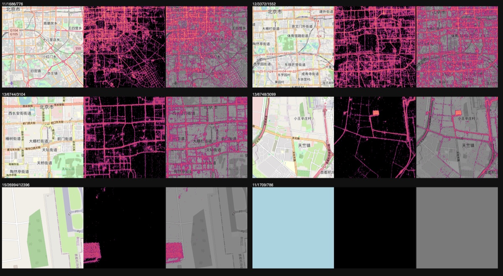

# Step 4: Tile drawing

## Summary

| | |
|---|---|
| **Built** | `render` (count the points in each of a tile's 256 × 256 pixels, color them on a log scale, encode a PNG with zlib) and the command `gpstiles render FILE.gpt Z X Y -o tile.png` |
| **Status** | approved (developer's go-ahead 2026-10-31) |
| **Date** | 2026-10-31 |
| **Agent(s)** | Claude Opus 5.5 main · Codex reviewer (gpt-6-astra, high effort) · Claude Opus 5.5 skeptic reviewer (separate agent) |

## Design
- **Count, color, encode.** A tile's points are one slice of the file (step 3b). Each point's pixel is the 8 bits of its world x and y just below the tile's own bits (a pixel at zoom z is 2^(24 − z) world units). The counts go into a 256 × 256 table.
- **One color scale per zoom.** A pixel with `count` points gets t = ln(count) / ln(max), where max is the header's densest pixel at that zoom (step 3a). So the same density has the same color on every tile, and a bright spot means the same thing everywhere (DESIGN §5.5). t runs through 5 color stops, from magenta (1 point) to pale yellow (the densest pixel). Empty pixels are fully transparent, so the base map shows through.
- **PNG by hand, compressed by zlib** (the one allowed dependency): signature, IHDR (256 × 256, 8-bit RGBA), one IDAT with the zlib stream of the rows (each row starts with filter byte 0), IEND, each chunk with its CRC.
- **`render` writes the same picture the server will send** (step 5a), to a temp file renamed into place, and prints `points=N bytes=M`.

| t = ln(count) / ln(max) | 0 (1 point) | 1/4 | 1/2 | 3/4 | 1 (densest) |
|---|---|---|---|---|---|
| Color | `#8c2981` magenta | `#b73779` pink | `#de4968` red | `#fe9f6d` orange | `#fcfdbf` pale yellow |
| T-Drive, zoom 11 (max 8,145) | 1 point | 9 points | 90 points | 857 points | 8,145 points |

## Files changed

| File | Change | Why |
|---|---|---|
| `src/render.h`, `src/render.c` | added | pixel counts, the color rule, the PNG writer, `render_tile` |
| `src/main.c` | changed | `render` command (refuses `-o` naming its input); `parse_tile` (zoom, x, y checks) now shared by `count` and `render` |
| `Makefile` | changed | link zlib (`-lz`) |
| `tests/unit/test_render.c` | added | 3 tests |
| `tests/e2e/test_render.py` | added | 5 tests |
| `tests/oracle/tile_rules.py` | added | the tile in plain Python: pixel counts, the color rule, a PNG decoder (chunks, CRCs, zlib, all 5 row filters) |
| `tests/data/check_tdrive.py` | changed | the real tile 11/1686/776 (1.8 million points) checked pixel by pixel |
| `tests/validate/step-4.sh` | added | the DESIGN §12.2 check: tiles beside OpenStreetMap |
| `docs/images/step-4-tiles.jpg` | added | the comparison picture below |
| `tests/unit/main.c`, `suites.h` | changed | run the render suite |
| `docs/TESTING.md` | changed | test list |

## Tests

| Test | Checks | Bug it would catch |
|---|---|---|
| `pixel_counts_of_a_hand_made_tile` | points put by hand in the 4 corner pixels of 10/843/388 (one inside its pixel, two on a pixel's last unit) and one just east of the tile → exact counts, nothing else lit · the next tile gets the eastern point · zoom 0 gets them all | x/y swapped, a pixel off by one, rows flipped, a point of the next tile drawn here |
| `colors_follow_the_log_scale` | t = 0, 1/4, 1/2, 3/4, 1 give exactly the 5 stops · empty → transparent · above max → top color · max 0 or 1 → no division by log(0) · 2^32 points with max 2^64 → t = 1/2 · exactly halfway between stops → halves round up · a tile outside the world → refused | a linear scale, stops out of order, rounding to even, an empty pixel drawn opaque, log(0), a bad tile drawn |
| `a_png_has_valid_chunks_and_every_pixel` | the PNG taken apart in C: signature, IHDR fields, 3 chunks with correct CRCs, the IDAT inflated with zlib to 256 × 1,025 bytes, filter byte 0, every pixel = `render_color` | a wrong CRC, length or IHDR field (browsers reject the tile), pixels shifted by the filter byte |
| `test_a_hand_made_tile_has_the_expected_pixels` | `render` on a file built by `build`; the PNG decoded by `tile_rules.py` (its own PNG reader); every pixel against Python's counts and color rule; the densest pixel is pale yellow, a single point magenta | the same bugs through the real command, and a PNG only our own reader accepts |
| `test_random_tiles_match_python_counts_and_colors` | 2,000 clustered points, tiles at zooms 0, 3, 9, 14, 18, 24: every pixel = Python | a wrong scale (not log, not per zoom, max from the tile), pixels merged or split |
| `test_an_empty_tile_is_fully_transparent` | an empty dataset and an empty tile → all 65,536 pixels (0, 0, 0, 0) | an empty tile drawn black, hiding the base map |
| `test_bad_arguments_and_files_are_refused` | 8 bad commands → exit 2 · a cut `.gpt`, a missing file, a missing output folder → exit 1 · no temp files left | a tile outside the world drawn, a broken file drawn from garbage |
| `test_a_failed_write_leaves_the_old_png_and_no_temp_file` | `-o` naming the input `.gpt` → exit 2, the dataset unchanged · `-o` naming a folder → exit 1 · a 100-byte file-size limit → exit 1, the old PNG unchanged, no temp file | the dataset replaced by a picture, a failed rename or write reported as success, a temp file left |
| `make check-data` | T-Drive tile 11/1686/776 (1,849,140 points): all 65,536 pixels = Python's counts (from the raw codes) and color rule | anything the small tests miss on real data |

```text
make check       unit 31 passed 0 failed · e2e 83 passed 0 failed · ALL PASSED (build)
make sanitize    unit 31 passed 0 failed · e2e 83 passed 0 failed · ALL PASSED (build/san)
make check-data  (import, build, info and count as in steps 2–3b), then:
                 check-data: render 11/1686/776: points=1849140 bytes=52467, all 65,536 pixels = Python's counts and colors (33,090 lit, densest pixel at zoom 11 = 8,145)
make verify      VERIFY PASSED, 3 min 18 s (step-0a 2 ok · 0b 7 ok · 1 2 ok · 2 3 ok · 3a 7 ok · 3b 3 ok · 4 7 ok)
--- tests/validate/step-4.sh
  ok  rendered: 11/1686/776 (points=1849140) 12/3372/1552 (points=1157176) 13/6744/3104 (points=290766) 13/6748/3099 (points=200235) 15/26994/12396 (points=54232) 11/1709/786 (points=0)
  ok  11-1686-776: 33,090 of 65,536 pixels lit
  ok  12-3372-1552: 38,032 of 65,536 pixels lit
  ok  13-6744-3104: 21,446 of 65,536 pixels lit
  ok  airport tile 13/6748/3099: 603 pixels in the upper half of the color scale
  ok  11/1709/786 (the sea east of Beijing): fully transparent
  ok  screenshot for a person to check: build/validate/step-4.png (all 6 OpenStreetMap tiles downloaded and checked)
```

## Review (Codex)

Run with `CODEX_BIN=<wrapper> tools/review.sh 4` (gpt-6-astra, high reasoning effort). Files in `.review/step-4/`.

| Round | Finding (severity, file:line) | What happened |
|---|---|---|
| 1 | Medium, `src/render.c:27`: pixel counts stopped at 2^32 − 1 while the header's max is 64-bit, so a pixel with 2^33 points got a wrong color (the design aims at billions of points) | Fixed: counts are 64-bit end to end (512 KB per tile being drawn). Tests at 2^32 and 2^33 points. Caught (R13) |
| 1 | Low, `tests/validate/step-4.sh:71`: the visual check passed even when the OpenStreetMap tiles failed to load | Fixed in round 2's form (below) |
| 2 | The 64-bit fix: "Fixed" | — |
| 2 | Low: the load check ran in a second Chrome session, so it could disagree with the screenshot | Fixed: the 6 reference tiles are downloaded first with `curl` and checked to be PNGs, and the page shows those files. Without the internet the picture is reported as SKIPPED (R14), never as ok |

Left for the developer to decide: none.

## Review (Claude skeptic, separate agent)

A second Claude Opus 5.5 agent with a fresh context, in its own copy. It checked the pixel math at every zoom 0–24 (388 tiles under the sanitizers, against a `.gpt` written by the Python oracle, not by `build`), compared the compiled color function with the Python one over 6.6 million (count, max) pairs (no differences), had macOS's own image reader decode the PNG, and failed each of the 10 large memory allocations in turn (each gives "out of memory", exit 1, no files).

| Round | Finding (severity, file:line) | What happened |
|---|---|---|
| 1 | Medium M1, `src/main.c` (`cmd_render`): `render data.gpt … -o data.gpt` replaced the dataset with the PNG and reported success | Fixed: refused like `import` and `build` do ("it is also the input file"). Test `test_a_failed_write_leaves_the_old_png_and_no_temp_file`. Caught (R9) |
| 1 | Low L1, `tests/validate/step-4.sh`: an old screenshot passed for a new one | Fixed: the old one is removed first, and a failing Chrome fails the script |
| 1 | Low L2, `src/render.c`: no guard against a zoom over 24 (undefined shift, a read past `max_pixel_count`); the step-5a server passes numbers from URLs | Fixed: `render_tile` refuses a tile outside the world (−1), and `render.h` states the rule. Caught (R10) |
| 1 | Test gap G1: nothing tested a render that fails after its temp file exists | Fixed: `-o` naming a folder (the rename fails), a 100-byte file-size limit (the write fails: exit 1, old PNG unchanged, no temp file). Caught (R12) |
| 1 | Test gap G2: "halves round up" never tested at an exact .5 | Fixed: count 8 with max 256 is exactly halfway between two stops → (203, 64, 113). Caught (R11: round-half-even gives 202, 112) |
| 2 | All five round-1 items: "fixed", each re-proven with its round-1 reproduction or mutant (`-o` as a hard link, symlink, `IN.GPT` or absolute path also refused) | — |
| 2 | Low N1: the y half of `render_tile`'s range check had no test | Fixed: a test for tile 3/0/8. Caught (R15) |
| 2 | Not counted: a leftover line in the unit test; `render_tile`'s −1 means "no such tile" or "out of memory", so the server must check tile numbers first | Removed; the step-5a server checks them before drawing |

Left for the developer to decide: none.

## Proof the tests catch bugs

Each break in a fresh scratch copy, `make check`:

| # | Deliberate break | Tests that failed |
|---|---|---|
| R1 | x and y swapped in the pixel | `pixel_counts_of_a_hand_made_tile` |
| R2 | pixels twice too big (shift off by one) | `pixel_counts_of_a_hand_made_tile` |
| R3 | a linear color scale instead of log | `colors_follow_the_log_scale` |
| R4 | empty pixels opaque black | `colors_follow_the_log_scale` |
| R5 | the IDAT CRC computed without its type | `a_png_has_valid_chunks_and_every_pixel` |
| R6 | rows marked "Sub" but not filtered | `a_png_has_valid_chunks_and_every_pixel` |
| R7 | the color scale from zoom 0's densest pixel | e2e `test_a_hand_made_tile…`, `test_random_tiles_match_python…` |
| R8 | counts not cleared before counting | `pixel_counts_of_a_hand_made_tile` |
| R9 | `-o` may name the input `.gpt` (M1 undone) | e2e `test_a_failed_write_leaves_the_old_png_and_no_temp_file` |
| R10 | `render_tile` draws a tile outside the world (L2 undone) | `colors_follow_the_log_scale` |
| R11 | halves rounded to even (`lrint`) | `colors_follow_the_log_scale` |
| R12 | a failed rename ignored | e2e `test_a_failed_write_leaves_the_old_png_and_no_temp_file` |
| R13 | counts cut to 32 bits when colored (Codex medium undone) | `colors_follow_the_log_scale` |
| R14 | the reference maps can't be downloaded (no internet) | `step-4.sh` reports "SKIPPED (the picture): only 0 of 6 OpenStreetMap tiles downloaded" instead of ok |
| R15 | `render_tile` doesn't check the tile's y | `colors_follow_the_log_scale` |

The code was restored exactly afterwards: yes (every break was in a deleted scratch copy).

## Validate it yourself

| Do this | Expected | Actual (agent's run) |
|---|---|---|
| `bash tests/validate/step-4.sh`, then open `build/validate/step-4.png` | each tile beside the same OpenStreetMap tile and on top of it: the heat lines sit on the roads | they do (picture below) |
| `build/gpstiles render data/build/tdrive.gpt 11 1686 776 -o /tmp/beijing.png && open /tmp/beijing.png` | central Beijing's road grid | `points=1849140 bytes=52968`, the grid |
| `build/gpstiles render data/build/tdrive.gpt 13 6748 3099 -o /tmp/airport.png && open /tmp/airport.png` | a bright (orange) block: the airport's taxi holding area | as expected |
| `build/gpstiles render data/build/tdrive.gpt 11 1709 786 -o /tmp/sea.png` | `points=0`, a fully transparent tile | `points=0` |



What the picture shows, row by row: central Beijing at zooms 11, 12 and 13, where every bright line is a road on the OpenStreetMap tile; the airport taxi area at zoom 13 (the orange block) and at zoom 15; and a tile of sea with no points, fully transparent.

## Deploy (from step 5b, after approval)

| Command | Smoke test | Rolled back? |
|---|---|---|
| none (deploy starts at step 5b) | | |

## Who did what

| Agent | Did |
|---|---|
| Claude Opus 5.5 (main) | code, tests, Python answers, breaks, validation, this file |
| Codex CLI gpt-6-astra (high effort) | review (read-only) |
| Claude Opus 5.5 skeptic (separate agent, own scratch copy) | adversarial review |

## Decisions
- **Colors: the bright half of the "magma" scale,** magenta → pink → red → orange → pale yellow. The first try started at dark purple (`#3b0f70`): at street level single points vanished on the dark base map of step 6. Starting at magenta keeps one point visible. Rejected: a fixed alpha ramp (a single point would be almost invisible).
- **t = ln(count) / ln(max), max = the header's densest pixel at that zoom** (DESIGN §5.5: the same density has the same color on every tile). At zooms 12–24 the max is 8,140, one spot where a taxi sat still; a busy road (tens of points per pixel) is then pink, not yellow. Rejected for now: a percentile instead of the max (it would change the header's meaning, DESIGN §9.3).
- **Halves round up** in the color interpolation, written in `render.h`, so the Python oracle matches the C byte for byte.
- **Counts are 64-bit** (Codex round 1): a pixel can hold billions of points and still get the right color. The count table is 512 KB per tile being drawn, on the heap (too big for a thread's stack).
- **Filter byte 0 and zlib's default level**: simplest valid PNG. A T-Drive tile is 20–55 KB. Rejected: per-row filters (smaller files, more code).
- **`parse_tile` shared** by `count` and `render`, so both check zoom, x and y the same way.

## Not verified
- No real tile with over 2^32 points in one pixel was drawn (the color rule is tested at 2^32 and 2^33 points).
- The visual comparison needs the internet for the OpenStreetMap tiles; without it the script says SKIPPED for the picture. The pixel checks don't need it.
- Big-endian machines.

## Next
- Step 5a: the web server sends these tiles at `/tiles/{id}/{z}/{x}/{y}.png`.
