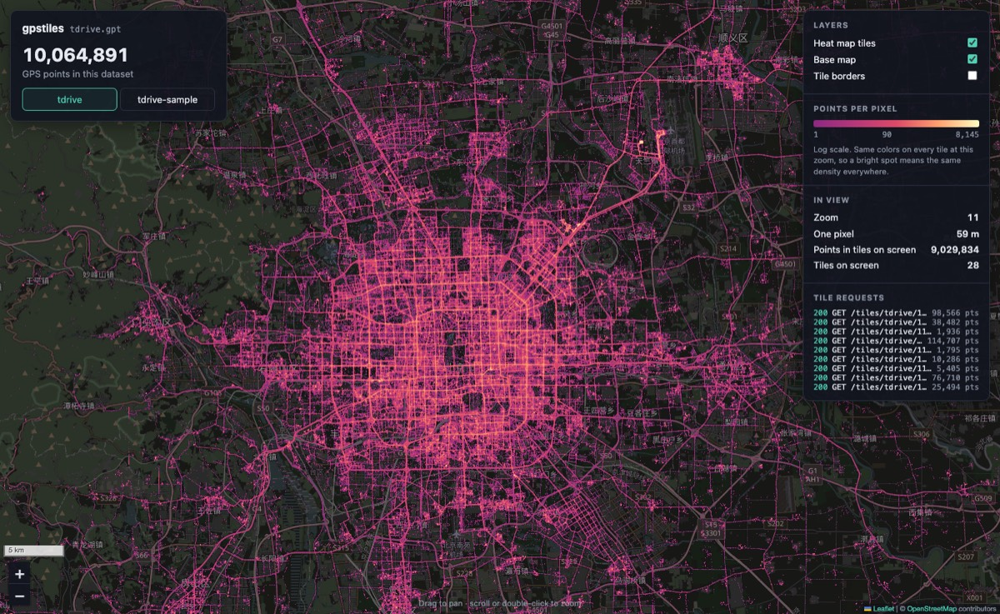

# Step 6: Map page

## Summary

| | |
|---|---|
| **Built** | The map page at `/`: a dark OpenStreetMap base map with the heat tiles on top, a color key per zoom, what's in view, the tile requests as they happen, and a dataset switch. Compiled into the program with Leaflet 1.9.4 |
| **Status** | approved (developer's go-ahead 2026-10-31) |
| **Date** | 2026-10-31 |
| **Agent(s)** | Claude Opus 5.5 main · Codex reviewer (gpt-6-astra, high effort) · Claude Opus 5.5 skeptic reviewer (separate agent) |

## Design
- **One program, no web folder to install.** `tools/embed.sh` turns `www/index.html`, `app.css`, `app.js` and Leaflet 1.9.4 into C arrays at build time (`build/gen/www.c`), and the server answers `/`, `/app.css`, `/app.js` and `/leaflet/…` from them. A deploy still copies one file.
- **Only the base map comes from the internet** (DESIGN §11.1). Leaflet is served by the program itself, pinned with its official integrity hashes, so a changed file is refused by the browser. The page's Content-Security-Policy lets the browser load scripts, styles and data only from this server, and images only from this server, `tile.openstreetmap.org`, and `blob:`/`data:` (below).
- **Heat tiles are fetched, not linked:** each tile is read with `fetch`, so the page can show each response's `X-Points` header in "Tile requests" and add them up under "In view", like the mockup. A tile is a `<div data-tile="z/x/y">` holding the picture, so "Tile borders" can label it; a tile Leaflet drops (pan, zoom, switch) cancels its request.
- **The address is the state:** `#tdrive/11/39.9500/116.4300` (dataset, zoom, center). A reload, a link or a typed address opens that view. The dataset switch moves the map to the new dataset's view box (DESIGN §9.3) first, without animation, and only then asks for that dataset's tiles.
- **The legend follows the zoom:** its labels are 1, √max and max, where max is the header's densest pixel at that zoom (`/api/datasets` sends all 25), the same scale the tiles use (step 4).



## Files changed

| File | Change | Why |
|---|---|---|
| `www/index.html`, `www/app.css`, `www/app.js` | added | the page: layout, panels, map, heat tiles, dataset switch, address state |
| `www/leaflet/leaflet.js`, `leaflet.css`, `LICENSE` | added | Leaflet 1.9.4, unchanged from the release (BSD 2-Clause); its hashes match the official ones |
| `tools/embed.sh` | added | `www/` files → C arrays |
| `src/www.h` | added | the compiled-in files |
| `src/server.c`, `server.h` | changed | `/`, `/app.css`, `/app.js`, `/leaflet/…` with their content types; the page's Content-Security-Policy |
| `Makefile` | changed | builds `build/gen/www.c` and links it |
| `tests/e2e/browser.py` | added | drives headless Chrome over its DevTools pipe, built-in Python modules only |
| `tests/e2e/test_page.py` | added | 2 tests |
| `tests/validate/step-6.sh` | added | the DESIGN §12.2 check in headless Chrome, with clicks and screenshots |
| `tools/review.sh` | changed | leaves `www/leaflet/` (minified, pinned by hash) out of the review diff |
| `docs/TESTING.md` | changed | test list |

Review the full change, new files included: `.review/step-6/round-K.diff` before commit, or `git show <commit>` after.

## Tests

| Test | Checks | Bug it would catch |
|---|---|---|
| `test_page.py`: page and Leaflet served with matching integrity hashes | `/` is HTML with the CSP; it names exactly 4 files; each has its content type; Leaflet's two files hash to the pinned values and say 1.9.4; `HEAD /` has no body; `/index.html` and `/leaflet/` are 404 | the page missing, Leaflet changed or not 1.9.4, JavaScript served as text, no CSP |
| `test_page.py`: Chrome shows the datasets, asks for exactly the tiles on the map, switches | headless Chrome (1200 × 800, internet blocked) on two tiny datasets: exactly the 25 tiles the OpenStreetMap tile formula gives for the view, each asked for once; count, file, zoom and tiles shown; X-Points added up (200); legend max; every request row; the three layer boxes clicked with the mouse; the switch clicked: count 1, only the other dataset's tiles, each one on the map; no script error, no blocked load | a switch that doesn't list the served files or doesn't change the map, tile URLs with a wrong id, zoom, x or y, tiles asked for a view the map doesn't show, X-Points not added up, a layer box that does nothing, a script error or a CSP block |
| `tests/validate/step-6.sh` | real T-Drive and tdrive-sample in headless Chrome with the real base map: counts against DESIGN §13 and awk, tile requests, a click on the switch, an address change to zoom 17, screenshots | (validation) |

```text
make check       unit 31 passed 0 failed · e2e 96 passed 0 failed · ALL PASSED (build)
make sanitize    unit 31 passed 0 failed · e2e 96 passed 0 failed · ALL PASSED (build/san)
make check-data  as in step 4 (import, build, info + count, render on all of T-Drive)
make verify      VERIFY PASSED, 6 min 57 s (step-0a … 5b as before · step-6 4 ok)
--- tests/validate/step-6.sh
  ok  #tdrive at zoom 11: shows 10,064,891 points (DESIGN §13), asked for exactly the 28 tiles on the map, points in them: 9,029,834; base map 28 tiles, https://tile.openstreetmap.org/11/1686/775.png among them
  ok  clicked tdrive-sample: shows 543,401 points (= awk over its 500 files), its 35 tile requests all /tiles/tdrive-sample/, each for a tile on the map, points in them: 542,662
  ok  zoom 17 near Tiananmen loaded (24,894 points in its tiles, base map 24 tiles); no script errors or blocked loads
  ok  screenshots for a person to check: build/validate/step-6.png, step-6-sample.png, step-6-street.png
```

## Review (Codex)

Run with `CODEX_BIN=<wrapper> tools/review.sh 6` (gpt-6-astra, high reasoning effort). Files in `.review/step-6/`. The review diff leaves out `www/leaflet/` (Leaflet as published, minified, pinned by hash).

| Round | Finding (severity, file:line) | What happened |
|---|---|---|
| 1 | Medium, `app.js:118`: turning the base map off and on put it over the heat (same pane, same z-index, later in the page) | Fixed: base map z-index 1, heat 2. The test checks the heat is on top after the toggle. Caught (W11) |
| 1 | Medium, `app.js:114`: an address like `#tdrive/11/39.95/1e20` froze the page (Leaflet's tile loop can't advance) | Fixed: the zoom is rounded into 0–24, the latitude kept inside the map, the longitude wrapped into −180..180. Four bad addresses tested. Caught (W12) |
| 1 | Medium, `app.js:70`: in a copy of the world (`…/476.43`) "Tiles on screen" and the points were 0 | Fixed: x wraps around, at most one world width of columns. Tested east of the antimeridian and at zoom 1 (several copies on screen). Caught (W13, W14) |
| 1 | Low, `test_page.py:90`: no Chrome counted as a pass | Fixed: a test returns `"SKIPPED: why"`, which `run.py` prints and counts apart (`N skipped`), never as passed. New runner test. Caught (W15) |
| 2 | Items 1–4: fixed (checked by reading and in-memory runs) | — |
| 2 | Medium, `deploy.sh:117`: the new page check would refuse a rollback to step 5b (no page at `/`), and call a restored 5b release broken after a failed deploy. This would have hit the real service: it runs 5b and becomes `previous` when step 6 deploys | Fixed: the page is checked only in a release whose program has it (the compiled-in page names `src="/app.js"`; the step-5b program doesn't). A stand-in from before the page deploys, is rolled back to and forward again (scenario 11c). Caught (P18, P19) |
| 2 | Low, `app.js:109`: 4 decimals in the address moved the view hundreds of pixels after a reload at zoom 24 | Fixed: as many decimals as the zoom needs to put the center back within a tenth of a pixel (5 at zoom 10, 10 at zoom 24). The test compares the center pixel before and after a reload at zoom 20. Caught (W26) |

Left for the developer to decide: none. The last fixes were not reviewed by Codex again (2-round limit); each is guarded by a test that a deliberate break showed failing.

## Review (Claude skeptic, separate agent)

A second Claude Opus 5.5 agent with a fresh context, in its own copy, with its own servers on free ports and headless Chrome (one view with the real base map). Reproduction scripts and screenshots: `scratchpad/reviews/step-6-claude-round1-repro/`. Round 1 reviewed the tree just before Codex's fixes, so findings 1, 3, 4 and 5 are the same bugs Codex found.

| Round | Finding (severity) | What happened |
|---|---|---|
| 1 | High 1: base map off and on hides the heat (real T-Drive: heat pixels 189,666 → 0) | Fixed with Codex's finding (z-index). Caught (W11) |
| 1 | Medium 2: the address was rewritten on every tile response (about 30 per view); Chrome ignores more than 200 in 10 s, so after a few zooms the address froze and a reload opened the wrong view | Fixed: the address is written only after a move, and only when it changes. The test zooms 10 times with the + button, then checks the address and a reload. Caught (W16) |
| 1 | Medium 3: "Tiles on screen" wrong in a copy of the world (12 shown, 18 on the map) | Fixed with Codex's finding. The test now compares "Tiles on screen" with the tiles that overlap the window, in five views. Caught (W13, W14) |
| 1 | Low 4: out-of-range numbers in the address froze the page, and a page error showed as "Can't load the dataset list" | Fixed with Codex's finding; only a failed dataset list now shows that message. Caught (W12, W21) |
| 1 | Low 5: one tile too many where a screen edge lies on a tile edge (20 vs 16) | Fixed: Leaflet's own range (`ceil − 1`). Tested with both far edges on tile edges. Caught (W24) |
| 1 | Low 6: with the heat layer off, the points shown were stale (0) | Fixed: "–" while the heat layer is off. Caught (W23) |
| 1 | Low 7: failed tile requests were silent | Fixed: an `ERR` row and "Tile requests fail: is the server running?". Tested by stopping the server. Caught (W22) |
| 1 | Low 8: the deploy smoke test never loaded the page | Fixed: it checks `/` is HTML with the CSP and names `/app.js`; a new stand-in without a page is refused in `make deploy-test`. Caught (P17) |
| 1 | Test gap (medium): the address, a reload and a typed address untested | Fixed: new test (10 zooms, reload, 4 typed addresses). Caught (W16, W17, W18) |
| 1 | Test gaps (low): the legend's middle label, "One pixel", the error panel, the tile count after the switch | Fixed: √200 at zoom 0, 40,075,016.686 × cos(lat) / 2^(z+8), a file server without `/api/datasets`, and the overlap check. Caught (W19, W20, W21) |
| 1 | Test gap (low): the Leaflet pin was checked against the page itself | Fixed: the published 1.9.4 hashes are written in the test. Caught (W25: Leaflet changed and the page's pin updated to match) |
| 1 | Test gap (low): `step-6.sh` passed with no base map | Fixed: it requires base tiles to show and checks the one under the center is OpenStreetMap's `11/1686/776`. Caught (V1: x and y swapped in the base map URL) |
| 1 | Test gap (low): screenshots taken while tiles fade in | Fixed: it waits until every tile has opacity 1 |
| 1 | Test gap (low): `browser.py` saw no console warnings, read errors before the last call, and lost requests past 250 | Fixed: console and browser warnings and errors are recorded (`problems()`, read last), and the request list holds 100,000 |
| 1 | Test gap (low): aborts and the dataset guard untested against slow tiles | Not fixed: each one alone keeps a stale count out; testing them needs a slowed server. Under "Not verified" |
| 1 | Unrelated: two old test leftovers in the system temp folder (77 MB) | Deleted (from a stopped run on Oct 30 and a killed test at 14:03) |
| 2 | Findings 1–8 and test gaps 1–6: fixed, each re-run with its round-1 reproduction (real base map: heat pixels 189,666 before and after base off/on; 18 wheel zooms, 18 address writes, none ignored; a reload at the same zoom) | — |
| 2 | Test gap 7 (aborts, the dataset guard; a CSP without `base-uri`, `form-action`, `frame-ancestors`) still passed | The three CSP rules are now tested (W28). Aborts and the guard: under "Not verified" |
| 2 | Low A: a rollback to step 5b would be refused (no page) | The same as Codex round 2's medium: fixed (P18, P19) |
| 2 | Low B: offline, `step-6.sh` failed where `step-4.sh` skips its picture | Fixed: without a single base tile it prints `SKIPPED (the base map's look)` and runs every other check; a CSP block still fails |
| 2 | Low C: `browser.py` dropped every failed network load, so the page's own 404s were invisible (shown with two) | Fixed: only the base map's tiles are dropped. A test fetches a missing file and expects the 404 reported. Caught (W27). It then showed the browser's own `/favicon.ico` 404 on every page: the page now declares no icon. Caught (W29) |
| 2 | Low D: a regressed address check would let a test Chrome allocate without limit | Fixed: test Chrome runs with a 512 MB JavaScript heap |

Left for the developer to decide: none.

## Proof the tests catch bugs

Each break in a fresh copy of the repo, then `make check` (or the named validation):

| # | Deliberate break | Test that failed |
|---|---|---|
| W1 | Leaflet changed by one word | both page tests (hash, and Chrome refuses the script) |
| W2 | no Content-Security-Policy on the page | `the_page_and_leaflet_are_served…` |
| W3 | tile URLs with x and y swapped | `chrome_shows_the_datasets…` |
| W4 | the switch lists only the first dataset | `chrome_shows_the_datasets…` |
| W5 | JavaScript served as `text/plain` | both |
| W6 | the switch adds the heat layer before the map moves | `chrome_shows_the_datasets…` (old-view tiles asked for) |
| W7 | CSP without `data:` images | both |
| W8 | points in view: only the last tile counted | `chrome_shows_the_datasets…` |
| W9 | the heat-map box does nothing | `chrome_shows_the_datasets…` |
| W10 | tile borders without their address | `chrome_shows_the_datasets…` |
| W11 | the heat layer without its z-index | `chrome_shows_the_datasets…` (base map over the heat) |
| W12 | the address's longitude used as it is | `chrome_shows_the_datasets…` (the page froze at 1e20) |
| W13 | tiles on screen clipped to the first copy of the world | `chrome_shows_the_datasets…` |
| W14 | no one-world limit on the columns (tiles counted per copy) | `chrome_shows_the_datasets…` |
| W15 | `run.py` counts a skipped test as passed | `a_skipped_test_is_counted_apart…` |
| W16 | the address rewritten on every tile response | `chrome_keeps_the_address_right…` |
| W17 | lat and lon swapped in the address | both Chrome tests |
| W18 | no `hashchange` listener | `chrome_keeps_the_address_right…` |
| W19 | the legend's middle label is max, not √max | `chrome_keeps_the_address_right…` |
| W20 | one pixel's size without the latitude | `chrome_shows_the_datasets…` |
| W21 | a failed dataset list shows nothing | `chrome_shows_when_the_dataset_list_or_the_tiles_fail` |
| W22 | failed tile requests are silent | `chrome_shows_when…` |
| W23 | points in view stale while the heat layer is off | `chrome_shows_the_datasets…` |
| W24 | `floor` instead of `ceil − 1` for the last tile | `chrome_shows_the_datasets…` (21 or 30 tiles, not 20) |
| W25 | Leaflet changed and the page's pin updated to match | `the_page_and_leaflet_are_served…` (published hash) |
| W26 | the address with 4 decimals at every zoom | `chrome_keeps_the_address_right…` (center moved after a reload) |
| W27 | `browser.py` drops every failed network load | `chrome_shows_when…` |
| W28 | the CSP without `frame-ancestors` | `the_page_and_leaflet_are_served…` |
| W29 | no icon declared (`/favicon.ico` 404s) | both Chrome tests that read the page's problems (the 404 is reported) |
| V1 | the base map's URL with x and y swapped | `tests/validate/step-6.sh` (the base tile under the center isn't OpenStreetMap's) |
| V2 | no `hashchange` listener | `tests/validate/step-6.sh` (the zoom-17 address does nothing) |
| P17 | the deploy smoke test doesn't check what `/` answers | `make deploy-test`: "the wrong-page program wasn't caught" |
| P18 | every release taken to have the page | `make deploy-test`: "a release without the page was refused" |
| P19 | no release taken to have the page | `make deploy-test`: "the no-page program wasn't caught" |

The code was restored exactly afterwards: yes (every break was made in a deleted scratch copy).

## Validate it yourself

| Do this | Expected | Actual (agent's run) |
|---|---|---|
| `tests/validate/step-6.sh` | 4 `ok` lines; screenshots in `build/validate/` | 4 `ok`: 10,064,891 points (DESIGN §13), the 28 tiles on the map asked for once, base tile `11/1686/775` shown; after the click 543,401 (awk), 35 requests all `/tiles/tdrive-sample/`; zoom 17 loaded with no problems |
| open http://127.0.0.1:8080/ (after the deploy) | the page as in the picture above; T-Drive at its view box | see Deploy |
| click **tdrive-sample** | 543,401 points; the map redraws with fewer points | as in `step-6.sh` |
| zoom in near Tiananmen to zoom 17 | single points along the streets | `build/validate/step-6-street.png` |
| tick **Tile borders** | each heat tile outlined, its `z/x/y` in the corner | as in the test |
| reload the page | the same dataset, zoom and place | as in the test |

## Deploy (after approval)

Step 5b's deploy, done after its commit (`e46af4d`), with `~/.local/gpstiles/datasets.conf` listing `data/build/tdrive.gpt` and `data/build/tdrive-sample.gpt`:

| Command | Smoke test | Rolled back? |
|---|---|---|
| `make deploy` (17 s, `make check` included) | green: 2 datasets listed and drawn, bad URL → 404, launchd's pid 55018 listening on 127.0.0.1:8080 | no |
| `make status` | loaded, pid 55018, `current: releases/e46af4d-20261031151243`, answering | — |
| `footprint 55018` (macOS) | 3 MB of its own memory; the other ~83 MB of its RSS are the mapped `.gpt` files, which macOS can drop | — |

Step 6's own deploy follows this commit; its result is in step 7's file.

## Who did what

| Agent | Did |
|---|---|
| Claude Opus 5.5 (main) | page, embedding, server routes, browser driver, tests, breaks, validation, screenshots, this file |
| Codex CLI gpt-6-astra (high effort) | review (read-only) |
| Claude Opus 5.5 skeptic (separate agent, own copy) | adversarial review |

## Decisions
- **Base map: OpenStreetMap's standard tiles, darkened by a CSS filter** (PROGRESS "Open decisions"). CARTO's dark tiles need an account, which we may not create. OSM needs no key; the page shows its attribution, and use stays light and interactive, as OSM's tile policy asks. The tests block the internet, so they never fetch OSM tiles; only `step-6.sh`'s three screenshots do (about 100 tiles a run). **For the developer to confirm** (another tile server is a one-line change in `www/app.js` plus the CSP).
- **`img-src` allows `data:`:** Leaflet cancels a base-map tile's download by pointing it at a built-in `data:` image; without `data:` every pan logged errors (found by the new test). `data:` images can't run code.
- **The tests drive Chrome themselves** (`browser.py`, the DevTools pipe) rather than with Playwright or Selenium: TESTING §4 allows no installs. Without Chrome the Chrome test returns early and is listed under "Not verified".
- **Proposed (TESTING §2):** the level 3–4 time budgets (under 5 s each) were already passed by step 5a's slow-client and memory tests; `make check` takes about 17 s and `make sanitize` about 23 s. Proposed budget: `make check` under 30 s, `make sanitize` under 60 s. Not applied without approval.

## Not verified
- Browsers other than Chrome (Safari, Firefox).
- The base map's look depends on OpenStreetMap's servers. Offline, the page shows the heat tiles on a plain dark background (that is how the tests run).
- Small screens: below 700 px wide the side panel hides (CSS only, not tested).
- Very long sessions: the page keeps each seen tile's point count until the next switch (a few bytes a tile).
- Slow tile answers: a tile that Leaflet drops cancels its request, and a late answer for another dataset is not counted; each alone keeps a stale count out, and neither is tested against a slowed server (skeptic test gap 7).
- The 512 MB JavaScript limit for test Chrome only matters if a page runs away; no test makes one.
- Offline, `step-6.sh` skips the base map's look (it says SKIPPED); this Mac was online.

## Next
- Step 7: the area count API, hover counts and the box tool on the page.
