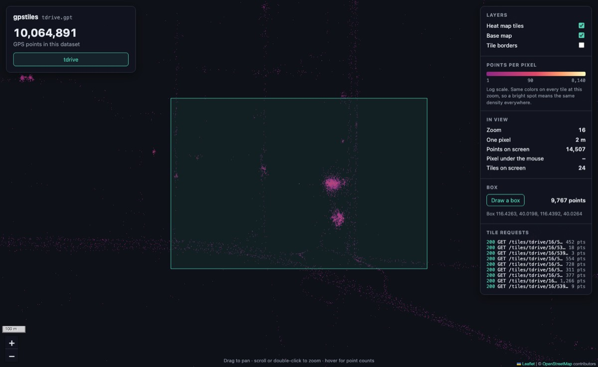

# Step 7: Area count + API

## Summary

| | |
|---|---|
| **Built** | `area` (the exact number of points in any box, in milliseconds) · `GET /api/datasets/{id}/count?bbox=w,s,e,n` · on the page: a "Draw a box" tool with the exact count, the count of the pixel under the mouse, and the exact points on screen |
| **Status** | approved (developer's go-ahead 2026-10-31) |
| **Date** | 2026-10-31 |
| **Agent(s)** | Claude Opus 5.5 main · Codex reviewer (gpt-6-astra, high effort) · Claude Opus 5.5 skeptic reviewer (separate agent) |

## Design
- **Cover the box with Z-order squares** (DESIGN §5.6, §7.2). Start with the whole world. A square outside the box adds nothing; a square fully inside adds its slice length (two binary searches, no point read); a square on the box's edge is split in 4 until its slice has at most 64 points, which are then checked one by one. Only squares along the edge are opened, so a box over 10 million points costs a few thousand binary searches.
- **The box rule is DESIGN §9.2's:** `bbox=west,south,east,north` in degrees, turned into world units with the points' own formulas (§9.4); a point counts if x0 ≤ x ≤ x1 and y0 ≤ y ≤ y1, edges included, so a box may be a line or a single point (§7.2's diagram says "west < east"; §9.2's rule, which only refuses west > east, is the one followed). Longitude 180 as an east edge is the world's last unit. Refused with 400: not four plain numbers, outside the map, west > east, south > north, NaN, infinity, a parameter other than `bbox`, or `bbox` twice. `%2C` is read as a comma (some HTTP libraries send it).
- **Hover is the same count for exactly the pixel under the mouse:** the pixel comes from the mouse's place on the map's pixel grid (whole numbers, no round trip through degrees), and the page sends that pixel's own world units, from its first to its last, 9 decimals (a world unit is 8.4 × 10⁻⁸°). So the number shown is the count step 4 colored that pixel by. Asked when the mouse rests 100 ms.
- **"Points on screen" is now exact:** the count of the view, instead of step 6's sum over whole tiles. A view across the 180° line is asked as two boxes (the API takes none across it), a view wider than the world as the whole world, and latitudes stop at ±85.051128779 (85.05112877980659 written with 9 decimals would round past the map's edge).
- **Box tool:** "Draw a box", drag on the map, and the exact count of the box appears in the side panel with its corners. Escape stops drawing; a switch of dataset clears the box.

| Request | Answer |
|---|---|
| `GET /api/datasets/tdrive/count?bbox=116.55,40.03,116.65,40.10` | `{"id":"tdrive","count":239864}` |
| `…/count?bbox=2,0,1,1` (west > east) | 400 `bbox must have west <= east and south <= north (no boxes across the 180 line)` |
| `…/count` (no bbox) | 400 `bbox=west,south,east,north is required` |



## Files changed

| File | Change | Why |
|---|---|---|
| `src/area.c`, `src/area.h` | added | the bbox parser, the square walk: counts, and the points for step 8's export |
| `src/server.c`, `src/server.h` | changed | the count route; query parsing (`%XX`, known parameters) |
| `www/app.js`, `index.html`, `app.css` | changed | exact points on screen, hover count, box tool |
| `tests/unit/test_area.c`, `main.c`, `suites.h` | added / changed | 600 random boxes against a slow check; the parser |
| `tests/oracle/box_rules.py` | added | the box rule in plain Python, apart from `area.c` |
| `tests/e2e/test_area.py` | added | the API against slow counts; bad boxes; hover and a dragged box in Chrome |
| `tests/e2e/test_page.py` | changed | "points on screen" is now the exact count |
| `tests/validate/step-7.sh` | added | DESIGN §12.2's check on T-Drive, in the page |
| `tools/deploy.sh`, `tools/deploy-test.sh` | changed | found deploying step 6: launchd sometimes refuses a bootstrap right after a bootout; it is now tried up to 5 times |
| `docs/TESTING.md` | changed | test list |

## Tests

| Test | Checks | Bug it would catch |
|---|---|---|
| `test_area.c`: box count and points equal a slow check | 600 random boxes of 4 kinds (any size, exactly one square, edges through points, pixel-sized) over 4,000 clustered points with repeats: count, points, their order, a row limit, a receiver that stops | a point on a box or square edge lost or counted twice, an edge square counted whole, rows out of order or past the limit |
| `test_area.c`: bbox text | the whole world, a normal box, a single point; 20 bad strings refused with a reason | west > east, NaN, infinity or an out-of-range box accepted; north and south swapped; longitude 180 as an east edge wrapping to x = 0 |
| `test_area.py`: box counts equal the slow count | 60 boxes over HTTP vs `box_rules.py`; the text is checked to mean exactly the box | edge errors through the real server |
| `test_area.py`: a hovered pixel | 40 pixel boxes at zooms 0–24, as the page sends them | the hover count disagreeing with the pixel's points |
| `test_area.py`: bad boxes refused | 17 bad `bbox` values and 5 bad queries → 400; unknown dataset → 404; `%2C` | a wrong count instead of an error |
| `test_area.py`: Chrome hover and a dragged box | the mouse on 4 pixels (5 points with one on the pixel's last unit, 1 point on the next pixel's first unit, 37, 0); a box dragged with the mouse: the bbox sent matches the drag, the count = the slow count; no page problems | a hover for the wrong pixel or a pixel-and-a-bit, a box counted for another box, points on screen not exact |
| `tests/validate/step-7.sh` | real T-Drive: the API box around the airport; in the page, the busiest zoom-16 pixel and an empty one hovered, a 600 × 400 px box dragged; each vs Python's slow count of the points near it | (validation) |

```text
make check       unit 33 passed 0 failed · e2e 103 passed 0 failed · ALL PASSED (build)
make sanitize    unit 33 passed 0 failed · e2e 103 passed 0 failed · ALL PASSED (build/san)
make check-data  as in step 4 (import, build, info + count, render on all of T-Drive)
make verify      VERIFY PASSED, 8 min 5 s (step-0a … 6 as before · step-5b now 21 deploy scenarios · step-7 4 ok)
--- tests/validate/step-7.sh
  ok  API: a box around the airport taxi area: bbox=116.55,40.03,116.65,40.10 → 239,864 points = Python's slow count
  ok  page: hovered pixel in an empty field (zoom 16) → '0 points' = Python's slow count of that pixel
  ok  page: hovered pixel the busiest at zoom 16 → '1,765 points' = Python's slow count of that pixel
  ok  page: a box drawn with the mouse, bbox=116.426281929,40.019809323,116.439156532,40.026382110 → 9,767 points = Python's slow count
```

## Review (Codex)

Run with `CODEX_BIN=<wrapper> tools/review.sh 7` (gpt-6-astra, high reasoning effort). Files in `.review/step-7/`.

| Round | Finding (severity, file:line) | What happened |
|---|---|---|
| 1 | Medium, `app.js:183`: clearing a box didn't drop its count still on the way, so a slow answer refilled a cleared box (after a switch, or a new box) | Fixed: clearing a box drops answers still on their way. Tested with the page's `fetch` slowed by 600 ms and a switch before the answer. Caught (A12) |
| 1 | Medium, `app.js:162`: the hover count stayed from before a zoom when the mouse didn't move | Fixed: a move clears the count and drops answers on the way; when it ends, the pixel now under the mouse is asked. Tested with a zoom under a still mouse. Caught (A13) |
| 1 | Medium, `app.js:159`: hovering the empty map above or below the world counted the edge row; a box wholly above the world counted an edge strip | Fixed: no pixel there ("–"), and a box wholly outside counts 0 ("The box is outside the map."). Tested at zoom 1 with a point on the world's top edge. Caught (A14, A15) |
| 1 | Low, `app.js:199`: a drag let go outside the map (over the side panel, outside the window) left drawing on | Fixed: the drag follows the mouse and ends wherever the button is let go; Escape or leaving the window drops a half-drawn box. Tested by letting go over the side panel. Caught (A16) |
| 1 | Low, `area.c:40`: longitude 180 as a box edge is the world's last unit (2³² − 1), not §9.4's x = 0 for points, and the oracle repeats the rule | Kept, on purpose: with x = 0, `-180,…,180,…` (the whole world) would be a sliver at −180. Now pinned by a test with points at x = 0 and x = 2³² − 1 (`-180,…,-180,…` finds only the first, `180,…,180,…` only the second), and proposed for DESIGN §9.2 under Decisions |
| 2 | Items 1–4: fixed (checked in memory) | — |
| 2 | Low: item 5 partly fixed: the test pins the behavior, but DESIGN still reads as x = 0 | Left for the developer: the proposed §9.2 wording is under Decisions |

Left for the developer to decide: the longitude-180 box edge wording for DESIGN §9.2 (Decisions).

## Review (Claude skeptic, separate agent)

A second Claude Opus 5.5 agent with a fresh context, in its own copy, with its own servers on free ports, headless Chrome, one `make deploy-test` under its own label, and C harnesses for the area walk. Scripts: `scratchpad/reviews/step-7-claude-round1-scripts/`. It re-synced once mid-review to take in Codex's round-1 fixes.

| Round | Finding (severity) | What happened |
|---|---|---|
| 1 | Medium 1: "Points on screen" counted one world unit past each screen edge (the view box ran from corner to corner, like the old hover box). On T-Drive at zoom 24, 1,765 stacked points just left of or below the screen showed as on it | Fixed: the view is built from the pixels on screen, in whole world units, each edge in the middle of its unit; wrapped, split at 180°, the whole width when wider than the world. Tested with points 1 unit inside and outside every edge at zooms 16 and 24. Caught (A17) |
| 1 | Low 2: a click with "Draw a box" on (no drag) counted an invisible box and ended drawing | Fixed: a release within 3 px of the press makes no box and keeps drawing. Caught (A22) |
| 1 | Low 3: a bbox given twice, too long, with `%00` or a broken `%XX` was answered "bbox … is required" | Fixed: its own message for each. Caught (A23) |
| 1 | Low 4: the parser's length limits (a number under 64 characters, the bbox under 128) weren't in the oracle | Fixed: `box_rules.py` has them; a 73-character number and a 130-character bbox are tested on both |
| 1 | Low 5: the unit test's "hover" box was the old one (the next pixel's first unit) | Fixed: the pixel's own units |
| 1 | Low 6: the deploy comment claimed a cause the experiments didn't show, and a bootstrap that errs but loads the job would be tried again (and fail) | Fixed: the comment says the cause wasn't found; a job that loaded anyway counts. A second fake `launchctl` tests it (scenario 11e). Caught (P21) |
| 1 | Test gaps: a view across 180° counted on one side, a hover in a copy of the world, an old view count shown over a newer one, no debounce on hover | Fixed: all in the new edge test (a view straddling 180°, a hover one world east, a slow first answer, at most 2 requests for a 20-step move). Caught (A18–A21) |
| 1 | Checked and fine: 900,000 adversarial boxes = slow count (also under ASan + UBSan); worst box on T-Drive 1.2 ms; recursion at most 33 deep; the hover box exact for 8,050 pixels at zooms 0–24; 300 counts at once | — |
| 1 | Unrelated: a `gpstiles serve` left running from the builder's hand check (`kill %1` doesn't reach it outside an interactive shell) | Stopped |
| 2 | Findings 1, 2, 3, 5: fixed, each re-run (views with probes: 0 of 24 wrong, was 22; T-Drive at zoom 24 with the 1,765-point unit just outside each edge: 0 = 0 on all four sides) | — |
| 2 | Finding 4 partly: the limits and the 180° edge rule aren't written in DESIGN | Proposed under Decisions (DESIGN is changed only with approval) |
| 2 | Finding 6 partly: the wait for the old job to unload was untested | Fixed: a third fake `launchctl` keeps the old job 1.5 s after the bootout; the deploy must make exactly one bootstrap (scenario 11f). Caught (P22) |
| 2 | Low N1: after a failed bootstrap, `loaded` couldn't tell the old job from the new one (shown with a stub where the old job lingers 8 s: restart "succeeded" and the service went down) | Fixed: if the old job is still there after 5 s, the restart stops with that message, so a loaded job after a failed bootstrap can only be the new one |
| 2 | Test gap: a drawn box across 180° untested (the view no longer uses that code) | Fixed: a box drawn across the 180° line at zoom 3 counts the points on both sides. Caught (A24) |

Left for the developer to decide: the DESIGN §9.2 wording under Decisions.

## Proof the tests catch bugs

Each break in a fresh copy of the repo, then `make check` (or the named validation):

| # | Deliberate break | Test that failed |
|---|---|---|
| A1 | an edge square counted whole (inside test off by one) | `make check` crashed in the unit tests (the test's point buffer overran); the buffer is now bounded, so the counts fail instead |
| A2 | longitude 180 as an east edge wraps to x = 0 | `bbox_text_is_checked_and_turned_into_world_units` |
| A3 | north and south swapped | `bbox_text_is_checked…` |
| A4 | west > east accepted | `bbox_text_is_checked…` |
| A5 | `%2C` not decoded | `test_bad_boxes_are_refused` |
| A6 | a small edge square's points not checked one by one | `box_count_and_points_equal_a_slow_check…` |
| A7 | the hover box reaches into the next pixel's first unit | `chrome_hover_and_a_drawn_box…` |
| A8 | the hover pixel found through degrees (a round trip) | `chrome_hover_and_a_drawn_box…` (one pixel off at the corner) |
| A9 | latitudes clamped to MAX_LAT (rounds past the edge) | two `test_page.py` Chrome tests (zoom 0 and 1 answered "–") |
| A10 | a view across 180° counted on one side | `chrome_shows_the_datasets…` |
| A11 | the box tool counts the view, not the drawn box | `chrome_hover_and_a_drawn_box…` |
| A12 | a cleared box takes a late answer | `chrome_hover_and_box_counts_stay_right…` |
| A13 | the hover not asked again after the map moves | `chrome_hover_and_box_counts_stay_right…` |
| A14 | a hover above the world counted as the edge row | `chrome_hover_and_box_counts_stay_right…` |
| A15 | a box above the world counted as an edge strip | `chrome_hover_and_box_counts_stay_right…` |
| A16 | a drag let go over the side panel never ends | `chrome_hover_and_box_counts_stay_right…` |
| A17 | points on screen from the view's corners | `chrome_points_on_screen_is_exact_at_the_edges…` |
| A18 | a view across 180°: only its western part | `chrome_points_on_screen…`, `chrome_shows_the_datasets…` |
| A19 | a hover in a copy of the world not wrapped | `chrome_points_on_screen…` |
| A20 | an old view count shown over a newer one | `chrome_points_on_screen…` |
| A21 | hover asked on every mouse move | `chrome_points_on_screen…` |
| A22 | a click without a drag counted as a box | `chrome_points_on_screen…` |
| A23 | bbox given twice reported as missing | `test_bad_boxes_are_refused` |
| P20 | one bootstrap try (no wait, no retry) | `make deploy-test` (scenario 11d) |
| P21 | a bootstrap that loaded the job anyway is tried again | `make deploy-test` (scenario 11e) |
| A24 | a drawn box across 180° counted on its east side only | `chrome_points_on_screen…` |
| P22 | no wait for the old job to go | `make deploy-test` (scenario 11f: the deploy took the lingering old job for the new one) |

The code was restored exactly afterwards: yes (every break was made in a deleted scratch copy).

## Validate it yourself

| Do this | Expected | Actual (agent's run) |
|---|---|---|
| `tests/validate/step-7.sh` | 4 `ok` lines | 4 `ok`: the airport box 239,864 = Python; hovered pixels 0 and 1,765 = Python; a dragged box 9,767 = Python |
| open http://127.0.0.1:8080/, hover the map | "Pixel under the mouse": the points in that pixel | see Deploy |
| click **Draw a box**, drag on the map | the box, its corners, and "N points" | see Deploy |
| `curl 'http://127.0.0.1:8080/api/datasets/tdrive/count?bbox=116.55,40.03,116.65,40.10'` | `{"id":"tdrive","count":239864}` | `239864` (the same box in `step-7.sh`) |

## Deploy (after approval)

Step 6's deploy, done after its commit (`faf6879`):

| Command | Smoke test | Rolled back? |
|---|---|---|
| `make deploy`, 1st try | the restart failed: `Bootstrap failed: 5: Input/output error` | yes, automatically, to step 5b; its smoke test passed as "no map page (a release from before step 6)" (Codex round 2's fix at work) |
| `make deploy`, 2nd try | the same error | yes, the same |
| `bash tools/deploy.sh deploy` (traced) | green: the map page, 2 datasets, pid 80452 | no |
| `make status`; `curl /` | `current: releases/e68e36f-…`, `previous: releases/e46af4d-…`, answering; `/` is `text/html` | — |
| `footprint 80452` | 3 MB of its own memory | — |

The two failures led to the retry in this step (Decisions). Step 7's own deploy follows this commit; its result is in step 8's file.

## Who did what

| Agent | Did |
|---|---|
| Claude Opus 5.5 (main) | area module, route, page, tests, breaks, validation, deploy fix, this file |
| Codex CLI gpt-6-astra (high effort) | review (read-only) |
| Claude Opus 5.5 skeptic (separate agent, own copy) | adversarial review |

## Decisions
- **Exact pixel boxes for hover** (not the pixel's corner to the next pixel's corner): the hover number is then the count step 4 colored the pixel by.
- **Views across the 180° line are two boxes, added up;** a drawn box across it is counted the same way (the API itself still refuses boxes across it, DESIGN §9.2).
- **Proposed for DESIGN §9.2 (not applied without approval):** add the limits: "bbox at most 127 characters after %XX decoding, each number at most 63", and to the box rule: "Longitude 180 as a box edge is the world's east edge, the last unit (x = 2³² − 1); a point at 180 is stored at x = 0 (§9.4), with −180, so boxes that include −180 find it."
- **Deploy (step 5b's script):** after a bootout, wait for the job to go and try the bootstrap up to 5 times, a second apart. Found when 2 of 3 real deploys of step 6 failed with launchd's error 5; both were rolled back automatically, the third went live.

## Not verified
- The cause of launchd's error 5 after a bootout: not found. Quick bootout-bootstrap runs by hand never failed; the retry and the checks around it are tested with fake `launchctl`s.
- A drawn box sends its corners in degrees (9 decimals), so a corner exactly on a pixel edge may take in that edge's unit on either side; the count is always the API's exact count for the box sent (the view and the hover are exact to the unit).
- Browsers other than Chrome.

## Next
- Step 8: export the points of a box as CSV, and the page's export link.
