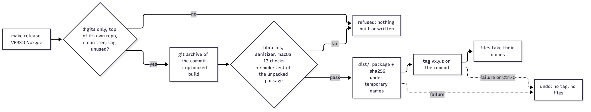
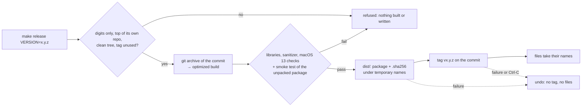

# Step 9: Stage 1 report and release

## Summary

| | |
|---|---|
| **Built** | `gpstiles bench` (tile drawing speed per zoom) · `README.md` · `make release-test` (a package in `build/`, no tag) and `make release VERSION=x.y.z` (a package and `.sha256` in `dist/`, a local tag; nothing is uploaded) · this report: stage 1's numbers and every stage 1 check ticked |
| **Status** | approved (developer's go-ahead 2026-10-31) |
| **Date** | 2026-10-31 |
| **Agent(s)** | Claude Opus 5.5 main · Codex reviewer (gpt-6-astra, high effort) · Claude Opus 5.5 skeptic reviewer (separate agent) |

## Stage 1 in numbers (T-Drive, this Mac)

Measured by `tests/validate/step-9.sh` in the final `make verify`: a fresh import and build from the raw files (`/usr/bin/time -l`), then `gpstiles bench`: at each zoom, 100 renders of the tiles under points spread evenly through the file, so busy places count more, as a map user's requests would.

| What | Result |
|---|---|
| Raw data | 8,911 files, 10,088,351 rows |
| `import` (all 8,911 files) | 1.83 s, peak memory 2 MB (the files already in the disk cache) |
| `build` (sort + save) | 0.96 s, peak memory 80 MB, 1 sorted run (the files already in the disk cache) |
| The `.gpt` file | 80,519,384 bytes: 10,064,891 points × 8 bytes + a 256-byte header |
| The service at rest | 2.6 MB of its own memory (`footprint`: 2,608 KB) and 0 % CPU, an hour after its deploy; its resident size, about 100 MB, is mostly the two mapped `.gpt` files, pages the system can drop |

Drawing one tile (`render`, the server's own drawing, without HTTP), milliseconds:

| Zoom | Distinct tiles timed | p50 | p99 | max | Points a render |
|---|---|---|---|---|---|
| 0 (the whole world) | 1 | 20.24 | 20.73 | 23.23 | 10,064,891 |
| 5 | 2 | 20.85 | 39.67 | 39.78 | 9,945,389 |
| 10 | 15 | 9.10 | 11.50 | 11.59 | 2,032,506 |
| 11 (Beijing on one screen) | 27 | 8.25 | 11.56 | 11.62 | 1,335,393 |
| 13 | 69 | 3.83 | 7.26 | 7.71 | 154,527 |
| 15 | 100 | 1.56 | 3.79 | 4.13 | 12,279 |
| 18 (streets) | 100 | 0.59 | 1.13 | 1.96 | 826 |
| 24 (the deepest) | 100 | 0.53 | 0.54 | 0.56 | 6 |

The time grows with the points in a tile, but not in a straight line. The whole world in one tile (10 million points) takes 20 ms, about 2 ns a point. A street tile at zoom 18 (826 points on average) takes 0.6 ms, close to what every tile costs however empty it is (6 points at zoom 24: 0.53 ms). The city at zooms 10–13 (0.15–2.0 million points a render on average) sits in between: p50 3.8–9.1 ms. At zooms 0–7 the 100 renders are the same 1 or 2 tiles, so p99 there is one tile's variation: zoom 5's 39.7 ms (21.1 ms in the run before) is the same 2 tiles now and then drawn at half speed, timing noise on a Mac doing other work, not a slow tile.

Through the running service (step 8's deploy, `curl`, 11 requests each, median): the whole world (`0/0/0`, 10,064,891 points) 20.8 ms, against 20.2 ms for the drawing alone; the zoom-11 tile over central Beijing (`11/1686/776`, 1,849,140 points) 10.0 ms; a zoom-15 tile in central Beijing (`15/26985/12413`, 20,903 points) 3.1 ms.

## Every stage 1 check (DESIGN §12.2)

Each line's validation runs again in every `make verify` (`tests/validate/step-N.sh`); the step files have the reviews and deliberate breaks.

| Step | DESIGN: how you can tell it worked | Ticked: what showed it | Commit |
|---|---|---|---|
| 0a Set up | builds; a failing test makes `make check` fail | `step-0a.sh`: the failing test makes `make check` exit non-zero and prints its `catches:` line | `673c69b` |
| 0b Loop tools | a failing test is caught by every guard · Codex returns a review | `step-0b.sh`: the Stop hook blocks, the commit is refused, `make verify` is red; Codex reviewed every step from 0b on (`.review/`) | `02480bd` |
| 1 Map math | central Beijing → a square; that square on OpenStreetMap shows central Beijing | `gpstiles where 116.391 39.907 --zoom 10` → `10/843/388`, shown on OpenStreetMap in `docs/images/step-1-where-on-osm.png` | `1e102a6` |
| 2 Read the raw data | 10,088,351 read · 23,357 at 0,0 · 103 impossible · 10,064,891 kept | `make check-data`: the import's counts = awk's = DESIGN §13 (and again above) | `9db2550` |
| 3a Sort and save | builds with lots and little memory identical · Python's sort matches · no temp files | `step-3a.sh`: default `--mem` and `--mem 1M` byte-identical, the points = Python's sort, peak memory below `--mem` + 16 MiB, nothing left | `08b30ae` |
| 3b Read the saved file | 10,064,891 points · a square = its 4 children · Python's slow count agrees | `make check-data`: `info`, children summing to the parent, the count = Python's | `47c1a2e` |
| 4 Draw a square | the bright lines sit on the real roads | `step-4.sh`: the tiles beside OpenStreetMap's (`docs/images/step-4-tiles.jpg`), pixels = Python's | `556fc61` |
| 5a Web server | a tile's address shows it · both datasets with their own counts · bad addresses → errors, the server keeps running | `step-5a.sh`: each dataset's tile = Python's pixel by pixel, counts = awk, bad URLs answered while it keeps serving | `0e6b17f` |
| 5b Local deploy | a test install answers, a broken version is rolled back, it survives a restart · `make deploy` → 127.0.0.1:8080 | `step-5b.sh` (`make deploy-test`, 21 scenarios); the real deploys of steps 5b–8 (each step file) | `958bdb1` |
| 6 Map page | looks like the mockup · ring roads, airport, street points · the switch changes the map | `step-6.sh`: headless Chrome, counts = DESIGN §13 and awk, a click on the switch; `docs/images/step-6-page.jpg` | `eb9088b` |
| 7 Count an area | a slow count gives the same number, for a drawn box and a hovered pixel | `step-7.sh`: the page's hover and a dragged box = Python's slow count on T-Drive | `5db12b0` |
| 8 Download an area | opens in Excel or Numbers · rows = box count · every point inside | `step-8.sh`: rows = the count = Python's points, inside the box as plain numbers; the page's Export link downloads them. Opening in Numbers by hand: not done by the agent (Python's csv reader instead) | `765ad07` |
| 9 Report + release | a table of build time and tile speed · the package runs on its own · every check ticked | this file: the tables above; `step-9.sh`: `make release-test`'s unpacked package passes its smoke test on its own, no tag, nothing in `dist/`, and a real `make release` in a throwaway repo; `make release VERSION=0.1.0` itself runs after this commit (`PROGRESS.md`) | this commit |

## Design
- **`gpstiles bench FILE.gpt`** renders the tiles under 100 points spread evenly through the file at each zoom 0–24 (so busy places count more, as a map user's requests would) and prints p50, p99 and max in milliseconds. It measures drawing only (count, color, PNG), one tile at a time, with the file already in memory, no HTTP. At low zooms those 100 renders are the same 1 or 2 tiles (the `tiles` column says how many distinct ones), so p99 there is how much one tile varies, not the slowest 1 % of tiles.
- **`make release-test`** (before approval) and **`make release VERSION=x.y.z`** (after): an optimized build of its own, for macOS 13 or later, whose compiler, flags and libraries are set by the script (not taken from the environment or from the make command that ran it), then checked: only `libSystem` and `libz`, no sanitizer code, built for 13.0. The archive holds plain files (no macOS metadata, owner root): the program, the README, Leaflet's license (and a `LICENSE` once there is one). The unpacked package is smoke-tested on its own: it imports a 10-row CSV, builds it, serves it on a free port, and the page, the dataset list, a tile (decoded), a 404, a count and an export must answer.
- **A release** must run at the top of its own clean git repo (untracked files count too), with a version of plain digits (checked before anything else, as it becomes part of paths), an unused tag and a commit. It builds that commit's files (`git archive`), not the folder. The package and its checksum go into `dist/` under temporary names, then the annotated tag `vx.y.z` goes on the commit, then the files take their names. A failure on the way undoes what was done, and so does Ctrl-C once the tag exists (a Ctrl-C before it can leave only hidden `.part` files, which a retry overwrites), so the same version can always be tried again. `make release` hands VERSION to the script through the environment, never as shell code. Nothing is uploaded.
- **README.md:** what it does, quick starts from the package and from source with T-Drive, every command, the API, the background service, the checks, and the licenses (gpstiles' own: not chosen yet).



<details><summary>Diagram source (mermaid — flowchart)</summary>



</details>

## Files changed

| File | Change | Why |
|---|---|---|
| `src/main.c` | changed | `gpstiles bench` |
| `tools/release.sh` | added | release-test and release |
| `tools/png_check.py` | added | the tile check shared by the deploy and release smoke tests |
| `tools/deploy.sh` | changed | uses `png_check.py` |
| `Makefile` | changed | `release-test`, `release` |
| `README.md` | added | the project's front page |
| `docs/images/stage-1-page.jpg` | added | the page with a box, its count and Export link, and a hover |
| `tests/e2e/test_bench.py` | added | 2 tests |
| `tests/validate/step-9.sh` | added | the release checks and the stage 1 numbers |
| `docs/TESTING.md` | changed | test list; §12.7's release row (what the package holds, built from the commit) |

## Tests

| Test | Checks | Bug it would catch |
|---|---|---|
| `test_bench.py`: one row per zoom with the expected tiles | 26 lines; 100 renders a row; p50 ≤ p99 ≤ max, max > 0; the distinct tiles and points per render = Python's from the same choice of tiles | a zoom skipped, unsorted times, the wrong tiles, a timer that measures nothing |
| `test_bench.py`: bad arguments and empty files | a file with no points, missing or extra arguments, an unknown option (the message names it) | a crash, a typo ignored, the wrong argument blamed |
| `tests/validate/step-9.sh` | `make release-test` with a sanitizer in the environment and on make's command line (the release build must take neither); the archive read with Python's `tarfile`; no tag, `dist/` unchanged. In a throwaway git repo: 6 bad versions refused (nothing built, removed or tagged); `make release VERSION=0.0.1` (an annotated tag on its commit, a `.sha256` line `shasum -c` accepts, the LICENSE packed); the same version again, an untracked source file, a copy inside another repo (ignored or committed) and a folder outside git: all refused; the commit built, not a hidden edit; a failing tag and an unwritable `dist/` leave nothing, and a retry works; a VERSION with shell code refused and not run. Then the stage 1 numbers | (validation) |

```text
make check       unit 33 passed 0 failed · e2e 119 passed 0 failed · ALL PASSED (build)
make sanitize    unit 33 passed 0 failed · e2e 119 passed 0 failed · ALL PASSED (build/san)
make check-data  as in step 4 (import, build, info + count, render on all of T-Drive)
make verify      VERIFY PASSED, 12 min 29 s (step-0a … 8 as before · step-9 15 ok)
--- tests/validate/step-9.sh
  ok  release: smoke test green on the unpacked package (http://127.0.0.1:64020)
  ok  package gpstiles-test-macos-arm64.tar.gz: LEAFLET-LICENSE README.md gpstiles, plain files owned by root (92K)
  ok  no tag made, dist/ as it was
  ok  versions that aren't x.y.z digits are refused in a clean repo: nothing built, removed or tagged
  ok  make release in a throwaway repo: an annotated tag on its commit, a checksum line shasum -c accepts, the LICENSE packed, the commit built (not a hidden edit); refused again, with an untracked file, inside another repo or outside git; an unwritable dist/ or a failing tag leaves nothing (retry works); make release runs no shell code from VERSION
  ok  import: 1.83 s (warm file cache), peak memory 2 MB · rows=10088351 imported=10064891 skipped_zero=23357 skipped_out_of_range=103 skipped_malformed=0
  ok  build: 0.96 s (warm file cache), peak memory 80 MB · points=10064891 runs=1
  ok  bench zoom  0 (  1 tiles): p50 20.24 ms · p99 20.73 ms · max 23.23 ms · 10064891 points a render
  ok  bench zoom  5 (  2 tiles): p50 20.85 ms · p99 39.67 ms · max 39.78 ms · 9945389 points a render
  ok  bench zoom 10 ( 15 tiles): p50 9.10 ms · p99 11.50 ms · max 11.59 ms · 2032506 points a render
  ok  bench zoom 11 ( 27 tiles): p50 8.25 ms · p99 11.56 ms · max 11.62 ms · 1335393 points a render
  ok  bench zoom 13 ( 69 tiles): p50 3.83 ms · p99 7.26 ms · max 7.71 ms · 154527 points a render
  ok  bench zoom 15 (100 tiles): p50 1.56 ms · p99 3.79 ms · max 4.13 ms · 12279 points a render
  ok  bench zoom 18 (100 tiles): p50 0.59 ms · p99 1.13 ms · max 1.96 ms · 826 points a render
  ok  bench zoom 24 (100 tiles): p50 0.53 ms · p99 0.54 ms · max 0.56 ms · 6 points a render
```

## Review (Codex)

Run with `CODEX_BIN=<wrapper> tools/review.sh 9` (gpt-6-astra, high reasoning effort). Files in `.review/step-9/`.

| Round | Finding (severity, file:line) | What happened |
|---|---|---|
| 1 | **High**, `release.sh:20`: the version pattern accepted `0.1.0/../../data`; with a `build/release-0.1.0/` from an earlier release, the cleanup's `rm -rf` would delete the repo's `data/` | Fixed: an exact `x.y.z` of digits, checked before anything else. Tested with that very version and a sentinel file, in a throwaway repo. Caught (B6) |
| 1 | Medium, `step-9.sh:19`: every `make verify` after a real release would fail (it wanted `dist/` empty) | Fixed: `dist/` compared before and after |
| 1 | Medium, `release.sh:71`: the package's tile checked by its first 8 bytes | Fixed: the whole tile decoded by `tools/png_check.py`, now shared with the deploy smoke test |
| 1 | Medium, `README.md:22`: the package's README started with `make` and `build/gpstiles` | Fixed: a quick start from the package (`./gpstiles`, a 3-row CSV), and one from source |
| 2 | Items 1–4 fixed | — |
| 2 | Medium, `Makefile:111`: `make release VERSION='x; command'` ran the command | Fixed: the version reaches the script through the environment, quoted by the shell. Tested through the make target. Caught (R4) |
| 2 | Medium, `release.sh:102`: a failure after the tag (an unwritable `dist/`) left a tag that blocked any retry | Fixed: files staged in `dist/` first, then the tag, then the names; any failure undoes the steps before it. Tested with an unwritable `dist/` and a retry. Caught (R5) |

Left for the developer to decide: none.

## Review (Claude skeptic, separate agent)

A second Claude Opus 5.5 agent with a fresh context, in its own copy, with throwaway git repos only inside it, the real T-Drive files read only. It re-synced as the builder fixed Codex's findings.

| Round | Finding (severity) | What happened |
|---|---|---|
| 1 | Medium 1: outside git a release's checks passed and `dist/` was written before the tag failed | Fixed: git must answer (a work tree, `git status` succeeding, a commit); `dist/` gets the files' names only after the tag. Caught (S1) |
| 1 | Medium 2: the archive held macOS metadata (`._` files, extended attributes) and the local user name and uid; macOS `tar -t` hid them | Fixed: plain files owned by root; the check reads the archive with Python's `tarfile`. Caught (S2) |
| 1 | Medium 3: bench's "100 tiles" were 1–2 tiles at low zooms, and nothing said the times are render only | Fixed: a `tiles` column (distinct tiles) checked against Python, `renders`, and "drawing only, without HTTP" in the usage, the README and this report |
| 1 | Low 4–5: `LDLIBS`/`CC` from the environment could put a sanitizer in the package; the binary was stamped "macOS 27 or later" | Fixed: the build's tools and flags set by the script, then checked (`otool -L`, `nm`, `minos 13.0`); release-test runs with a sanitizer in `LDLIBS` |
| 1 | Low 6: untracked files hidden by `status.showUntrackedFiles=no` reached a tagged release | Fixed: `--untracked-files=normal`; tested with a valid hidden `.c` file. Caught (S6) |
| 1 | Low 7–9: prefix matches in the smoke test; a LICENSE turning the check red; bench blaming the wrong argument | Fixed (exact JSON ends; LICENSE expected and packed when present, caught (S8); `first_option`) |
| 1 | Low 10–11: README gaps; warm-cache timings unlabeled | Fixed: the id rule, `datasets.conf`, macOS 13, internet for the base map, the license names, a new front picture; "(warm file cache)" |
| 1 | Test gaps: bench timing nothing or in seconds; a sanitizer build; the `.sha256`; a deleted version check | Fixed: max > 0; the binary checks; a real release in a throwaway repo; the bad versions tried in a clean repo. Not fixed: a p50/p99 swapped for min/max passes (the test can't know real times) |
| 2 | Findings 1–11: fixed, each re-run. Two leftovers: the README's bench line didn't say "drawing only"; a comment in `step-9.sh` still said "100 tiles a zoom" | Both fixed |
| 2 | Low N1: a release was built from the working folder (a file hidden by `.git/info/exclude`, an edit hidden by `--skip-worktree` reached the binary, not the tag) | Fixed: a release builds `git archive` of its commit. Tested with a hidden edit. Caught (R1) |
| 2 | Low N2: a copy inside an unrelated repo that ignores it passed, and tagged that repo | Fixed twice over: the `git archive` build exports nothing from a folder the commit doesn't hold, and the repo root must be git's top level (which also refuses a copy the outer repo holds in a commit, a monorepo). Tested both ways. Caught (R2) |
| 2 | Low N3: the cleanup after a failed tag was untested; a stop between the tag and the names left the tag | Fixed: a trap undoes the tag and the staged files; a failing tag (a signer that always fails) leaves nothing, and a retry works. Caught (R3) |
| 2 | Test gap: the `.sha256` line's format | Fixed: exactly the hash, two spaces and the bare file name |

Left for the developer to decide: none.

**After both second rounds** (the 2-round limit, so no reviewer has seen these): the round-2 fixes above, and one more hole the builder found while proving them: a variable on make's command line (`make release VERSION=… ALL_CFLAGS=…`) reached the release build through `MAKEFLAGS`; the library check refused the resulting sanitizer build, and the build now ignores `MAKEFLAGS` (R6). Each of these changes has a deliberate break that its test catches (R1–R7 below).

## Proof the tests catch bugs

Each break was made in a scratch copy, then the named check was run. B1–B6, S1, S2, S6 and S8 ran on the tree as it stood then (later changes only added checks); R1–R7 on the final tree.

| # | Break | Caught by |
|---|---|---|
| B1 | bench's times not sorted (`qsort` of 0 items) | `make check`: `test_bench_prints_one_row_per_zoom_with_the_expected_tiles` |
| B2 | bench stops a zoom short | `make check`: the same test |
| B3 | bench times the first point's tile 100 times | `make check`: the same test |
| B4 | the package without the README | `step-9.sh`: `FAIL step-9: the package holds: LEAFLET-LICENSE gpstiles` |
| B5 | `release-test` makes a git tag (in a copy with its own git) | `step-9.sh`: `FAIL step-9: release-test made a git tag` |
| B6 | the version checked by a loose pattern (path traversal) | `step-9.sh`: `FAIL step-9: a refused version removed files`. Its first run passed: the sentinel file test was added then |
| S1 | no git guards (the work tree, `git status` and HEAD checks) | `step-9.sh`: `FAIL step-9: a refused release outside git left files`. Removing only the first two passed: the HEAD check still refused, and left nothing |
| S2 | the archive with macOS metadata and the local user | `step-9.sh`: `FAIL step-9: the package holds: top ['._gpstiles-test-macos-arm64', …] odd [… '…/._README.md' …]` |
| S6 | untracked files hidden by git's settings pass the clean-tree check | `step-9.sh`: `FAIL step-9: a release with an untracked source file was made`. Its first run passed: the test's empty `extra.c` broke the build, so the release failed anyway; the test now uses a valid file |
| S8 | the repo's LICENSE not packed | `step-9.sh`: `FAIL step-9: the package lacks the repo's LICENSE` |
| R1 | a release built from the folder, not the commit | `step-9.sh`: `FAIL step-9: an edit outside the commit reached the release` |
| R2 | a folder inside another repo taken as a repo of its own | `step-9.sh`: `FAIL step-9: a release was made from a committed folder inside another repo`. Its first run passed: with only an ignored copy, `git archive` refused it anyway; the committed copy was added |
| R3 | a failed tag leaves the staged files | `step-9.sh`: `FAIL step-9: the failed tag left a tag or files (.part)` |
| R4 | make pastes VERSION into the shell command | `step-9.sh`: `FAIL step-9: make release took a version with shell code` |
| R5 | the tag made before `dist/` is written | `step-9.sh`: `FAIL step-9: the failed release left a tag or files` (a first version of this break tagged twice and was caught by the wrong check, so it was redone) |
| R6 | the release build takes variables from make's command line (`MAKEFLAGS`) | `step-9.sh`: `FAIL step-9: make release-test failed: release: the program links /usr/lib/libSystem.B.dylib /usr/lib/libz.1.dylib @rpath/libclang_rt.asan_osx_dynamic.dylib` |
| R7 | `make release` doesn't pass VERSION on (not exported) | `step-9.sh`: `FAIL step-9: make release VERSION=0.0.1 failed: usage: make release VERSION=x.y.z` |

Not caught, by design: bench printing the fastest and slowest render as p50 and p99 (a test can't know the real times).

The code was restored exactly afterwards: yes (every break was made in a deleted scratch copy).

## Validate it yourself

| Do this | Expected | Actual (agent's run) |
|---|---|---|
| `make release-test` | `release: smoke test green on the unpacked package`, a package in `build/release-test/` | `release: smoke test green on the unpacked package` · `gpstiles-test-macos-arm64.tar.gz`: LEAFLET-LICENSE README.md gpstiles, plain files owned by root (92K) |
| `tests/validate/step-9.sh` | the lines in Tests above, then import, build and bench numbers | as in Tests |
| `make release VERSION=0.1.0`, then `ls dist/` | `gpstiles-0.1.0-macos-arm64.tar.gz` and its `.sha256` | after this commit: `PROGRESS.md` |
| `cd dist && shasum -a 256 -c gpstiles-0.1.0-macos-arm64.tar.gz.sha256` | `gpstiles-0.1.0-macos-arm64.tar.gz: OK` | after this commit: `PROGRESS.md` |
| `git tag -n` | `v0.1.0          gpstiles 0.1.0` | after this commit: `PROGRESS.md` |

## Deploy (after approval)

Step 8's deploy, done after its commit (`765ad07`):

| Command | Smoke test | Rolled back? |
|---|---|---|
| `make deploy` (51 s, `make check` included) | green: the map page, 2 datasets listed and drawn, bad URL → 404, pid 83707 | no |
| `make status` | `current: releases/820f438-20261031184524`, `previous: releases/da206fe-20261031172829`, answering (pid 83707) | — |
| `curl -i '…/api/datasets/tdrive/export.csv?bbox=116.55,40.03,116.65,40.10&limit=2'` on the service | `200 OK`, `X-Total-Points: 239864`, `X-Rows: 2`, then `lon,lat` and 2 rows | — |

Step 9's own deploy and `make release VERSION=0.1.0` (local only: a package in `dist/` and a local tag, nothing pushed or uploaded) run after this commit; their results go in `PROGRESS.md`, which goes in with the next commit (as every step's commit hash does).

## Who did what

| Agent | Did |
|---|---|
| Claude Opus 5.5 (main) | bench, release script, README, tests, breaks, validation, the numbers, this report |
| Codex CLI gpt-6-astra (high effort) | review (read-only) |
| Claude Opus 5.5 skeptic (separate agent, own copy) | adversarial review |

## Decisions
- **License: not chosen.** v0.1.0 is packaged and tagged locally with no license file, so others have no right to use it yet. The release script packs a `LICENSE` as soon as one is committed (tested). **For the developer.**
- **The release is built for macOS 13 or later** (`-mmacosx-version-min=13.0`); by default it would be stamped with this Mac's own macOS 27. It has only been run on this Mac.
- **A release is made only from a commit** (`git archive`), at the top of its own repo. A folder with changes, or a copy inside another repo, can't be released; `make release-test` is the way to package the working folder.
- **Proposed (TESTING §2), now with real numbers:** `make check` takes 57 s and `make sanitize` 64 s on this Mac (the headless Chrome page tests and the export reader tests), and `make verify` 12 min 29 s, far past the < 5 s per level in TESTING §2. Proposed: `make check` under 90 s, `make sanitize` under 120 s, `make verify` under 15 minutes. Not applied without approval.

## Not verified
- The package on a Mac other than this one, or on an older macOS (built for 13.0, run only here).
- Cold-cache timings (they need `sudo purge`); the numbers above are with the files in the disk cache.
- The Gatekeeper prompt for a downloaded package (it would open a dialog on this Mac).
- A Ctrl-C in the moment between the tag and the files' final names: the trap that undoes both is not tested (that window is a few milliseconds); the failing-tag and unwritable-`dist/` paths, which share its cleanup, are.
- Opening an exported CSV in Numbers or Excel by hand (step 8).

## Next
- Stage 1 is done. Stage 2 (DESIGN §12.3) starts only when the developer says so.
